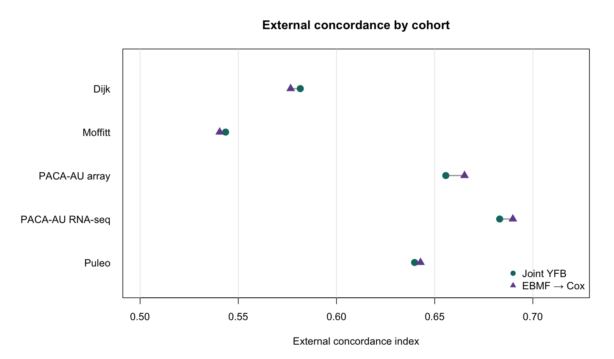
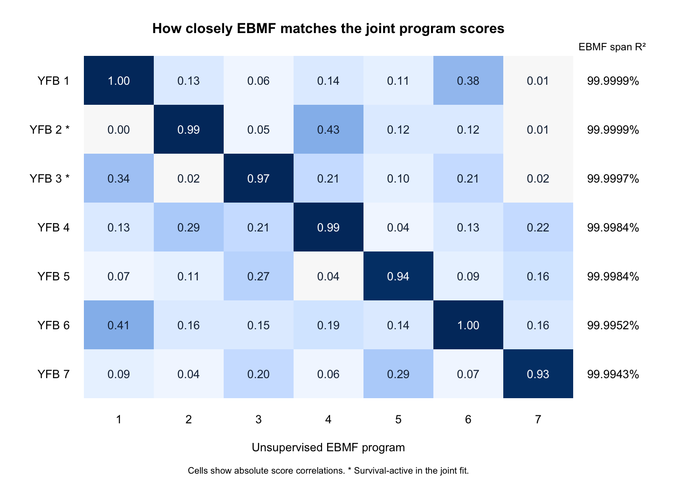
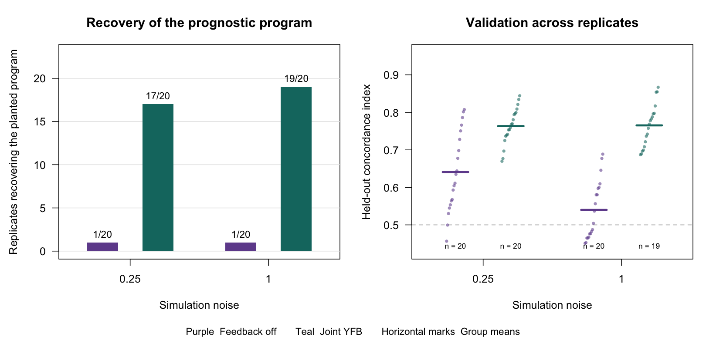

# Joint YFB verification on PDAC and planted-factor simulation

## Pooled PDAC

Canonical YFB with survival feedback into the gene weights (`w_S = 1`)
was trained on 273 TCGA and CPTAC patients using 2,064 expression genes
and starting rank 7. Replaying the October code (`be57fe9`) reproduced
the saved loadings, coefficients, and external risk scores exactly and
converged in 244 iterations. The current code retained nonzero coefficients
but reached the 300-iteration cap. Applying only the Gaussian
log-normalizer correction (`31db892`) to the October code reproduced the
current fit and objective trace. Mean external C moved from 0.621 to 0.620.

Across the five external cohorts, October joint YFB and rank-7 EBMF→Cox
averaged C = 0.621 and 0.623. The paired difference was −0.002 (95%
bootstrap interval −0.012 to +0.006). We detected no difference in
discrimination. The bootstrap conditions on these trained models and
resamples matched rows within cohorts. The saved predictions do not
identify patients across cohorts, so the interval assumes cohort independence.

The two survival-active programs matched individual EBMF scores at
absolute correlations of 0.993 and 0.975. The full EBMF score span
explained over 99.99% of their training-score variance. The corresponding
gene-weight correlations were 0.991 and 0.976. This comparison found no
additional low-variance prognostic direction in the joint fit.

| Program | Cox coefficient (posterior SD) | Top eight genes toward higher predicted risk | Exploratory biological annotation |
|---|---:|---|---|
| 2 | +0.350 (0.086) | SLC16A3, ITGA3, LDHA, SLC2A1, ALDOA, PGK1, P4HA1, PFKP | Basal-like tumor signature (39 of the top 100 genes), with glycolysis-associated genes among the strongest weights |
| 3 | −0.185 (0.075) | NCAPD2, MT2A, RPL17, EEF1D, PEG10, ANGPTL4, MT1X, CAV1 | Bailey squamous signature (12 of the top 100 genes) on the risk-associated end |

Genes are ordered by the fitted loading multiplied by the sign of the Cox
coefficient. For program 3, this selects the negative end of the loading
vector. Enrichment used the 2,064 training genes as background and adjusted
across nine signatures and both programs. The signature results are
exploratory and do not identify a cell of origin or a causal mechanism.

## Planted low-variance prognostic program

The October calibrated simulation used 400 training subjects, a planted
log-hazard coefficient of 3.3, and 20 replicates per noise level. Recovery
required an absolute loading correlation of at least 0.7 with the planted
program and the correct survival direction after sign alignment. This comparison is against the historical YFB factorization with
survival feedback off, with a survival coefficient fit for prediction.
The supervised arm also changed initialization and priors.

| Noise | Maximum planted share of expression variance | Recovered, feedback off | Recovered, joint YFB | Mean validation C, off / joint | Joint fits converged |
|---|---:|---:|---:|---:|---:|
| 0.25 | 0.49% | 1/20 | 17/20 | 0.641 / 0.763 | 19/20 |
| 1.00 | 0.04% | 1/20 | 19/20 | 0.540 / 0.765 | 19/20 |

At noise 1.00, one joint fit had undefined validation C. The joint mean
uses the 19 defined values. Recovery and convergence use all 20 fits.
The results show recovery under this strong planted survival signal.
The later larger-feature evaluation did not meet its combined recovery,
false-active and convergence gate.

## What to verify next

The close PDAC matches make weak effective feedback plausible, but the
concordance comparison does not identify its cause. The existing
training-only weight grid found that raising `w_S` can destabilize the
fit. Use planted simulations with varied prognostic variance, effect size,
and feature count to assess recovery and false activity before selecting
a feedback setting. Compare the resulting programs and held-out
predictions with rank-matched EBMF and EBMF→Cox.

Sources and rebuild instructions are in the
[November 6 notebook](../progress_book/chapters/2026-11-06.qmd),
[October decisions](../../DECISIONS.md),
[per-replicate simulation results](../../results/benchmark_sim/outputs/supervision_diagnostics/c3c4_n400_b3.3/results.csv),
and [survival-weight grid](2026-10-30-current-method-a1.md).
