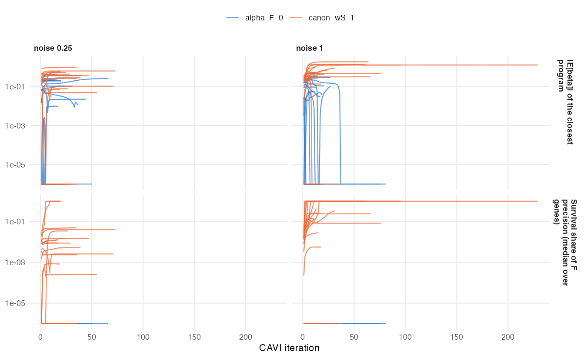

# Survival supervision of the loadings (October 2026, in progress)

## Executive summary {.unnumbered}

1. **Test bed.** A planted prognostic program that explains 0.27% (noise multiplier 0.25) or
   0.02% (noise 1) of expression variance, alongside two non-prognostic programs that carry the
   variance. Fit at K = 7; 20 seeds per noise level.
2. **Survival barely entered the loadings before.** At α_F = 0 it does not enter at all. With
   α_F = 0.5 its median share of a loading's precision is under 1%, and α_F = 0.5 reproduces the
   April scale runaway in simulation (‖F_k‖ up to 169 times its starting value).
3. **Two errors found and fixed:**
   - the survival term of the single-modality F update left the other genes of the same program in
     the residual, so each gene re-explained the whole program and the update overshot;
   - with a signed loading prior, the SVD start discarded signs and every program collapsed.
4. **Scale canonicalization with the corrected update is stable:** every fit converges, and the
   coefficients stay bounded.
5. **Recovery is still low:** 1/20 seeds at noise 0.25 and 6/20 at noise 1, against the 80%
   threshold. This is the starting point for supervised initialization and the β prior (C3–C4).

## Test bed

Data come from the multimodal simulation's low-variance prognostic scenario, expression block only
(n = 120 training and 120 validation patients, p = 50 genes, 3 true programs). Program 3 has score
scale 0.15 and log hazard ratio 1.10; programs 1 and 2 carry the variance and are not prognostic.
Each cohort is z-standardized. A fit **recovers** the planted program when some estimated program
has absolute loading correlation ≥ 0.7 with it and a coefficient of the correct sign. A program is
**survival-active** when its posterior mean coefficient is at least 1.96 posterior SDs from zero.

The fits use a point-Laplace prior on L and F. The recommended point-exponential prior collapses
to zero programs on this centered data in 6 of 10 seeds: centered scores are signed, and a
nonnegative score prior cannot represent them.

## Diagnostics of the earlier F update (C1)

| Arm | Recovered (of 10) | Median \|cor\| with planted | Null survival-active / fit | Converged | Validation C |
|---|---|---|---|---|---|
| α_F = 0 | 0 | 0.17 | 0.4 | 10 | 0.534 |
| α_F = 0.5 | 0 | 0.11 | 0.4 | 10 | 0.533 |
| equal weights (α_F = 0.5, precisions doubled) | 1 | 0.23 | 0.6 | 10 | 0.558 |

: C1 arms at noise 0.25 (oracle C 0.666). {#tbl-c1}

![Survival's median share of the F-update precision and $|E[\beta]|$ for the estimated program closest to the planted one, by iteration (one line per seed). Values of exactly zero are drawn at 10⁻⁶.](../figs/2026-10-15_c1_supervision_trace.png)

The diagnostics answer the four questions from the plan:

- **Is the planted direction pulled at all?** Barely. The closest program is a variance program
  whose coefficient is near 0, so survival information is gated out.
- **Survival's share now.** Median 0.7% of the loading precision at α_F = 0.5 and 14% with equal
  weights, both for programs that already carry a nonzero coefficient.
- **Does the April runaway reproduce?** Yes, at α_F = 0.5: ‖F_k‖ reaches 169 times its starting
  value.
- **Objective versus update.** The monitored objective weights survival p/(1−α)·α = 50 times
  more than genomics, while the F update weights them equally. The monitored value decreases
  32–82 times per arm across 10 fits, so it is not the objective the updates climb. The large
  survival weight also inflates the denominator of the relative-change test, so fits can stop
  early.

## Scale canonicalization and the corrected update (C2)

Each program is rescaled to unit SD of its training score after every iteration; β̃_k is then a log
hazard ratio per SD. α_F is dropped: every survival term carries one weight w_S, and w_S = 1 is the
plain posterior. The F update now removes the other genes of the program from each gene's survival
term and runs as a sequential sweep over genes, the same update the multimodal model uses. The
derivation and the correction are in `derivations/cox_on_YF/canonical_ZF/`.

| Arm | Noise | Recovered (of 20) | Null survival-active / fit | Converged | Validation C |
|---|---|---|---|---|---|
| α_F = 0 (earlier) | 0.25 | 0 | 0.45 | 20 | 0.553 |
| canonical, w_S = 1 | 0.25 | 1 | 0.60 | 20 | 0.557 |
| α_F = 0 (earlier) | 1 | 0 | 0.15 | 20 | 0.521 |
| canonical, w_S = 1 | 1 | 6 | 0.65 | 20 | 0.641 |

: C2 arms (oracle C 0.678 at noise 0.25, 0.839 at noise 1). {#tbl-c2}

With canonicalization the coefficients stay below 2 in absolute value, and every fit converges.
Survival's share of the loading precision rises to between 10% and 100% for the closest program at
noise 1, and the planted program is found in 6 of 20 seeds there. At noise 0.25, the variance
programs dominate the factorization and the planted program is found once.

The null survival-active rate rises by 0.15 and 0.50 per fit over α_F = 0. The second is at the
limit of the +0.5 margin.
