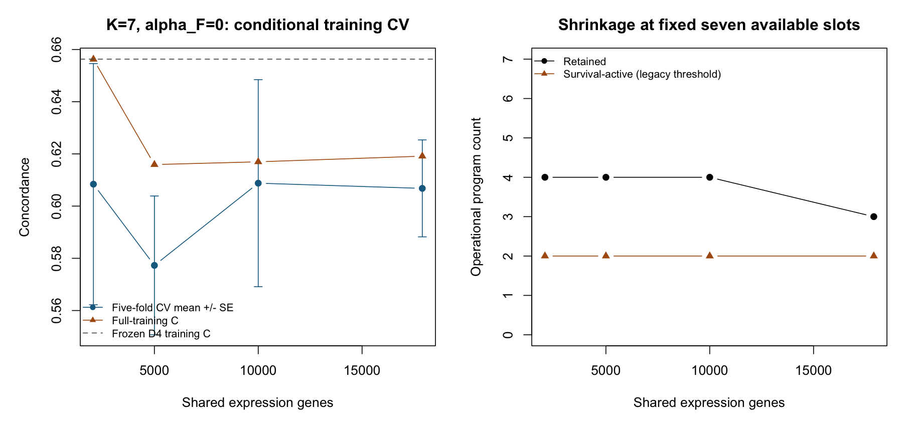
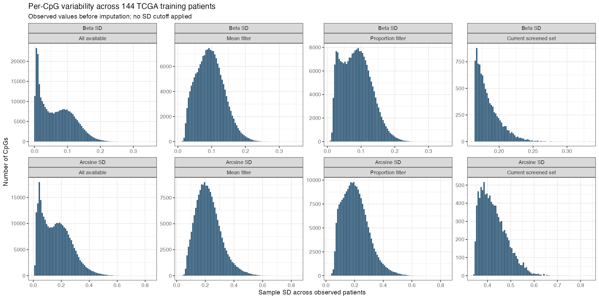

# October 16, 2026

## Progress since October 2

The feature studies now cover the full shared-gene universe and the requested
CpG variability inventory. More genes give similar conditional prediction
performance, but the programs change. CpG fitting exposed a numerical failure
that is repaired experimentally; convergence remains unresolved.

**The benchmark is retained:** Single external C=0.627 with $\alpha_F=0$
(survival does not guide its loading updates). The joint benchmark has ICGC
primary C=0.685 versus C=0.676 for the expression-only framework on the
same donors; both fits are unconverged. No fully
validated survival-supervised replacement or incremental predictive benefit
from methylation has been established.

## Increasing the number of genes

We fitted nested gene sets on the same 273 TCGA+CPTAC training patients,
using the Single benchmark settings, $K=7$, no pruning and cold starts.
All **24 full-training/CV fits converged**, through all 17,900 shared genes.
The nominal 5,000 target gives 5,001 shared genes under the unchanged ranking.

| Shared genes | Training C | Mean conditional CV C ± SE | Retained programs |
|---:|---:|---:|---:|
| 2,064 | 0.656 | 0.608 ± 0.046 | 4 |
| 5,001 | 0.616 | 0.577 ± 0.027 | 4 |
| 10,000 | 0.617 | 0.609 ± 0.040 | 4 |
| 17,900 | 0.619 | 0.607 ± 0.019 | 3 |

{fig-alt="Training and conditional cross-validation performance and retained programs at four gene counts."}

Prediction stays similar across the full range: conditional CV C is about
0.608 at 2,064 genes, 0.609 at 10,000 and 0.607 with all 17,900. The
uncertainty intervals overlap; no new feature count was selected.

**Program agreement depends on which counts are compared.** The expansion
from 5,001 to 10,000 genes is highly consistent. Agreement is less uniform
when moving from the small screened set or to all shared genes:

| Gene-count comparison | Matched nonconstant programs | Common-gene loading \( |r| \) range | Risk-score r |
|---|---:|---:|---:|
| 2,064 → 5,001 | 4 | 0.115–0.962 | 0.655 |
| 5,001 → 10,000 | 4 | **0.960–0.994** | **0.972** |
| 10,000 → 17,900 | 3 | 0.737–0.915 | 0.667 |

These are matched programs, not all seven starting columns; constant or
unmatched programs have no defined correlation. Similar prediction can
coexist with changes in individual programs. Screening/scaling preceded the
folds, so this is conditional CV rather than a fully nested preprocessing
evaluation. No new external scoring was used.

## Increasing the number of CpGs

The observed-value mean/SD inventory covers **305,492 raw probes** in 144
TCGA patients. The unchanged model-eligible universe contains **305,352**;
its imputation exactly reproduces the frozen 10k matrix. Within that universe,
the mean-in-[0.1,0.9] rule retains 182,934 probes and the 95%-extreme-proportion
rule retains 221,142. These are descriptive alternatives; no filter or SD
cutoff has been adopted, and upstream probe-QC completeness remains unverified.

{fig-alt="Histograms of per-CpG standard deviation on beta and arcsine scales, including the supplied descriptive filters."}

| Methylation-only fit | Training C | Credible programs | Outcome |
|---|---:|---:|---|
| 10,000 CpGs, original arithmetic | 0.613 | 0 | Capped at 500 |
| 25,000 CpGs, original arithmetic | Unavailable | Unavailable | Cox risk-set underflow |
| Same 25,000, stable log-space arithmetic | 0.984 | 7 | Capped at 500; extreme predictors |

Stable arithmetic fixes the execution error without changing the likelihood;
it does not fix the fit. The 25k risk SD reaches about 39,086, and risk and
reconstruction still move beyond the original tolerance. Its high training C
is not a validated gain. Four matched programs have common-probe loading
correlation above 0.92, while three are weakly matched; risk correlation is
0.245. Both fits cap and arithmetic differs, so this is provisional agreement,
not a clean converged feature-count comparison. Larger counts, CV, filter
comparisons and joint curves remain open.

## Meeting plan: what remains

| October 2 item | Current status |
|---|---|
| Unified write-up | Interim report delivered; final method/biology revisions remain open |
| Gene-count sensitivity | Single training/CV curve complete; matched TCGA framework expression-only curve remains open |
| CpG variability and feature counts | Inventory/histograms complete; count fits partial and unstable |
| Survival-supervised programs | Experimental updates implemented; original adoption gates still fail |
| Rank selection and large-p simulation | Pruning remedies not adopted; added-noise large-p study unrun |
| Multimodal contribution | Matched prediction and reproducible added biology still need validation |

**Next priorities:** establish stable survival-supervised fitting, then
complete the matched expression-only, methylation-only and joint feature
curves. Retained programs must be justified by reproducible molecular and
prognostic roles; fewer programs alone are not evidence of a better model.
