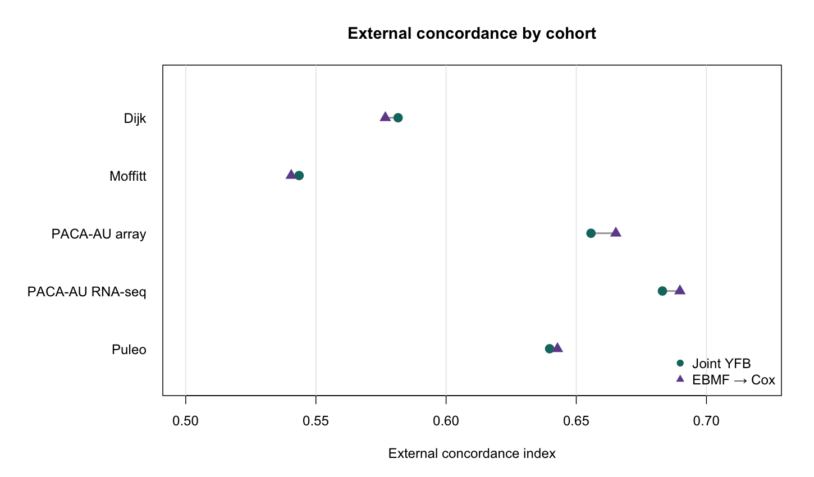
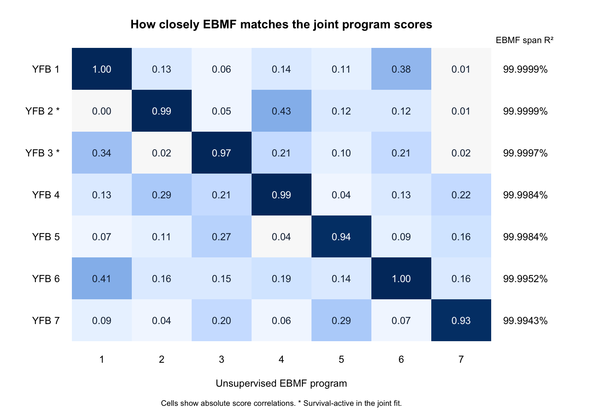
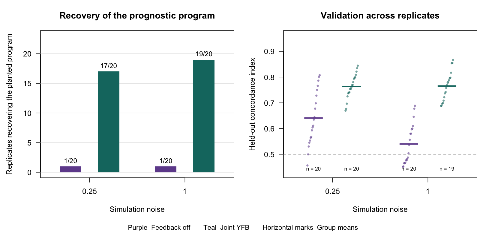
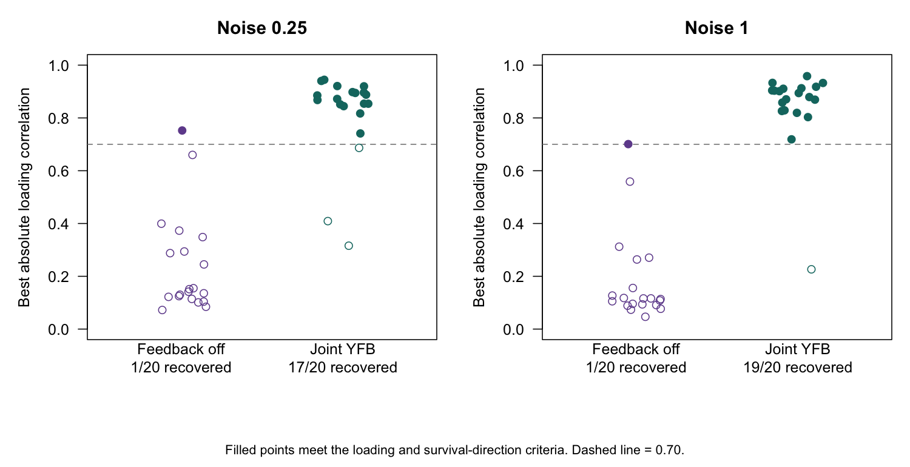
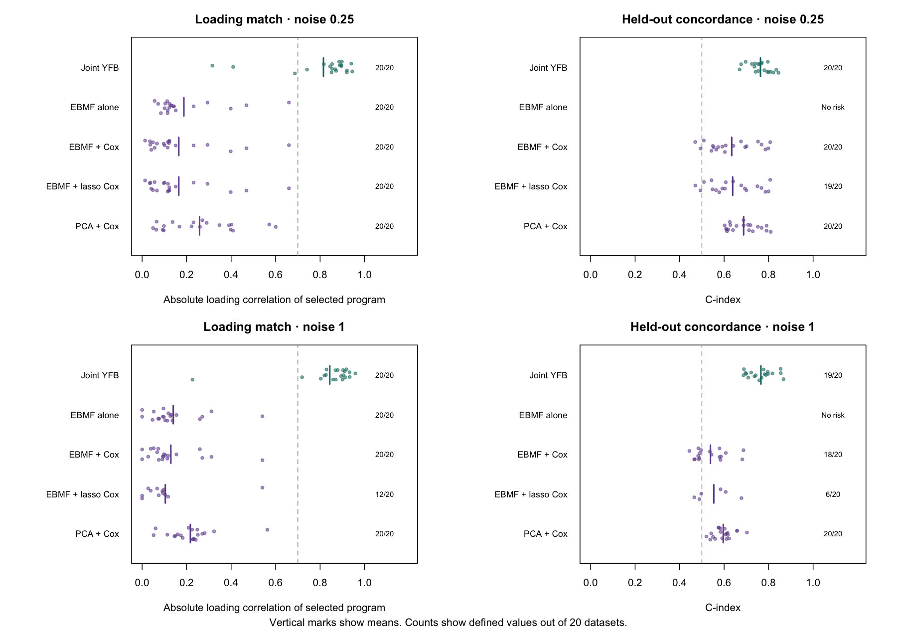
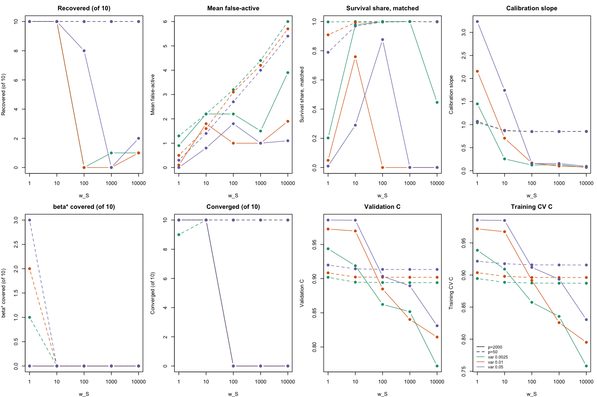
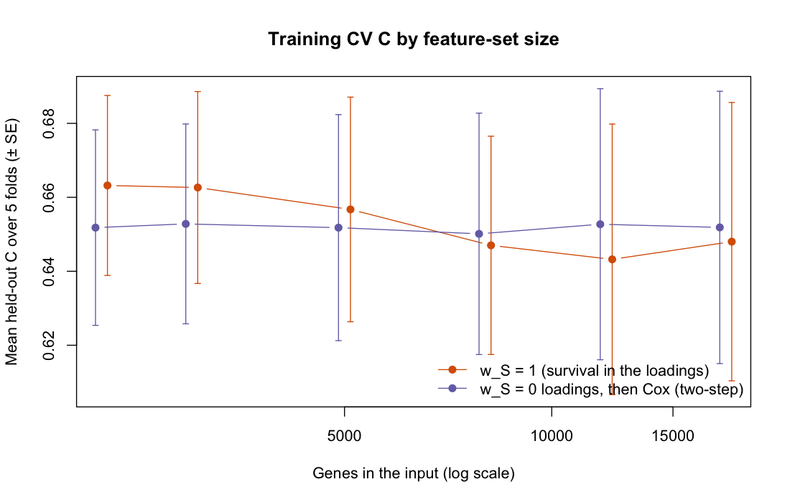
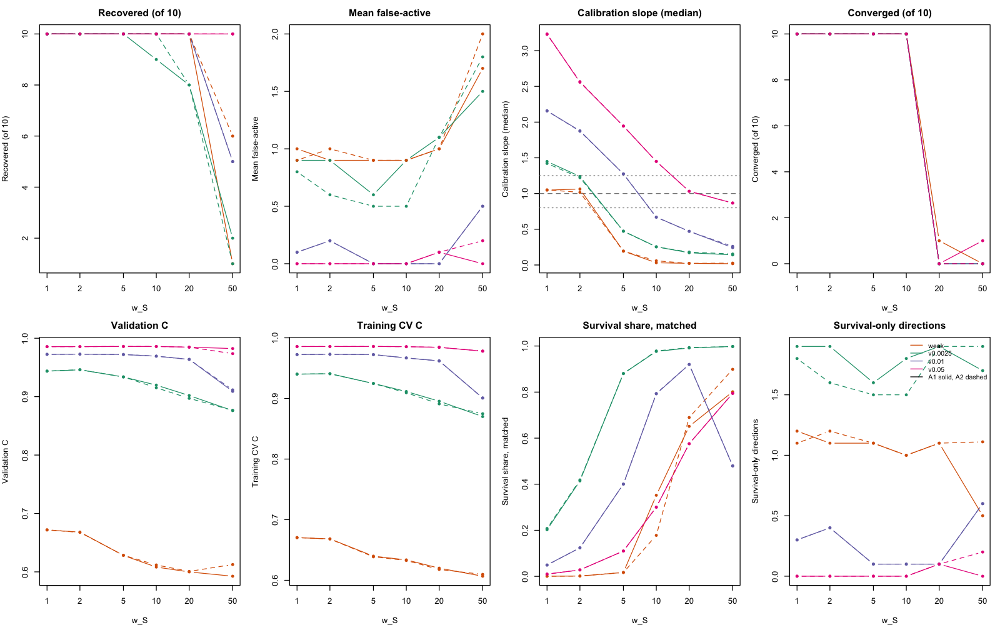
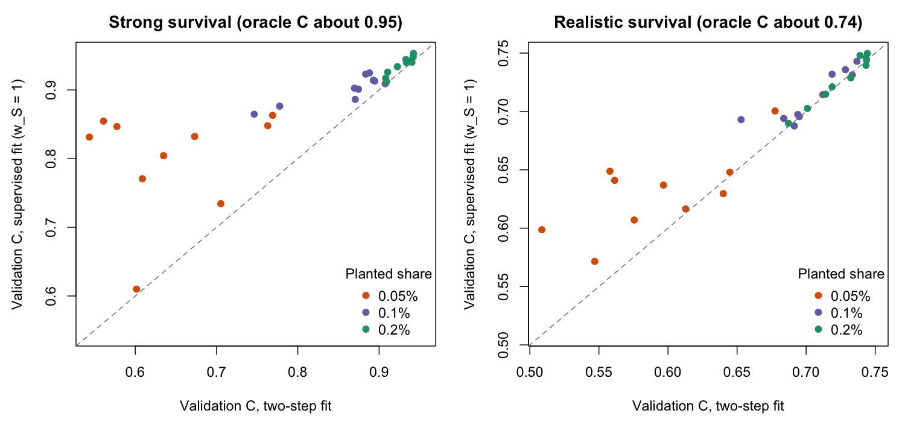

# November 6, 2026

This chapter covers the week of November 2–6. It starts with a summary, then the issues that
were resolved (the derivation review and the October 26 review in GitHub issue #6), then the
supervision experiments in order, and ends with open items.

## Summary

- **The derivations now match the code.** The YFB and LB derivations were rewritten as single
  documents, checked term by term against the update functions, and compared side by side. The
  review found and fixed a sign-check bug in LB, removed the post-fit sign flip from both
  fitters, and added fold-in prediction for LB.
- **Supervision helps where it should.** In simulation, the supervised fit matches the two-step
  fit (unsupervised loadings followed by a Cox model) when a prognostic program is easy to find,
  and beats it near the detection threshold. At a planted share of 0.05%, validation C is 0.156
  higher and the program is recovered in 5 of 10 datasets, against none for the two-step fit.
- **The survival weight can be chosen from the data.** Five-fold cross-validated partial
  log-likelihood picks a weight between 1 and 10 that rises with signal strength. It never picks
  a weight at which the fit stops converging.
- **On the real data the survival weight does not matter between 1 and 50.** Cross-validation
  picks `w_S = 1`, so the real-data model is unchanged. Even at 50, survival supplies less than
  10⁻⁴ of the loading precision.
- **False-active programs do not affect prediction.** Where the planted program is recovered,
  the other active programs carry at most 1.3% of the risk-score variance.
- **Two measurement errors were found and corrected.** The calibration slopes in the
  simulations, and the two-step comparison fits, had used the default tie handling of the Cox
  fit. That merges the extreme simulated survival times. Every number below uses exact times.

## Rashid Lab Meeting Update (November 5th, 2026)

*To be filled in.*

## Key issues resolved

### Derivations reviewed against the code

The model derivations had been spread over pieces written between March and October. Some of
those pieces disagreed with each other or with the code. This week they were reorganized and
checked.

- **Folder layout.** `derivations/` is now organized by model: `SSBMF-YFB-model-derivations/`,
  `SSBMF-LB-model-derivations/`, `SSBMF-YFB-multimodal-model-derivations/`,
  `SSBMF-LB-vs-YFB-comparison/` and `early-work/`. `derivations/README.md` maps the old names to
  the new ones.
- **One YFB derivation.** `SSBMF-YFB-model-derivation-full.tex` derives the whole model in one
  place:
  - the objective with the survival weight and the Cox approximation;
  - every update;
  - initialization, convergence, pruning and prediction;
  - the balance between expression and survival information in the loading update;
  - an errata table against the April pieces.

  `verify_derivation.R` checks each update's terms against a brute-force evaluation of the
  objective and against the code (47 checks, now 73 with projection centering). The April
  formulas for two survival terms fail these checks, as expected.
- **LB and YFB side by side.** `SSBMF-LB-vs-YFB-comparison.tex` sets the two models' updates
  next to each other. It shows how the survival share of the loading update scales with the
  number of genes and with a program's variance share, and it compares both with DeSurv. Its
  recommendation is to keep YFB as the primary model, because new patients are scored exactly
  by projection, and to keep LB as an alternative.
- **LB fixes.** The LB post-fit sign check used the concordance in the wrong direction, so it
  flipped 8 of 8 correctly oriented fits and discarded the variance of β. It is fixed, and
  saved LB risk scores from earlier default runs have the opposite sign. The post-fit sign flip
  was then removed from both fitters. A converged fit is already oriented, so a flip could only
  hide a failed fit.
- **LB fold-in prediction.** New patients' LB loadings are now estimated with the training
  update minus the survival term (`predict_ssbmf_lb_foldin()`), following Yusha's note. In
  eight simulated splits it recovered test loadings better than least-squares projection (mean
  |r| 0.949 against 0.909).
- **Matched LB and YFB comparison (exploratory).** On 12 small planted datasets at matched
  survival weights, YFB reached test C 0.78–0.79 against an oracle of 0.790. LB reached 0.72–0.76
  at the lower weight and lost at least one planted program in every fit
  (`docs/findings/2026-11-06-lb-yfb-matched-comparison-findings.md`).
- **New opt-in derivations.** The survival-block weight and the joint posterior for β are
  derived in `components/survival_block_weight/`. Projection-only centering, which lets the
  model take nonnegative input with centering only inside the Cox projection, is a new section
  of the full YFB derivation. With `strata_id` it centers within each cohort, since the
  stratified Cox likelihood ignores a per-cohort constant. All three are opt-in and leave the
  default fit unchanged.

### GitHub issue #6 (the October 26 review)

Naim's review listed eight items. The table gives their state on `fix/yfb-supervision`.

| Item | State | What was done, or what is left |
|---|---|---|
| 1. KL normalizer in the loading update | Fixed in the code (`31db892`, exact-KL test). Rerun on 11/6 (KL-1, `0fb8aba`): without pruning the fit recovers the planted program in 17 and 19 of 20 datasets, as before. With pruning, ordinary or protected, it recovers 11 of 20. | Pruning still loses the planted program. KL-1 found that an empty program's KL term came out slightly positive instead of zero. That was fixed (`f3263d6`), and the repeat (KL-2) makes it plain: with pruning the fit recovers the program in only 2 of 20 datasets, against 17 and 19 without. The working fit stays at K = 7 without pruning (`docs/findings/2026-11-06-flat-beta-pruning-rerun-findings.md`). |
| 2. Double log₂ on RNA-seq | Fixed (`6a0b96f`). Single-log refit: external C 0.625 against 0.627, and 5 of 5 CV folds converge instead of 2. | The circulated writeup still shows double-log numbers. The next writeup uses single-log numbers throughout. |
| 3. BO-T12 collapse on Linux | Open. Not reproducible on macOS. | Needs a Linux run (Longleaf, or Docker, which is not installed here). |
| 4. Report the October 15 null result | Recorded in DECISIONS.md, not yet in a writeup. | Goes into the next writeup and the revised prelim Chapter 4. |
| 5. Fair comparison and risk orientation | Orientation fixed in both named scripts (`b85d390`). No reported C value changed. | The other runners that oriented with `max(C, 1 − C)` were fixed on 11/6 (`ea142a6`). Rescoring from saved scores reproduced every number that could be checked, including the rank-matched pooled ΔC of 0.0105 (−0.0125 to 0.0329) (`docs/findings/2026-11-06-orientation-audit.md`). The next writeup leads with this rank-7 comparison. |
| 6. External-cohort uses and shared donors | Done on 11/6 (`356347f`). Every decision that looked at external outcomes is listed with its record (`docs/findings/2026-11-06-external-cohort-uses.md`). Resampling donors instead of records leaves the S-12 pooled gain at +0.007 with interval −0.003 to +0.017, which still includes zero. | Keep one cohort untouched by any future choice. |
| 7. Comparators (PurIST, DeSurv, elastic-net Cox, clinical) | Open. | A real-data comparator runner, next after the supervision decision. |
| 8. Reproducible writeup | Test baselines are stored as fixtures (`1703bc6`). | The 11/6 writeup now computes its numbers from saved CSVs (`41c457c`), as this chapter's new sections do. The fits still need to be stored on Longleaf with the path recorded. |

### Corrections to the simulation measurements

Two numbers in last week's simulations were wrong for the same reason. `survival::coxph()`
merges survival times that are equal to within a small tolerance. The simulated times span many
orders of magnitude, so near-equal times were treated as ties.

- **Validation calibration slopes in S-9.** These were reported as 0.18 to 1.20. With exact
  times they are 1.45 to 3.23, so the supervised coefficients were attenuated, not overconfident.
- **The two-step comparison fits in S-13 and S-14.** Their training Cox fits were attenuated,
  which gave slopes of up to 12.7. With exact times the slopes are 0.96 to 1.16. The S-14 verdict
  did not change.

All simulation runners now use exact times.

## Attempts to resolve model supervision

### Joint YFB on pooled PDAC

The October canonical YFB fit used survival feedback in the gene-weight
updates (`w_S = 1`) and retained two survival-active programs. We compared
it with rank-7 unsupervised EBMF on the same 2,064 genes from 273 pooled
TCGA and CPTAC patients. We used EBMF alone to compare programs, and
EBMF followed by Cox to compare prediction.

A fresh replay of the October code (`be57fe9`) reproduced the archived
loadings, coefficients, and external risk scores exactly. It converged
in 244 iterations.
With the same historical preprocessing and gene set, the current
fitter reached the 300-iteration cap. It retained nonzero coefficients
(programs 2 and 3 had means +0.333 and −0.206) and averaged external
C of 0.620. Applying only the later Gaussian log-normalizer correction
(`31db892`) to the October code reproduced the current replay's
loadings, coefficients, and monitored objective exactly. The correction
changed when the relative-objective stopping rule was satisfied.
The comparison below uses the archived October fit.



Across the five external cohorts, mean C was **0.621** for joint YFB and
**0.623** for EBMF followed by Cox. The paired difference was **−0.002**
(95% bootstrap interval **−0.012 to +0.006**). We checked that the archived
survival times and event indicators matched in order and used the saved
risk directions. The bootstrap resampled rows within each cohort and
weighted cohorts equally. Its interval is conditional on these trained
models and assumes independence across cohorts. The saved records do not
contain patient identifiers for checking overlap across cohorts.



| Joint program | Cox coefficient (posterior SD) | Best EBMF score correlation, absolute | EBMF span R² | Exploratory annotation of risk-associated genes |
|---|---:|---:|---:|---|
| 2 | +0.350 (0.086) | 0.993 | 99.9999% | DeSurv basal-like tumor signature, 39 of the top 100 genes |
| 3 | −0.185 (0.075) | 0.975 | 99.9997% | Bailey squamous signature, 12 of the top 100 genes |

The signed gene weights also closely match the corresponding EBMF
programs (Pearson correlations 0.991 and 0.976 for programs 2 and 3).

The genes below are ordered by loading multiplied by the sign of the
Cox coefficient. For program 3, this ranks the negative loadings toward
higher predicted risk.

| Program | Top eight genes toward higher predicted risk |
|---|---|
| 2 | SLC16A3, ITGA3, LDHA, SLC2A1, ALDOA, PGK1, P4HA1, PFKP |
| 3 | NCAPD2, MT2A, RPL17, EEF1D, PEG10, ANGPTL4, MT1X, CAV1 |

Program 2's basal-like signature includes prominent glycolysis-associated
weights. Program 3's risk-associated end overlaps the Bailey squamous
signature. Both overlaps passed an exploratory Benjamini–Hochberg adjustment
across nine signatures and two programs, with the 2,064 training genes as
background. These annotations require independent validation. The fitted shared
point-Laplace prior put approximately $5.7 \times 10^{-7}$ mass on the
spike. The two active labels use the posterior mean-to-SD rule, so they
give no evidence that the fitted spike pruned the other coefficients.

**Interpretation.** Joint YFB learned survival-associated programs with
similar observed discrimination to the two-step model. On these training
patients, EBMF already represented almost all the score variation in
both survival-active programs. This fit therefore gives little evidence
that joint fitting recovered a low-variance prognostic score outside the
EBMF span. The calibrated October simulation provides evidence for that
capability under its planted design.

#### Planted low-variance prognostic program

The calibrated October simulation used 400 training subjects and a
strong planted survival coefficient (log-hazard coefficient 3.3).
Recovery required an absolute loading correlation of at least 0.7
and the correct survival direction after sign alignment.



| Noise | Maximum planted expression variance share | Recovery, feedback off / joint | Mean validation C, off / joint | Joint converged |
|---|---:|---:|---:|---:|
| 0.25 | 0.49% | 1/20 / 17/20 | 0.641 / 0.763 | 19/20 |
| 1.00 | 0.04% | 1/20 / 19/20 | 0.540 / 0.765 | 19/20 |

At noise 1.00, the joint mean C uses 19 defined values. One replicate had
undefined validation C. The feedback-off reference is historical YFB with
a fitted survival coefficient and no survival feedback into the gene
weights. The joint arm also changes initialization and priors. This
simulation supports low-variance program recovery under the tested design.
The later larger-feature evaluation failed its combined recovery,
false-active and convergence gate.



The recovery plot shows one near miss at low noise and a wider
gap for the other supervised failures. At high noise, the single missed
program had a loading correlation of about 0.23.



In the matched comparator rerun, none of the four comparator methods
met its recovery criterion at either noise level. EBMF alone selects
its closest loading by correlation with the planted program and has no
risk score. The two-step methods select a program by absolute Cox
z-statistic and also require the correct survival direction for recovery.
At high noise, EBMF followed by lasso Cox had defined concordance in
6 of 20 datasets. Its plotted mean describes those six datasets.

The close PDAC program matches are consistent with weak effective
survival feedback. The prediction comparison alone cannot establish
that explanation. The existing training-only weight grid found that
higher weights can destabilize the fit, so a stronger feedback setting
should be evaluated on recovery, false activity and convergence together.

**Expression and methylation extension.** First verify that the
multimodal fitter at `M = 1` reproduces the single-modality reference
under matched settings. For `M = 2`, use shared patient scores and
separate expression and methylation loadings, feature precisions, and
loading priors. The existing implementation sums the modality projections
before computing the Cox predictor
$\eta = (\sum_{m=1}^{M} Y^{(m)} F^{(m)})\beta$.
Check each block's contribution to the
combined score and validate prediction on patients with matched
modalities, using training-only choices for priors and rank.

### Survival weight at 2,000 genes (simulation)

```{r s9-setup, include=FALSE}
library(knitr)
S9 <- "../../../results/benchmark_sim/outputs/yfb_survival_weight_2026-11-04/grid"
s9_rd <- function(f) { p <- file.path(S9, f); if (!file.exists(p)) stop("Missing saved evidence: ", p); read.csv(p) }
s9_cells <- s9_rd("gate_cells.csv"); s9_summ <- s9_rd("summary.csv"); s9_cv <- s9_rd("cv_chosen_cells.csv")
w1 <- s9_cells[s9_cells$arm == "w1", ]
w1s <- s9_summ[s9_summ$arm == "w1", ]
```

The October 30 gate failed for the new opt-in fitter. We then tested the canonical
fitter's survival weight `w_S` on the same corrected simulation grid. The difference
from the S-7 run of that fitter is the input. The canonical fitter has signed loading
priors and no gene intercept, so it now gets the per-cohort z-scored matrix instead of
the nonnegative uncentered one. Weights ran from 1 to 10,000, plus `w_S = p/50` and a
weight set to give survival 20% of the loading precision.

At `w_S = 1` the fit passes the registered gate. At 2,000 genes it recovers the
planted program in `r paste(w1$recovered, collapse = ", ")` of 10 datasets in the
three variance cells, against `r paste(w1$reference_recovered, collapse = ", ")` for
the unsupervised reference. Mean false-active counts are
`r paste(formatC(w1$mean_false_active, format = "f", digits = 1), collapse = ", ")`,
and every fit converges. On the uncentered input the same weight gave false-active
counts of 1.0 to 1.5, which would have failed the gate.

```{r s9-gate}
kable(s9_cells[s9_cells$arm %in% c("w1", "w10", "w100", "share0.2"),
  c("arm", "variance", "recovered", "reference_recovered", "mean_false_active", "converged", "qualifies")],
  row.names = FALSE, digits = 2,
  col.names = c("Weight", "Planted variance", "Recovered", "Reference", "Mean false-active", "Converged", "Qualifies"))
```

Training cross-validation chooses `w_S = 1` in most datasets, so the weight can be set
without the planted truth:

```{r s9-cv}
kable(s9_cv, row.names = FALSE, digits = 2)
```

Larger weights hurt. At 2,000 genes no fit with `w_S` of 40 or more converges within
300 sweeps, and recovery collapses. Reconstruction stays bounded and the noise
precision does not fall, so this is not the earlier reconstruction failure. Its cause
is not yet identified. At 50 genes every weight recovers the program, but false activity
rises with the weight. Survival's share of the loading precision at `w_S = 1` drops
from about 0.8 to 1.0 at 50 genes to between 0.01 and 0.2 at 2,000 genes. Recovery
does not drop with it, so the weight does not need to scale with the number of genes.



One problem remains, and it is the opposite of what an earlier draft of this section
said. At 2,000 genes the supervision at `w_S = 1` is too weak for out-of-sample risk.
The median validation calibration slopes are
`r paste(formatC(w1s$cal_slope_median[w1s$p == 2000], format = "f", digits = 2), collapse = ", ")`
across the three cells, against about 1 for the true predictor. A slope above 1 means
the fitted risk differences are too small. The fitted risk score has a third to a half
of the true predictor's spread, and no 95% interval covers the true projected
coefficient. Patient ranking is unaffected, with validation C of 0.94 to 0.99. A weight
of 10 is closer to calibrated at the two larger planted variances, and weights of 100
or more overfit, with slopes near 0.1. The earlier draft computed the slope with the
default tie correction of the Cox fit, which merges the extreme simulated survival
times and flattened every slope, including the true predictor's. The slopes here use
exact times.

The next question is therefore how to set the supervision strength from the data
while keeping the fit stable. A calibrated power on the Cox likelihood (SafeBayes or
the Holmes–Walker calibration), downweighting the genomics term, and normalizing the
two likelihood terms as DeSurv does are the candidates.

A rerun of the October 15 test bed at `w_S = 1` recovered the program in 18 of 20
datasets at low noise and 19 of 20 at high noise. The recovered datasets match the
October 30 run. Sweep counts differ because of the later log-normalizer correction to
the objective, which changes when the stopping rule fires.

The real-data training CV at `w_S = 1` is registered and running. It covers the
programs, cross-validated C, a feature-set-size curve from the D4 genes to all 17,900
shared genes, and a comparison with survival screening. No external cohort is scored
until those choices are fixed.

### Survival-weighted fit on the training patients

```{r s11-setup, include=FALSE}
S11 <- "../../../results/benchmark_sim/outputs/yfb_supervised_real_2026-11-04"
s11_rd <- function(f) { p <- file.path(S11, f); if (!file.exists(p)) stop("Missing saved evidence: ", p); read.csv(p) }
s11 <- s11_rd("summary.csv"); s11_scr <- s11_rd("screen_paired.csv"); s11_prog <- s11_rd("programs_D4.csv")
s11_null <- s11_rd("null_cells.csv")
d4 <- s11[s11$part == "size" & s11$set == "D4", ]
f3 <- function(x) formatC(x, format = "f", digits = 3)
```

We fit the `w_S = 1` model on the 273 TCGA and CPTAC training patients with five-fold
cross-validation, using the single-log data and no external cohort. On the 2,218 D4 genes
the mean held-out C is `r f3(d4$mean_C[d4$arm == "w1"])` (SE `r f3(d4$se_C[d4$arm == "w1"])`).
The two-step fit, which takes the unsupervised loadings and then fits Cox on the program
scores, gives `r f3(d4$mean_C[d4$arm == "w0cox"])`. The paired fold difference is 0.011
(SE 0.005).

The loadings of the two fits are the same. On these data survival supplies about 10⁻⁸ to
10⁻⁶ of the loading precision. The real coefficients are small, and that share scales
with E[β²]. The real programs also explain much more expression variance than the
simulated one, so their genomics precision is large. The small gain comes from
estimating β jointly with a shrinkage prior. In the simulation, fixed weights of 40 or
more broke convergence. Getting survival to move the real-data loadings therefore needs
a supervision strength set from the data.

```{r s11-programs}
p <- s11_prog[s11_prog$arm == "w1" & abs(s11_prog$beta) > 1e-6, ]
p$top_positive <- sub("^((\\S+ ){5}).*", "\\1", p$top_positive)
p$top_negative <- sub("^((\\S+ ){5}).*", "\\1", p$top_negative)
kable(p[order(-abs(p$z)), c("program", "beta", "beta_sd", "survival_active", "top_positive", "top_negative")],
  row.names = FALSE, digits = 2,
  col.names = c("Program", "β", "SD", "Active", "Top genes, positive pole", "Top genes, negative pole"))
```

A positive β means a higher program score raises the hazard. Three programs are
survival-active: a hypoxia and glycolysis versus normal-pancreas axis, a ribosomal and
proliferation versus classical-epithelial axis, and a third adverse program.

Adding genes beyond the D4 set does not help. Mean C ranges from 0.643 to 0.663 from
2,218 to all 17,900 shared genes, and every size is within one SE of the others. The
registered rule, which picks the smallest set that matches the all-genes fit, chooses D4.



Screening genes on survival inside each fold before the joint fit gives no consistent
gain:

```{r s11-screen}
kable(s11_scr[, c("N", "arm", "C_U", "C_S", "diff_S_minus_U", "diff_se", "mean_overlap_S_in_U")],
  row.names = FALSE, digits = 3,
  col.names = c("Genes", "Fit", "C, outcome-free screen", "C, Cox screen", "Difference", "SE", "Overlap"))
```

No screened set beats the `w_S = 1` fit on all D4 genes. With survival permuted in the
simulated data, the `w_S = 1` fit has `r paste(range(s11_null$n_active), collapse = " to ")`
false-active programs per dataset on average, below the limit of one. The fixed model for
the single external scoring is therefore `w_S = 1` on the D4 genes with no survival screen.

### External scoring of the fixed fit

```{r s12-setup, include=FALSE}
S12 <- "../../../results/benchmark_sim/outputs/yfb_supervised_external_2026-11-05"
s12 <- read.csv(file.path(S12, "external_cindex.csv"))
s12d <- read.csv(file.path(S12, "external_paired_diff.csv"))
```

The fixed `w_S = 1` fit on the D4 genes was scored once on the five external cohorts,
after per-cohort z-scoring. The two-step fit was scored alongside it. Nothing was
chosen from these results.

```{r s12-table}
w <- reshape(s12[, c("cohort", "model", "n", "events", "C", "lo", "hi", "cal_slope")],
             idvar = c("cohort", "n", "events"), timevar = "model", direction = "wide")
w$diff <- s12d$diff[match(w$cohort, s12d$cohort)]
kable(w[, c("cohort", "n", "events", "C.w1", "lo.w1", "hi.w1", "C.twostep", "diff", "cal_slope.w1", "cal_slope.twostep")],
  row.names = FALSE, digits = 3,
  col.names = c("Cohort", "n", "Events", "C, w_S = 1", "Lower", "Upper", "C, two-step",
                "Difference", "Slope, w_S = 1", "Slope, two-step"))
```

Mean external C is `r sprintf("%.3f", mean(s12$C[s12$model == "w1"]))` for the
survival-weighted fit and `r sprintf("%.3f", mean(s12$C[s12$model == "twostep"]))` for
the two-step fit. The supervised fit is equal or higher in every cohort. The
cohort-stratified paired difference is
`r sprintf("%+.3f", s12d$diff[grepl("5 cohorts", s12d$cohort)])` (95% interval
`r sprintf("%.3f", s12d$lo[grepl("5 cohorts", s12d$cohort)])` to
`r sprintf("%.3f", s12d$hi[grepl("5 cohorts", s12d$cohort)])`), about the size of the
training CV difference. The earlier frozen benchmark averaged 0.627 under the older
preprocessing, so performance is about the same. Calibration slopes on the external
cohorts range from 0.36 to 1.57, with 0.99 in Puleo, the largest cohort, and they are
closer to 1 for the supervised fit than for the two-step fit in every cohort.

### Choosing the survival weight by cross-validation (simulation)

```{r s13-setup, include=FALSE}
S13 <- "../../../results/benchmark_sim/outputs/yfb_supervision_strength_2026-11-05"
s13 <- read.csv(file.path(S13, "selected_vs_twostep.csv"))
s13v <- read.csv(file.path(S13, "verdict.csv"))
```

S-9 left two problems. At `w_S = 1` the coefficients were attenuated, and weights of 40 or more
stopped converging. In the original objective, raising `w_S` also weakened the prior on β,
because the weight multiplied the Cox term in the β update too. The survival-block weight
(arm A1) applies `w_S` to the Cox term and to the β prior together. β then gets an ordinary
Bayesian Cox fit while the loadings see survival at weight `w_S`. This is the same as down-weighting the
expression likelihood by 1/`w_S`. Arm A2 adds a joint Gaussian posterior for β, with each
program's prior variance estimated from the data. Each dataset's weight was chosen from
{1, 2, 5, 10, 20, 50} by five-fold cross-validated partial log-likelihood on the training data.

```{r s13-table}
kable(s13[, c("arm", "cell", "weights", "recovered", "twostep_recovered", "mean_false_active",
              "twostep_false_active", "c_validation", "twostep_c", "slope_median", "twostep_slope")],
  row.names = FALSE, digits = 3,
  col.names = c("Arm", "Cell", "Chosen weights (count)", "Recovered", "Two-step recovered",
                "False-active", "Two-step false-active", "C", "Two-step C", "Slope", "Two-step slope"))
```

- **The weight choice works.** The chosen weight rises with the strength of the planted program:
  1 or 2 in the weak and 0.25% cells, 5 at 1%, and 10 at 5%. It never chose 20 or 50. At those
  weights the full fits stop converging (0 or 1 of 10 per cell).
- **Supervision matches the two-step fit on this test bed.** Both recover the program in 10 of 10
  datasets in every cell, and validation C differs by at most 0.007. The registered gate passed
  only against the older unsupervised reference, which was fitted to uncentered input. Against
  the matched two-step fit, the recovery gain is zero.
- **The coefficients are still slightly attenuated.** Median calibration slopes at the chosen
  weight are 1.22 to 1.45 in the three variance cells. The registered band was 0.8 to 1.25, met in 1 of 3 cells.
- **The joint posterior for β adds nothing measurable** (C within 0.004 of A1), so it stays opt-in.

Neither arm passed every registered criterion (`r paste(s13v$arm, ifelse(s13v$null_pass, "passes", "fails"), "the null check", collapse = "; ")`), so nothing was adopted.



### Programs near the detection threshold (simulation)

```{r s14-setup, include=FALSE}
S14 <- "../../../results/benchmark_sim/outputs/yfb_near_threshold_2026-11-05"
s14 <- read.csv(file.path(S14, "metrics.csv"))
s14a <- aggregate(cbind(recovered, abs_r, false_active, c_validation, oracle_c) ~ strength + share + arm,
                  s14, mean)
s14a$recovered <- s14a$recovered * 10
```

On the S-9 test bed the two-step fit already finds the planted program, so it cannot show what
supervision adds. S-14 planted weaker programs, at 0.05%, 0.1% and 0.2% of expression variance,
with strong survival (oracle C about 0.94) and realistic survival (oracle C about 0.74). Ten
datasets per cell.

```{r s14-table}
x <- s14a[s14a$arm %in% c("twostep", "A1_w1"), ]
x <- x[order(x$strength, x$share, x$arm), ]
x$share <- paste0(x$share * 100, "%")
kable(x, row.names = FALSE, digits = 3,
  col.names = c("Survival", "Planted share", "Arm", "Recovered (of 10)", "Mean |r|", "Mean false-active",
                "Validation C", "Oracle C"))
```



With strong survival, the supervised fit has the higher validation C in 29 of 30 datasets. The
gain grows as the program gets weaker: +0.156 at 0.05%, +0.041 at 0.1% and +0.008 at 0.2%. At
0.05% it recovers the program in 5 of 10 datasets, where the two-step fit recovers none. With
realistic survival the two fits are within 0.01 of each other at 0.1% and 0.2%, and neither
recovers the 0.05% program. This is the regime the joint model is for. It needs enough survival
information, and the gain on real PDAC data, where survival information is closer to the
realistic setting, will be modest.

The registered recovery criterion failed because it limited the mean false-active count to 1. The
two-step fit fails it too, and the next section shows these programs barely matter for prediction.
A fixed weight of 5 recovered more in the strong cells but overfit (slopes 0.04 to 0.65) and lost
the program under realistic survival. The weight has to come from the data.

### How much the false-active programs contribute

```{r fa-setup, include=FALSE}
fa13 <- read.csv(file.path(S13, "false_active_contribution.csv"))
fa14 <- read.csv(file.path(S14, "false_active_contribution.csv"))
```

A false-active program is one whose coefficient is more than 1.96 posterior SDs from zero but
that does not match the planted program. To see whether they matter, each validation risk score
was split into the matched program's part and the rest. The standardized coefficient is the log
hazard ratio per SD of a program's score.

- **Where the planted program is recovered,** the other active programs carry at most 1.3% of the
  risk-score variance. Their standardized coefficients are about 0.1 to 0.3, against 1 to 17 for
  the matched program, and removing them changes validation C by at most 0.008 (S-13 maximum
  `r sprintf("%.3f", max(abs(fa13$delta_c), na.rm = TRUE))`).
- **Where the program is only partly found** (0.05% share), the other programs carry 9% to 69% of
  the risk-score variance and add to C. They hold pieces of the planted direction. The split is
  much larger for the two-step fit (69%) than for the supervised fit (8.7%).

For prediction the false actives are negligible. For biology they need filtering. Only programs
with a large standardized coefficient relative to the strongest one should be named as
prognostic. A rule that combines that ratio, the share of risk-score variance and stability
across folds is being tested.

### Real-data refit with the survival weight chosen by cross-validation

```{r s15-setup, include=FALSE}
S15 <- "../../../results/benchmark_sim/outputs/yfb_supervised_refit_2026-11-06"
s15c <- read.csv(file.path(S15, "weight_curve.csv")); s15n <- read.csv(file.path(S15, "nested_cv.csv"))
s15v <- read.csv(file.path(S15, "verdict.csv")); s15p <- read.csv(file.path(S15, "programs_full_fit.csv"))
```

The same weight choice was applied to the 273 training patients, with weights from 1 to 50 and
the S-11 folds. A nested cross-validation repeated the choice inside each training split, to give an
honest estimate of the whole procedure.

```{r s15-curve}
kable(s15c[, c("w", "cvpl", "mean_C", "se_C", "folds_converged", "share_active_median")],
  row.names = FALSE, digits = c(0, 3, 3, 3, 0, 8),
  col.names = c("w_S", "CV partial log-likelihood", "CV C", "SE", "Folds converged",
                "Survival share of loading precision"))
```

The chosen weight is `r s15v$w_star`. The curve is flat, changing by 0.26 out of 775 across a
fifty-fold range of weights, so the weights chosen inside the nested splits vary
(`r paste(s15n$chosen_w, collapse = ", ")`). The nested C is `r sprintf("%.3f", s15v$nested_mean_C)`
(SE `r sprintf("%.3f", s15v$nested_se_C)`). By the registered rule nothing changes. The
`w_S = 1` fit and its external scoring stand.

The reason is the scale of the real data. Survival's share of the loading precision grows in
proportion to the weight but is still below 10⁻⁴ at 50, and every program's loadings correlate
1.000 with the unsupervised ones. Reaching a share near 0.1 would need a weight of order 10⁴,
the same order as DeSurv's weighting, and in simulation weights of 40 or more stopped converging.
On these data the supervised model's gain comes from fitting β jointly, not from moving the
gene programs.

```{r s15-programs}
x <- s15p[s15p$active | s15p$std_beta > .1, c("k", "pve", "beta", "beta_sd", "active", "std_beta", "risk_var_share")]
x$ratio <- x$std_beta / max(x$std_beta)
kable(x, row.names = FALSE, digits = 3,
  col.names = c("Program", "PVE", "β", "SD", "Active", "Standardized β", "Risk-variance share", "Ratio to largest"))
```

The three active programs have standardized coefficients of 0.41, 0.22 and 0.23. All three have
at least half the effect of the largest program and carry at least 20% of the risk-score variance. The
inactive program 4 (standardized coefficient 0.15) is the borderline case for the proposed rule.

## Open items and questions

- **Stronger supervision on real data.** Moving the real-data loadings needs weights near 10⁴.
  That first needs the fit to stay stable at large weights, the problem S-9 found and did not
  solve.
- **Classifying programs for the biology.** The proposed rule (standardized coefficient ratio,
  risk-variance share, stability across folds) needs its fold-stability part computed and a
  check on the simulations.
- **Pruning.** With the empty-program KL fixed, pruning removes the planted program in nearly every
  dataset. The working fit stays at K = 7 without pruning. Whether a different deletion rule can
  work is a separate question.
- **Issue #6.** Still open: comparators (item 7), the writeup and prelim text for items 2, 4
  and 5, storing the fits (item 8), and the Linux check (item 3).
- **Matched LB and YFB study.** It now has the nonnegative input it needs, with projection-only
  centering (including within strata).
- **Writing.** The prelim Chapter 4 revision and the 11/6 writeup are in progress.
