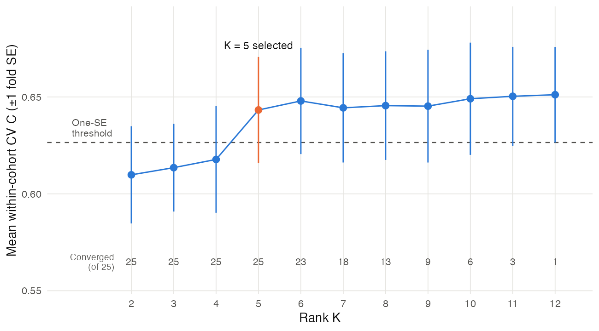
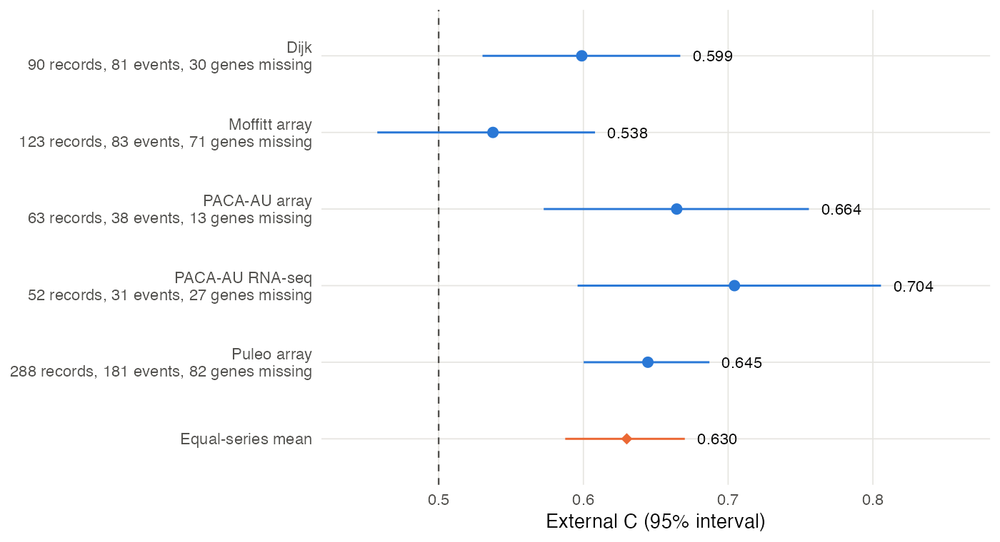

# November 13, 2026

The week's main experiments and questions, each with its short answer. C is Harrell's
concordance, LB and YFB are the two survival parameterizations (defined in the LB and YFB
section), L contains patient scores, F contains gene loadings, and w_S weights the survival term.

- **Can a point-exponential prior on L and F, which gives a nonnegative factorization,
  replace point-Laplace?** No. It predicts worse on the training data and rarely converges.
- **Does a sparse prior on β help?** No. Normal, point-normal and point-Laplace priors give
  nearly the same fits, so Normal stays.
- **Do the gene screen, input scaling and rank hold up under training cross-validation?**
  The 2,218-gene screen and z-scores stay. K = 5 is the smallest rank whose mean C is
  within one fold standard error of the best mean, the one-SE choice.
- **Should LB replace YFB?** No. On the real data they give the same programs and accuracy,
  but in three of four simulation cells LB marks more unmatched programs survival-active.
- **Does methylation alone find factors that expression misses?** Partly. The two share two
  strong axes, and methylation adds a recurring immune-like program.
- **Can one fitter model expression and methylation together?** Not yet. In simulation with
  equal feature counts, separate priors recovered individual planted programs more often,
  but no fit recovered all three together. No general advantage is established. In the
  matched TCGA fit, methylation dominates several programs, and the work is paused.
- **Does the survival weight change at K = 5?** No. w_S = 1 stays.
- **How does the fixed working model score externally?** Equal-series mean C 0.630
  (0.587 to 0.670) over five series.

The plan for the week is
[`docs/plans/2026-11-09-week-plan.md`](https://github.com/andrew-walther/multiomicsGEP/blob/main/docs/plans/2026-11-09-week-plan.md).

## Current state of method

The working model is YFB with point-Laplace priors on L and F, a Normal prior on β, z-scores
within cohort on 2,218 genes, pooled TCGA and CPTAC training, w_S = 1 and K = 5. Every current
choice was retained or selected by simulation and training cross-validation. Earlier
development also used external results for the screen and scaling, so the validation series
are not untouched. Under the current rule they only score the fixed model.

One run of five-fold CV at K = 5 gives within-cohort C 0.655 on the first partition.
The average over five partitions is 0.643, with every fold converged. The all-pairs values reported below,
0.660 for fixed-weight CV and 0.658 for nested weight-selection CV, also count pairs
across cohorts and summarize different comparisons.
Programs 2 (protective), 4 and 5 (adverse) are survival-active: the absolute posterior mean
of β is at least 1.96 posterior SDs. A main program is survival-active, has an absolute standardized
coefficient at least a quarter of the largest, accounts for at least 5% of risk-score variance through its signed
covariance share and is active in at least four of five training CV folds. Only
Program 2 meets all four conditions.

The two-step comparator fits the same rank-5 factorization without survival feedback
(w_S = 0), then fits Cox regression on its projected program scores. The estimated
supervised-minus-two-step differences are small: +0.004 in training CV on all pairs
(SE 0.004) and −0.001 externally (donor-bootstrap interval −0.010 to 0.008).
The donor bootstrap resamples people, keeping repeated assays from each person together.

@fig-cv-differences collects this week's training-CV comparisons against the working
configuration at the same rank.
Every alternative is lower. Only shared point-normal β, the variance screen and LB are
within one paired SE.

{#fig-cv-differences fig-alt="Forest plot of eleven paired differences in within-cohort C, grouped into L and F priors, β priors, gene screen and scaling, and LB versus YFB. All point estimates are below zero."}

## Gene screen, rank and scaling chosen by training CV

This experiment redid three earlier choices that had partly used external outcomes, now
with five-fold training CV alone. The 2,218-gene screen and z-score input stay, and the
one-SE rule picks K = 5 (@fig-rank-curve). Every alternative screen and scaling was lower
than the current input (@fig-cv-differences). We adopted K = 5 for the working model on
November 12 (new key `benchmark$k_working_yfb: 5` in `config/globals.yml`, while the
historical key stays 7). An
[independent review](https://github.com/andrew-walther/multiomicsGEP/blob/main/docs/reviews/2026-11-12-task-f-independent-review.md)
on November 12 agreed. Details are in the
[findings](https://github.com/andrew-walther/multiomicsGEP/blob/main/docs/findings/2026-11-12-training-cv-redo-findings.md).

{#fig-rank-curve fig-alt="Line plot of mean CV C against K from 2 to 12. C rises from 0.61 at K = 2 to 0.643 at K = 5 and stays between 0.644 and 0.651 above. K = 5 is the smallest rank above the threshold of 0.626. Converged fold counts fall from 25 at K = 5 to 1 at K = 12."}

**Design.** The outcome-free screens of the May comparison, including the current 2,218-gene
screen, are compared by five-fold training CV. They use no outcomes, so each is computed once
on all 273 patients before the folds, as DeSurv did. Only two remain once the LB-model and
cohort-indicator variants are dropped: the current screen and a variance screen after
quantile normalization (z-score each cohort, quantile-normalize the merged matrix, top 2,000
genes by variance). The two differ in their whole preprocessing, not only in the ranking
rule. For scaling, z-scores within cohort are compared with X/sd within cohort under a
centered projection and with within-patient ranks followed by z-scores. The rank runs from
K = 2 to 12 with the one-SE rule, as DeSurv chose its rank. Without pruning the fit keeps
every column, so CV chooses the fitted rank.

**Screen and scaling.** At K = 7 the current input had mean within-cohort C 0.658 and
converged in 3 of 5 folds. The three alternatives were 0.012 to 0.020 lower and converged in
all five. Averaged over the five partitions, the variance screen is 0.002 lower than the
current screen (SE 0.008), so the 2,218-gene screen stays. At K = 5 the point-exponential
prior still loses (0.519 against 0.655).

**Rank.** Concordance is lower from K = 2 to 4 in every partition and flat from K = 5 up.
Averaged over the five partitions, the best mean is 0.651 at K = 12 and the smallest K above
the one-SE threshold is 5 (0.643). Four of the five partitions select K = 5 on their own and
one selects K = 10. In the first partition alone, K = 5 was 0.003 below K = 7 (paired SE
0.007). K = 5 to 8 are indistinguishable on paired differences, so the rule picks the
smallest rank on the plateau rather than showing that K = 5 predicts better. K = 5 converges
in all 25 fold fits, K = 7 in 18 and K = 12 in 1. The partitions reuse the same 273 patients,
so they show that the choices do not depend on the fold assignment, not how much they would
vary in new samples.

**The K = 5 programs.** They match K = 7 programs 1 to 5 (score correlations 0.92 to
0.995). K = 7 programs 6 and 7 are dropped, and neither was survival-active. Program 2
(protective, z −4.5) and program 5 (adverse, z 2.8) stay survival-active. Programs 3 and 4
sit near the 1.96 threshold in both fits: program 3 falls from z 3.0 to 1.5 and program 4
rises from 1.9 to 2.4, so the active set changes from {2, 3, 5} to {2, 4, 5}. Only Program 2
meets the main-program definition. Results already reported at K = 7, including the November
external scores and this week's prior comparisons, stay on record labeled with K = 7.

## Point-exponential versus point-Laplace priors on L and F

This experiment asked whether a point-exponential prior on L and F could replace the
point-Laplace prior of the working model. Point-Laplace stays. On the training data every
point-exponential setup had lower within-cohort CV C, 0.573 to 0.635 against 0.658 at K = 7
(@fig-cv-differences), and at most one of five folds converged. In simulation it recovered
the planted program as often as point-Laplace, but it marked two to four other programs
survival-active per fit (@fig-false-active, left). The result matters because the project
set out to fit a nonnegative factorization, as DeSurv does, so that each program is an
additive set of genes and each patient a nonnegative mix of programs. On these data that
version is not competitive, even with the cohort difference removed. An
[independent review](https://github.com/andrew-walther/multiomicsGEP/blob/main/docs/reviews/2026-11-12-task-a-independent-review.md)
on November 12 agreed with the decision. Details are in the
[findings](https://github.com/andrew-walther/multiomicsGEP/blob/main/docs/findings/2026-11-12-lf-prior-comparison-findings.md).

**Why it was reopened.** Point-Laplace replaced point-exponential on October 15 because, on
z-scored input, the point-exponential fit collapsed to zero programs in 6 of 10 test
datasets. The November 6 option that centers only the Cox projection keeps the input
nonnegative and removes the term that shrank β to zero, so a like-for-like comparison became
possible.

**Design.** Both arms use the canonical fitter with `w_S = 1`, a Normal β prior, K = 7, no
pruning, at most 300 sweeps and tolerance 10^−5^. The point-Laplace arm uses the working
configuration at K = 7 on z-scores within cohort. The point-exponential arm divides each gene by its
within-cohort SD without centering and centers the Cox projection. The simulation uses the
three planted variance shares of the fixed-weight study (0.25%, 1% and 5%) and the
near-threshold cell (0.05% with strong survival), 10 datasets each, with planted L and F
drawn from exponential distributions so the truth favors neither prior. The training data
use the five cohort- and event-balanced folds, pooled without strata.

**Comparisons.** We compared recovery of the planted program, convergence, held-out
concordance and false-active programs, meaning survival-active fitted programs that match
no planted program.

![Mean false-active programs per fit by planted variance share, 10 datasets per cell. False-active programs are survival-active programs that match no planted program. Left: point-Laplace (PL) and point-exponential (PE) priors on L and F at K = 7. Recovery of the planted program was 5 of 10 (PL) and 8 of 10 (PE) near the threshold and 10 of 10 for both elsewhere, and all fits converged. Right: LB and YFB at K = 5 and w_S = 1. Recovery was 5 of 10 (LB) and 4 of 10 (YFB) near the threshold and 10 of 10 for both elsewhere.](../figures/2026-11-13/false-active.png){#fig-false-active fig-alt="Two line panels of mean false-active programs per fit across four planted shares. Left: PE rises from 2.6 to 4.3 while PL falls from 3.0 to 0. Right: LB stays between 1.2 and 1.8 while YFB falls from 2.9 to 0."}

Where coefficient size was measured, in the shifted z-score fits below, false-active
coefficients were mostly a tenth to a quarter of the matched planted program's. The
point-exponential fits still had lower training-CV concordance and poorer convergence.

The training-data loss comes from how the input handles the two cohorts. X/sd keeps each
cohort's mean level (median gene mean 11.0 in TCGA and 15.5 in CPTAC against a within-cohort
SD of 1), so in the first point-exponential fit one program tracks TCGA versus CPTAC and no
program is survival-active. A follow-up removed that difference in two ways. Cohort strata
center the projection and the baseline hazard within cohort, and a shifted z-score adds each
gene's minus-minimum to its z-scores so the input is nonnegative with equal cohort means. The
shift constants come from all 273 patients, held-out folds included, and enter the
reconstruction, so a refitted model can change with them. Under strata the programs keep the
loading directions of the unstratified point-exponential fit, with larger column norms. Both
recover part of the lost concordance but stay more than one SE below point-Laplace.

The following convergence counts describe the K = 7 comparison.

| Prior and input | Folds converged | Largest program correlation with cohort |
|---|---|---|
| Point-Laplace, z-scores (K = 7 reference) | 3/5 | 0.05 |
| Point-exponential, X/sd | 0/5 | 0.998 |
| Point-exponential, X/sd with cohort strata | 0/5 | 0.998 |
| Point-exponential, shifted z-scores | 1/5 | 0.05 |
| Point-exponential, within-patient ranks | 0/5 | 1.000 |

## Normal, point-normal and point-Laplace priors on β: Normal retained

This experiment compared a Normal prior on β with shared point-normal and shared
point-Laplace priors at K = 7. Normal is retained, and the choice makes little difference. The sparse
priors were 0.002 to 0.008 lower in within-cohort CV C (@fig-cv-differences), gave 2.4
survival-active programs per fold against 2.6 for Normal, and had about the same number of
false-active programs near the threshold (3.3 and 3.5 against 3.0). The comparison was
needed because the unit-survival-weight YFB configuration used Normal β without a
decision entry, while the earlier record said point-Laplace. An
[independent review](https://github.com/andrew-walther/multiomicsGEP/blob/main/docs/reviews/2026-11-12-task-b-independent-review.md)
on November 12 agreed. Details are in the
[findings](https://github.com/andrew-walther/multiomicsGEP/blob/main/docs/findings/2026-11-12-beta-prior-comparison-findings.md).

**Background.** Training CV of the earlier loading-supervision configuration compared point-Laplace with Normal only (mean C
0.651 and 0.653) and concluded that the point-Laplace choice stood. The unit-survival-weight YFB fit then
used Normal. Point-normal had set every β to zero before scores were standardized, which
might no longer happen now that β is on the standardized-score scale.

**Design.** Three arms that differ only in the β prior, with the same simulation cells and
training folds as the L/F comparison at K = 7. A point-mass prior cannot be estimated from a
single coefficient, so the sparse priors are shared across the seven programs. A shared
Normal arm separates sharing from sparsity. For point-normal, each program's posterior
inclusion probability is recorded.

**Comparisons.** We compared recovery, false activity, convergence, validation
calibration slopes and paired training-CV concordance, including whether a sparse prior
set every coefficient to zero.

**Other results.** The sparse priors lower false activity a little where the planted program
is clear (0.3 against 0.9 at the 0.25% share). The shared Normal arm had 4.1 false-active
programs near the threshold. Calibration slopes differ by at most 0.03 except for shared Normal at the 5% planted
variance share, where the slope is 2.965 against 3.234 for per-program Normal. On the real data the
shared point-normal prior gives inclusion probabilities of 0.94 to 1.00 for all seven
programs, so it does not single out the three survival-active ones, and replacing the
1.96-SD activity definition with inclusion probabilities is not supported. DECISIONS.md now
records that the working model uses Normal β and that this comparison keeps it.

## LB and YFB compared

This experiment compared the two survival parameterizations, LB (η = Lβ) and YFB
(η = (YF)β), on the same input, priors, starting values, K = 5 and folds. They perform the
same and learn the same factors on the real data. Mean within-cohort CV C is 0.652 for LB
and 0.655 for YFB (difference 0.003, SE 0.004, @fig-cv-differences), and every fold
converged. On the five external series the pair-weighted mean C is 0.627 for LB and 0.628
for YFB (difference 0.001, donor-bootstrap interval −0.002 to 0.005). The two full-data risk
scores correlate 0.998, each pair of corresponding programs has the same 20 top genes, and
programs 2, 4 and 5 are survival-active in both.

YFB is carried forward. In simulation at w_S = 1, LB marks more programs survival-active
that match no planted program in the three variance cells: 1.8, 1.5 and 1.2 per fit against
0.9, 0.1 and 0.0 for YFB (@fig-false-active, right). Near the threshold YFB marks more (2.9
against 1.4). YFB also scores a new patient directly, without fold-in. Details are in the
[findings](https://github.com/andrew-walther/multiomicsGEP/blob/main/docs/findings/2026-11-12-lb-yfb-study-findings.md).

### What L, YF and F mean

F (p × K) holds the gene-level loadings in both models. Each column is a program's weight
on every gene.

In LB, L (n × K) is the patient-level score matrix: each patient's latent activity on each
program, estimated from the factor model given all programs at once. exp(β~k~) is the hazard
ratio per unit of latent activity, holding the other activities fixed. A new patient has no
fitted L, so LB estimates it by fold-in under the stored priors and noise precisions, without
using any outcome.

In YFB, YF (n × K) is also patient-level, but it is computed directly from the data: it
projects each patient's standardized gene levels Y onto the loadings F. It is the same kind
of score DeSurv uses, Z = W′X, a weighted sum of gene levels, with F in the role of W.
exp(β~k~) is the hazard ratio per SD of that projection. A new patient's score is
Y~new~F.

The two are linked through the factor model. Since Y ≈ LF′, the projection is YF ≈ L(F′F) up
to noise, so each projection mixes the latent activities of programs that share genes, and
the two scores coincide only when programs share no genes. On these data the overlap is
small: each program's latent score correlates 0.985 to 0.999 with its projection, which is
why the two models predict alike. Their coefficients still use different units, so an LB
hazard ratio and a YFB hazard ratio for the same program are not directly comparable.

**Design.** The runner builds the input once, passes the same object to both fitters, and
stops if the two inputs differ. The simulation uses the prior-comparison cells and the
matched-generator settings at w_S = 1 and 10. On the training data, LB's
held-out folds are scored by fold-in and YFB's by projection, the same contrast as on an
external cohort. Program content is compared from one fit per model on all 273 patients.
We compared planted-program recovery, unmatched survival-active programs, convergence
and held-out concordance, alongside the real-data program content.

At w_S = 10 both mark few false-active programs in the three variance cells, and near the
threshold LB recovers the planted program in 7 of 10 datasets against 3 for YFB. All fits in these four variance-share cells converged. In the separate matched
generator, seven fits at w_S = 10 reached the iteration cap, including five of six LB
fits at amplitude 0.5. The simulation process reported at least 50 warnings whose messages
were not saved, a limit on what the run shows about numerical stability.

## External scoring of the fixed working model

The working model at K = 5 was scored once on the five external series, as the YFB arm of
the LB and YFB comparison. The equal-series mean C is 0.630 (donor-bootstrap interval 0.587
to 0.670) and the pair-weighted mean 0.628 (0.596 to 0.662), against 0.620 for the K = 7
fit (@fig-external-c). This difference is well within the intervals and played no part
in choosing K. An equal-series mean weights each series equally, while a pair-weighted
mean weights its C by its number of comparable survival pairs. Genes missing from a series are set to zero after standardization
within that series.

{#fig-external-c fig-alt="Forest plot of external C: Dijk 0.599, Moffitt array 0.538, PACA-AU array 0.664, PACA-AU RNA-seq 0.704, Puleo array 0.645, equal-series mean 0.630."}

The other exhibits that came from the K = 7 fit were rebuilt at K = 5
([findings](https://github.com/andrew-walther/multiomicsGEP/blob/main/docs/findings/2026-11-12-k5-exhibits-findings.md)).
At K = 5 the supervised and two-step fits have small estimated differences: the training CV
difference is +0.004 (SE 0.004, 0.660 against 0.656 on all pairs) and the external pooled
difference is −0.001 (donor interval −0.010 to 0.008), where K = 7 gave +0.011 and +0.007.
Every fold converges in both arms. The hazard ratio per SD is 1.39 (donor-clustered interval 1.24 to 1.56) against
1.40 for two-step, and the supervised calibration slopes range from 0.35 to 1.85. The
gene-count curve is level from 2,218 to about 8,000 genes in both arms and lower above. The
training cutpoint moves to 0.618 SD, putting 128 of 616 external records in the high-risk
group (pooled HR 1.69, donor-clustered interval 1.31 to 2.18). Program 4 has acinar genes at its adverse pole and
B-cell and interferon genes at the other, and its external direction agrees with training in
all five series. The supervised score's mean C exceeds DeSurv's by 0.016 (−0.009 to 0.043)
and elastic-net Cox's by 0.011 (−0.008 to 0.031). Both difference intervals include zero.

### Survival-weight refit at K = 5

The completed survival-weight refit at K = 5 keeps w_S = 1. The CV partial log-likelihood
chooses w_S = 1, with a range of 0.635 over weights 1 to 50. Nested CV gives C = 0.658 with
fold SE 0.027, with outer choices 1, 1, 1, 10 and 50. All 216 fits completed without fit
errors. Of these, 189 converged and 27 inner fits reached the 300-sweep limit. The five folds
at every weight in the overall weight curve converged, as did every selected outer fit and
the selected full fit. Scaling was prepared before these splits, so this evaluates weight
selection conditional on that matrix, with all-pairs fold scoring. The 27 capped inner fits
remain eligible because selection used finite CV partial log-likelihoods without
excluding capped fits. The full unit-weight
fit exactly reproduces the saved K = 5 fit, so its external scores stay unchanged. The
[completed exhibit ledger](https://github.com/andrew-walther/multiomicsGEP/blob/main/docs/findings/2026-11-12-k5-exhibits-findings.md)
gives every file and rebuild command.

## Single-modality model fit with methylation data

This experiment fit the single-modality model to methylation alone on 144 matched TCGA
patients and compared its factors with those of the expression fit on the same patients.
The interest is whether methylation finds different or additional factors, not whether it
finds prognostic programs. Methylation shares its strongest structure with expression and
adds some of its own:

- The two sets of patient scores share two strong axes. The first two canonical
  correlations are 0.90 to 0.92 and 0.85 to 0.88 across the seven fits, and the fifth is
  0.00 to 0.17.
- 19 of 35 methylation program fits are methylation-specific. They are recurring programs,
  not 19 separate ones.
- The clearest is an immune-like program that forms from about 50,000 CpGs. At 100,000 CpGs
  the expression programs explain little of it (R² 0.06).

Methylation CV C is near 0.5 and lower than expression in all seven comparisons, by
0.9 to 2.3 paired SEs, with three differences exceeding two SEs (@fig-methylation-cv).
Prediction is secondary to the factor comparison. These results bear on the joint model in the next
section: if methylation carries programs that expression lacks, a joint fit could find them.
Details are in the
[findings](https://github.com/andrew-walther/multiomicsGEP/blob/main/docs/findings/2026-11-12-methylation-single-modality-findings.md)
(sections "Rerun at K = 5" and "Text for the documents").

**Design.** K = 5, 144 matched TCGA patients with expression, methylation and survival (75
events), five event-balanced folds, and the CpG counts described under Recent decisions.
CpG screening and imputation happen before the folds are split. Each count is fitted under
both prior setups with a Normal β prior. The comparator is an expression fit with the 2,218
genes on the same patients and folds. With about 150 patients the CV estimates are noisy, so
the concordance comparison is descriptive.

**Methylation-specific programs.** A program counts as methylation-specific under a
descriptive definition without any survival requirement: correlation below 0.5 with every
expression program, matched in at least three folds and recurring at another CpG count.
Regressed on all five expression programs, 12 of the 19 have R² below 0.25 and 3 have R²
above 0.5. The clearest is a point-Laplace program at 100k and all CpGs (R² 0.06 and 0.04),
whose strongest gene-set associations are allograft rejection and TNF-α signaling,
suggesting an immune component. The most purity-related methylation program correlates up
to 0.87 with ABSOLUTE purity and overlaps the first expression program. Among 9,086
promoter-CpG and gene pairs, 76.5% have a negative methylation-expression correlation (not
adjusted for purity).

**CpG counts.** At 10k CpGs the immune-like factor is split across programs 2 and 4, with
absolute score correlations 0.61 and 0.59 to the 100k program. Regressed on all expression
programs, those two 10k programs have R² of 0.52 and 0.43. At 50k the factor has a
single-program match of 0.89 and R² of 0.25 on expression. So even at 10k, methylation
contains structure not explained by expression, and from 50k upward that structure forms a
separate program. 10k under point-Laplace predicts best and is the first count for the joint
fit. These comparisons are in-sample and descriptive. These fixed fits were later scored on matched ICGC donors, as reported descriptively
in the joint-model section below.

{#fig-methylation-cv fig-alt="Line plot of methylation CV C between 0.50 and 0.55 across CpG counts from 10k to 182,934, below dashed expression references at 0.582 and 0.620."}

The expression references come from a 1,000-sweep rerun. The eight expression fits that
had stopped at 300 sweeps all converged with the higher limit (305 to 438 sweeps).

## Joint model of expression and methylation (preliminary, paused)

This model shares the patient scores L across data types and gives each data type its own
loadings F~m~ and loading prior. It is in development and paused. With equal feature counts
in a simulation with 50 genes and 50 CpG sites, separate priors found the right loading and
data-type pattern more often than
one pooled prior: 5 vs 1 of 10 for an expression-only program, 2 vs 0 for a methylation-only
program and 7 vs 5 for a joint program. With 250 CpGs against 50 genes, recovery fell. In the matched TCGA fit, methylation
supplies 83% to 97% of reconstruction precision in three shared programs. Down-weighting the methylation likelihood did not fix this,
because it emptied the methylation loadings (@fig-weight-path). The next ideas, starting
with weighting methylation only in the score update, are in
[`docs/notes/2026-11-13-multimodal-balance-ideas-notes.md`](https://github.com/andrew-walther/multiomicsGEP/blob/main/docs/notes/2026-11-13-multimodal-balance-ideas-notes.md).

The aim of the joint model is interpretive: which genes and CpG sites load on the same
programs, whether methylation contributes joint programs, and whether some programs load on
methylation or expression alone. A gain in prediction over expression is not expected. The
prelim proposal presents the joint model as a proposed contribution still in development.

**Implementation.** Feature groups in `fit_ssbmf_yfb()` give each modality and program a
separate loading prior while retaining the shared scores, feature-specific noise and joint
projection. Omitting groups or supplying one group follows the existing single-modality
path. On frozen pooled and stratified test datasets, the score, loading and coefficient
means and the ELBO history agree exactly. The grouped loading divergence is evaluated
against the refitted prior and checked against numerical integration and analytic
calculations. The historical pooled path keeps its incoming-prior accounting, so objective
values and stopping times do not isolate the effect of separate priors. Empty blocks that
shrink to a point mass are set to zero in both their moments and joint projection.

**Simulation.** After the empty-block correction, all 120 low-variance simulation fits
converged, but recovery was low even for expression alone. All 120 fits in the informative
two-direction simulation also converged. In the equal-feature cell with 3% nonzero
methylation loadings, expression alone recovered the first direction in 9/10 datasets,
separate priors in 10/10 and pooled priors in 9/10. The joint fits averaged 0.4 and 0.1
false-active programs. With 250 methylation features against 50 expression features, joint
recovery fell to 4 or 5 of 10. These results do not establish a general advantage from
separate priors.

The one-modality programs above come from a third simulation that planted an
expression-only, a methylation-only and a joint program (50 genes, 50 CpGs, 15% nonzero,
120 training patients, 10 datasets). No fit recovered all three programs in the same
dataset. The methylation-only program has the smaller coefficient (β = 0.35) and was rarely
found by either prior.

**Balancing the data types.** Each data type's reconstruction likelihood was raised to a
power w~m~, as w_S does for the survival term. With 250 methylation features against 50
genes, the feature-count weight (w = 0.2) and the leading-eigenvalue weight emptied the
methylation loadings in nearly every program. A path of fixed weights showed the same
thing. At w = 0.7 the methylation share of the prognostic program fell from 52% and 60% to
21% and 9% (15% and 3% of CpGs active), and 42 and 46 of 50 methylation blocks were empty. No weight was usable. The
weight lowers each CpG's evidence for its own loading by the same factor that it lowers
methylation's influence on the scores, so empirical Bayes shrinks the methylation loadings
to zero before the data types are balanced.

{#fig-weight-path fig-alt="Two line panels across weights 0.2 to 1. The methylation share falls from about 50 to 60 percent at weight 1 to near zero at 0.45 and below. Empty methylation blocks rise from 5 to 8 at weight 1 to 42 to 48 at lower weights."}

The TCGA weight-path fits are descriptive and not validated by simulation.
On the matched TCGA patients at 10k CpGs, lowering the weight to 0.3 or below changed two
programs from joint to expression-only, while the most methylation-heavy program stayed
above 94% methylation at every weight. No program at any weight was distinct from both
single-data-type fits.

**Matched TCGA comparison, not validated by simulation.** The fixed comparison uses 144
patients, 75 events, 2,218 expression genes, 10,000 CpGs, K = 5 and the same five folds.
Feature selection and imputation use the saved preparation. Each fold fits its scaling on
training patients only.

| Fit | Mean CV C | Joint − expression (paired SE) | Converged, full fit plus five folds |
|---|---|---|---|
| Expression alone | 0.591 | | 3/6 |
| Methylation alone | 0.545 | | 6/6 |
| Joint, separate loading priors | 0.531 | −0.060 (0.024) | 6/6 |
| Joint, pooled loading priors | 0.536 | −0.055 (0.030) | 6/6 |

Three expression folds reached the 300-sweep limit and remain in the paired comparison. The
0.582 converged expression reference in the methylation section belongs to a separate
1,000-sweep follow-up. It cannot replace this table's reference without rerunning the joint
comparison. Every joint program matches a program in each single-modality loading block at
absolute correlation at least 0.5, so none qualifies as joint-only. Methylation supplies 29%
to 97% of the shared-score reconstruction precision in the separate-prior full fit. Those
are precision contributions, not shares of explained variance or prediction.

**ICGC, descriptive.** In 50 matched ICGC donors (30 deaths), C was 0.660 for expression
alone, 0.636 and 0.594 for methylation alone at 10k and 100k CpGs, and 0.692 for the
unweighted joint fit (difference 0.032, donor-bootstrap interval −0.093 to 0.147).

**Sources.** [Feature-group implementation and simulation findings](https://github.com/andrew-walther/multiomicsGEP/blob/main/docs/findings/2026-11-12-feature-group-fitter-findings.md),
[matched-TCGA findings](https://github.com/andrew-walther/multiomicsGEP/blob/main/docs/findings/2026-11-12-multimodal-tcga-comparison-findings.md),
[modality-weight findings](https://github.com/andrew-walther/multiomicsGEP/blob/main/docs/findings/2026-11-12-modality-weights-findings.md)
and [weight-path findings](https://github.com/andrew-walther/multiomicsGEP/blob/main/docs/findings/2026-11-12-weight-path-findings.md).

## External cohorts are used only to score a fixed model

On November 9 we decided that every modeling choice is made by simulation and by five-fold
cross-validation on the 273 TCGA and CPTAC training patients, or on the matched TCGA patients
for methylation. This covers preprocessing, gene screening, priors, rank, survival weight
and the tuning of comparators. The five external expression series (Dijk, Moffitt, PACA-AU
array, PACA-AU RNA-seq and Puleo) and the matched ICGC methylation set only score a model
that is already fixed. Their results can be presented, but they never choose between models
or settings.

Several earlier choices did use external outcomes, as listed in the
[external-cohort audit](https://github.com/andrew-walther/multiomicsGEP/blob/main/docs/findings/2026-11-06-external-cohort-uses.md).
Three of them still shaped the working model: the gene screen (2,218 genes: after a single
log transform, the top 3,000 genes per cohort by combined mean and variance rank, intersected
across TCGA and CPTAC, chosen on external concordance in May), per-cohort standardization
without a rank transform (May), and the rank of seven (first chosen by training CV, later
kept partly on external concordance in July and August). These three were redone on
training data this week. Of the other listed choices, the loading supervision weight α~F~
was replaced by the survival weight w_S, chosen by training CV. The β prior was compared
again this week. Cohort indicators were dropped in favor of cohort strata, which are not yet
in the working model and have not been evaluated on real data.

External scoring can be run at any time for reporting, since it never feeds back into a
choice. This week it ran once, after the methods work, on the working model as fixed by the
prior comparisons and the training-CV redo, so that the writeup and the prelim proposal
report simulation, training CV and external results for the same model.

**No held-out portion of the training data.** A fixed hold-out would act as a sealed test
set, but it would be too small to be useful. In the training CV of the rank-7, unit-survival-weight YFB fit the
fold concordances had an SE of 0.024, which implies a standard deviation of about 0.05 for
one fold of about 55 patients. A 20% hold-out would estimate concordance with about that SE,
while the differences between the settings compared this week have been 0.002 to 0.01, and
it would remove a fifth of the patients from every fit. Choices therefore use five-fold CV
on all 273 patients, with folds balanced by cohort and event. A paired comparison counts as
close when the difference is within one SE, and the split is then repeated with four more
seeds.

### How DeSurv used the same cohorts

DeSurv (Young et al. 2026) trained on TCGA and CPTAC pooled and chose every hyperparameter
(rank k, α, λ, ξ and the number of top genes) by maximizing five-fold cross-validated
concordance inside the training data, with the one-SE rule for k. It states that no
validation cohort data were used at any stage of tuning, and it held out no part of the
training data. Its folds are described only as dividing subjects into folds, so whether
they were balanced by cohort is not stated. The five external cohorts were used once, to
score the final model by projection, with the external data standardized by the training
mean and SD. Pooled external Cox models and log-rank tests were stratified by dataset. Two
external analyses over a grid were run after selection and reported as sensitivity
analyses, not used for choice: a table of adjusted external p-values over k and α, and the
external concordance curve over k. The risk-group cutpoint was chosen by training CV and
applied unchanged to the external cohorts. Our November external comparisons followed the
same pattern, so this week's rule matches DeSurv's protocol.

## Recent decisions

The working model now uses K = 5, selected by training CV. The β-prior comparison
retains per-program Normal and corrects the earlier point-Laplace description. YFB stays
in place of LB. The initial joint-model evaluation is complete, and further multimodal
work is paused after the likelihood-weight study. No joint configuration is adopted.

**Pooled training data without strata.** The week plan had the prior comparison fit both
arms with cohort strata, which give TCGA and CPTAC separate baseline hazards and center the
Cox projection within cohort. Stratified fitting was added on November 6 but has not been
evaluated on real data, while the working model and every current result built on it pool
the 273 patients after z-scoring each cohort. To avoid taking on that risk this week, we fit
both arms of the prior comparison pooled, without strata. The point-Laplace arm then uses the working configuration at K = 7. The point-exponential arm keeps each cohort's mean level, so part of a
patient's score could reflect cohort membership. To keep that from raising its apparent
accuracy, the primary CV metric for both arms is within-cohort concordance, which counts
only TCGA–TCGA and CPTAC–CPTAC pairs and pools them by pair count. Pooled concordance is
reported beside it, and each program's correlation with the cohort label is recorded. A
stratified version of the model is a later follow-up.

**Which CpG sites enter the methylation fit.** The 10,000-CpG screen used so far was a
prototype setting, not a decision. Eligible sites are those with mean methylation level
between 0.1 and 0.9 on the TCGA training patients, 182,934 of the 305,352 probes, which
removes sites that are almost always methylated or almost always unmethylated. Within that
set, sites are ranked by variance, and the study fits the top 10,000, 25,000, 50,000 and
100,000 and all 182,934. Both screens use no outcomes and are computed once before the
folds. Each count is fitted under both prior setups of the prior comparison, with a Normal
β prior. A full fit at each count is timed first, and five-fold CV runs only for counts
that converge.

Both decisions are recorded in
[DECISIONS.md](https://github.com/andrew-walther/multiomicsGEP/blob/main/DECISIONS.md)
under November 12.

## Recent progress

These items were finished and independently reviewed between November 10 and 11. Their
commits and the evidence for each are in the
[housekeeping handoff](https://github.com/andrew-walther/multiomicsGEP/blob/main/docs/reviews/2026-11-11-housekeeping-and-cv-handoff.md).

- **Review of an external issues-and-solutions specification (October 30).** Every issue,
  diagnosis and suggestion in the two specifications and eight screenshots was listed once,
  with the problem it bears on, what the project already did about that problem, and
  whether the idea adds anything
  ([findings](https://github.com/andrew-walther/multiomicsGEP/blob/main/docs/findings/2026-11-10-gemini-advice-findings.md)).
  The table has 33 ideas. None is adopted. The ideas kept for later are tests of scale
  invariance and modality balance in the multimodal fit, a coherent fixed-posterior update
  for the point-exponential prior if that prior fails to converge, and a distinction between
  anchored and bounded residual precision in instability studies. The two specifications
  are preserved in `docs/reviews/`, and the source folder was deleted.
- **README.** The top-level README was shortened to 107 lines with no internal study
  labels. Every removed topic is recorded in a
  [content ledger](https://github.com/andrew-walther/multiomicsGEP/blob/main/docs/findings/2026-11-10-readme-cleanup-findings.md)
  with where it now lives.
- **Inventory of scripts and results.** 204 scripts, 251 result and exhibit locations and
  82 Quarto and R Markdown sources are listed with what each produces and where
  ([findings](https://github.com/andrew-walther/multiomicsGEP/blob/main/docs/findings/2026-11-11-results-inventory-findings.md)).
- **Branch cleanup.** After the branch table was reviewed, 33 local and 14 remote branch
  names were removed. Every tip is preserved on `main` or under an archive tag. `main`, the
  publishing branch and the standalone rebuild branch remain
  ([findings](https://github.com/andrew-walther/multiomicsGEP/blob/main/docs/findings/2026-11-11-branch-review-findings.md)).
- **Cross-validation folds balanced by cohort and event.** The fold generator and four CV
  helpers can now balance folds by cohort as well as event status, with a check that every
  training fold contains both cohorts. An independent review approved this option and the
  earlier change that scores concordance within strata using each training fold's
  projection centers
  ([review](https://github.com/andrew-walther/multiomicsGEP/blob/main/docs/reviews/2026-11-11-stratified-cv-independent-review.md)).
  The full test suite passed with 801 tests after the later pilot.
- **Design for keeping results current, and a local pilot.** The
  [design note](https://github.com/andrew-walther/multiomicsGEP/blob/main/docs/plans/2026-11-11-results-rebuild-design.md)
  proposes that every result come from runner scripts that call the same fit and predict
  functions, with each output recording the commit and fitter options that produced it,
  and reruns writing to new dated folders instead of overwriting. It assigns each of the
  204 scripts a proposed role. A small pilot on synthetic data tested the workflow: a clean
  checkout set up, built and cataloged the results, both aggregate tables reproduced byte
  for byte, and an unchanged rebuild skipped every step
  ([findings](https://github.com/andrew-walther/multiomicsGEP/blob/main/docs/findings/2026-11-11-local-results-pilot-findings.md)).
- **Early benchmark files moved to an archive folder.** 110 early figures and 157 tables
  moved to `results/history/early-benchmarks/`, with a manifest of all 267 files and
  matching hashes before and after
  ([findings](https://github.com/andrew-walther/multiomicsGEP/blob/main/docs/findings/2026-11-11-early-benchmark-migration-findings.md)).
  Current results and checkpoints did not move.

## Open items

- The multimodal balance problem is paused. The next ideas are in
  [`docs/notes/2026-11-13-multimodal-balance-ideas-notes.md`](https://github.com/andrew-walther/multiomicsGEP/blob/main/docs/notes/2026-11-13-multimodal-balance-ideas-notes.md).
- Independent review of every result before it enters this notebook, the prelim proposal or
  the writeup.
- A stratified version of the model, with a scale-robust rule that tells a genomics-only
  program from a collapsed one.
- Pruning stays set aside. The full-posterior pruning rerun is revisited only if the
  CV-chosen rank is unstable across folds or seeds.
- Stable fits at large survival weights remain the main methods problem and are not part
  of this week.
