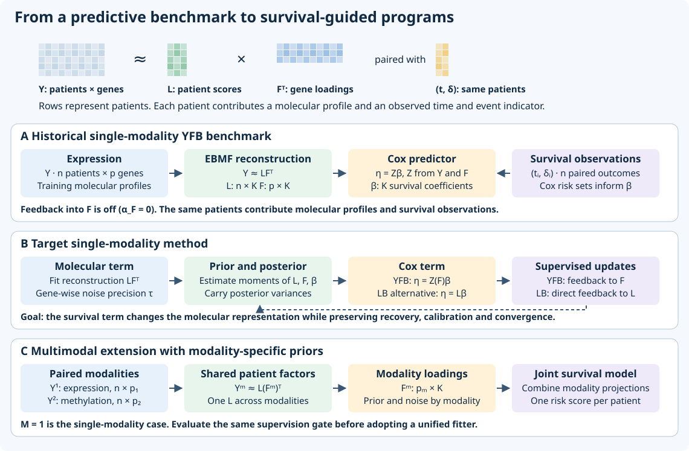
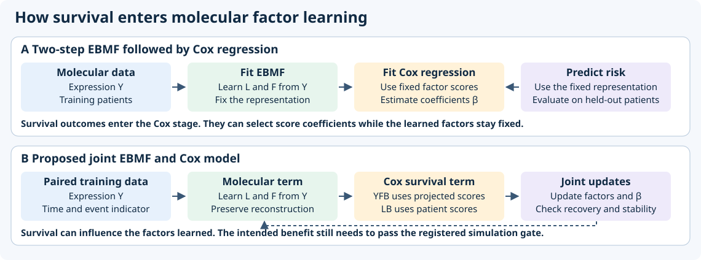
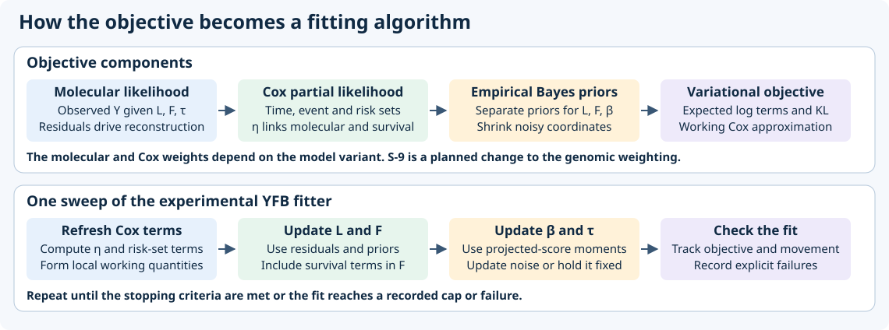
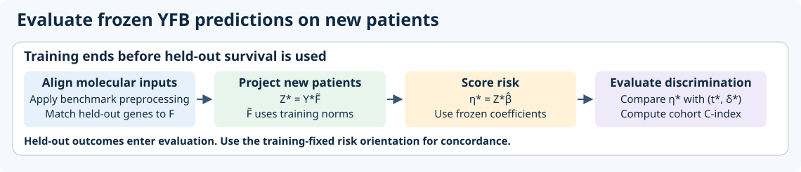
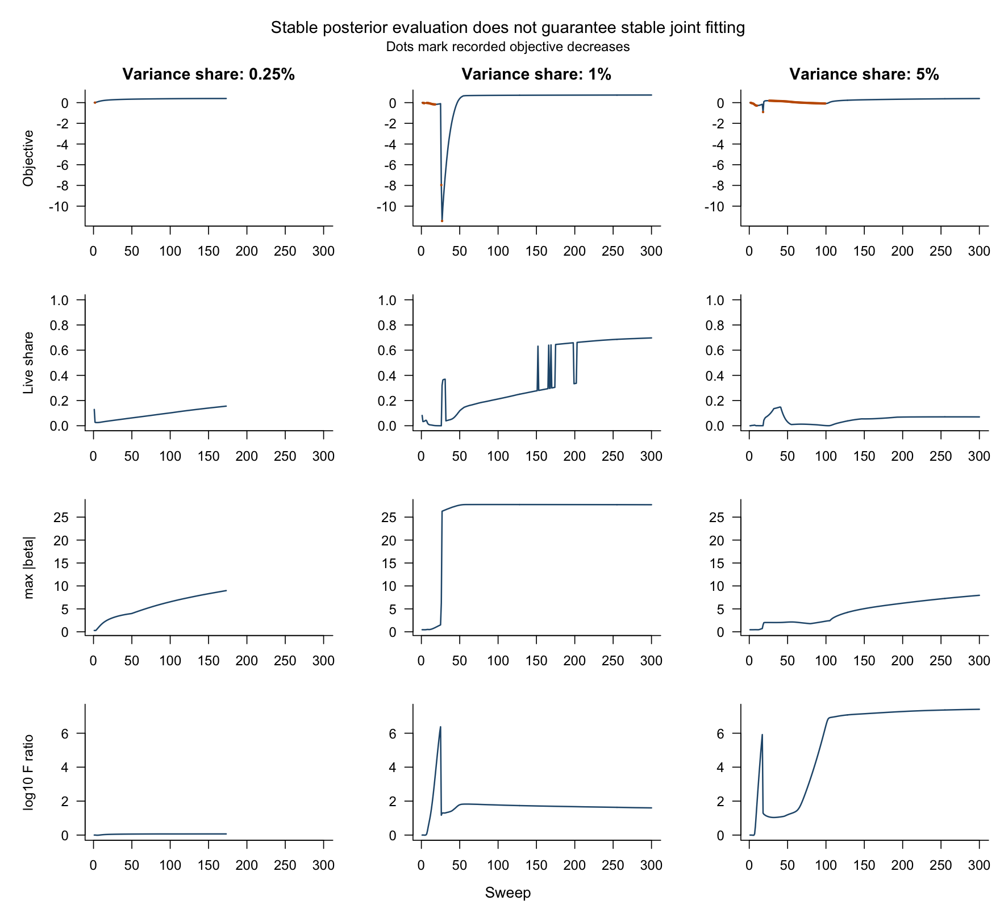
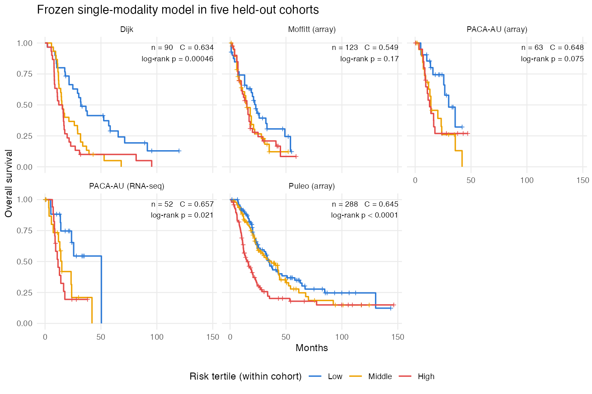

# Current project state {.unnumbered}

Updated November 13, 2026. The working model is YFB at K = 5 with point-Laplace
scores and loadings, per-program Normal survival coefficients, pooled TCGA and CPTAC
training, per-cohort z-scores on 2,218 genes and w_S = 1. The
[November 13 chapter](chapters/2026-11-13.qmd) reports the current evidence.

## Research status

| Stage | Work | Evidence or next checkpoint |
|---|---|---|
| Done | Priors, gene screen, input scaling and rank comparisons | Training CV keeps the signed point-Laplace model and selects K = 5 |
| Done | Rank-5 working-fit exhibits and weight search | Programs 2, 4 and 5 are survival-active. Only Program 2 is active in at least four of five CV folds, has an absolute standardized coefficient at least one-quarter of the largest, and accounts for at least 5% of risk-score variance through its signed covariance share. Weight search retains w_S = 1 |
| Done | LB and YFB comparison | YFB retained. On real data the programs and predictions closely agree |
| Done | Single-modality methylation fit | Shares two strong axes with expression (canonical correlations about 0.9) and adds a recurring methylation-specific, immune-like program from about 50k CpGs. Prediction is lower than expression |
| Done | Feature-group fitter and initial joint evaluation | Joint TCGA comparison is not validated by simulation, with no added prediction or joint-only program. The weight path is done and the multimodal work is paused. At balanced feature counts separate priors matched one-modality programs more often, but no fit recovered all three planted programs and a general advantage was not established. In TCGA, methylation dominates several shared programs. In simulation, likelihood weights empty the methylation loadings |
| Next | Cohort-stratified fit and scale-robust identification of empty programs | Evaluate on training data before external scoring |
| Open | Stronger loading supervision | Stable fits at weights that move loadings |
| Paused | Multimodal modality balance | Next ideas in [balance-ideas notes](https://github.com/andrew-walther/multiomicsGEP/blob/main/docs/notes/2026-11-13-multimodal-balance-ideas-notes.md), starting with weighting methylation only in the score update |
| Later | R package and final analysis snapshot | Follow methodological evaluation and final model decisions |

The sections below preserve earlier model diagrams and technical notes. Their
nonnegative reconstruction and historical priors describe previous configurations,
not the working rank-5 model. The checklist counts completed diagnostics separately
from evidence still needed for a final method.

## Model architecture

The historical YFB configuration estimates molecular loadings without survival
feedback and uses projected expression to estimate survival coefficients. The
target YFB formulation lets Cox information influence $F$. In LB, the Cox
predictor depends directly on $L$. A unified extension uses shared patient
scores and modality-specific loadings, priors, and noise. A result at $M=1$
must meet the same recovery, false-activity and convergence criteria before the
unified fitter becomes the common implementation.

The comparison draws on the visual separation of reconstruction and Cox
regression in Young et al., DeSurv Figure 1. Figure 2 and supplement Figures
S1–S3 motivate separating convergence, recovery and held-out performance in
the evidence section. The diagrams depict this project's EBMF implementations
and research goals. The DeSurv figures are available in the [DeSurv reproduction materials](https://github.com/rashidlab/DeSurv-paper).

### Two-step versus joint fitting

In the two-step baseline, EBMF learns molecular factors from expression.
Cox regression then estimates coefficients for expression projected onto those
fixed loadings. Coefficient shrinkage can select scores for prediction while
the factor loadings stay fixed. In the proposed joint model, Cox information
enters the factor updates themselves. YFB targets the feature loadings through
the expression projection. LB supplies direct survival information to the
patient scores, with an indirect effect on loadings through reconstruction.
LB prediction estimates a new patient’s activities from expression
with the training loadings fixed. Joint updates can change which programs
are recovered at a fixed starting rank.

The historical YFB benchmark had zero survival feedback into the loadings.
It uses its own priors and selection procedure, so it is distinct from the
two-step comparator. Its external discrimination serves as the predictive reference. Testing the
value of joint supervision requires matched two-step and joint fits with the
same training splits and held-out evaluation, plus planted-factor recovery,
false activity and convergence in simulation.

## Fitting and prediction

### Sampling model and empirical Bayes priors

For $n$ patients, $p$ molecular features and $K$ factors, let
$Y\in\mathbb R^{n\times p}$, $L\in\mathbb R^{n\times K}$ and
$F\in\mathbb R^{p\times K}$. The experimental single-modality fitter uses

$$
Y_{ij}\mid L,F,\tau_j\sim
\mathcal N\!\left(\sum_{k=1}^K L_{ik}F_{jk},\tau_j^{-1}\right),
\qquad
h_i(t)=h_{0,s_i}(t)\exp(\eta_i).
$$

The experimental reconstruction uses nonnegative expression on its fitted
scale. For raw input, the fitter divides by within-cohort feature standard
deviations without centering the reconstruction. It centers the expression
only for the Cox projection.

Here $s_i$ is the patient's stratum, or a common stratum for an unstratified
fit. With observed time $t_i$ and event indicator $d_i$, the Breslow Cox log
partial likelihood is

$$
\ell_{\mathrm{Cox}}(\eta)=\sum_{i:d_i=1}
\left[\eta_i-\log\sum_{r:t_r\ge t_i,\ s_r=s_i}\exp(\eta_r)\right].
$$

Tied events use the same risk set. YFB uses $\eta=Z\beta$ with
$Z=Y_c F D$, where $Y_c$ is centered expression and
$D_{kk}=\|E_q[F_{\cdot k}]\|_2^{-1}$ for a live loading column. The
working projection treats $D$ as fixed within a sweep and uses a finite
scale for zero columns. LB instead uses $\eta=L\beta$.

The experimental fit uses point-exponential priors for activities and
loadings, and a shared point-normal prior for survival coefficients:

$$
\begin{aligned}
L_{ik}\mid g_{Lk}&\sim g_{Lk}=(1-\pi_{Lk})\delta_0+
                         \pi_{Lk}\operatorname{Exp}(\lambda_{Lk}),\\
F_{jk}\mid g_{Fk}&\sim g_{Fk}=(1-\pi_{Fk})\delta_0+
                         \pi_{Fk}\operatorname{Exp}(\lambda_{Fk}),\\
\beta_k\mid g_\beta&\sim g_\beta=(1-\pi_\beta)\delta_0+
                         \pi_\beta\mathcal N(0,\sigma_\beta^2).
\end{aligned}
$$

The atom $\delta_0$ places a point mass at zero, the $\pi$'s are
slab probabilities, and the exponential parameters are rates. The fitter
estimates the prior parameters by empirical Bayes. The default experimental
coefficient fit bounds its shared prior parameters. Precision $\tau_j$ is
a point estimate updated from expected squared residuals, or held fixed in
the fixed-noise diagnostic. In the multimodal extension, each input block
$Y^{(m)}$ has its own $F^{(m)}$, loading prior and precision, with a shared
$L$. The allowed loading prior family can differ by modality.

### Variational fitting criterion

Let $q=q_Lq_Fq_\beta$ denote the factorized variational approximation, and
let $G_L,G_F,G_\beta$ denote the corresponding product priors above.
For positive survival weight $\gamma$, the **unguarded** experimental fit
monitors the following local approximation:

$$
\begin{aligned}
\widetilde{\mathcal L}(q)
={}& E_q[\log p(Y\mid L,F,\tau)] \\
&+\gamma\left[\ell_{\mathrm{Cox}}(E_q[\eta])
-\tfrac12\sum_i w_i\operatorname{Var}_q(\eta_i)\right]\\
&-\operatorname{KL}(q_L\Vert G_L)
 -\operatorname{KL}(q_F\Vert G_F)
 -\operatorname{KL}(q_\beta\Vert G_\beta).
\end{aligned}
$$

The $w_i$ are the diagonal working curvatures. The Gaussian expectation
uses posterior moments of both $L$ and $F$. This is a Cox working
approximation, with a separate bound-based acceptance criterion in guarded
runs. The bound holds with the projection scale fixed. Recomputing that scale
between sweeps changes the criterion and limits what acceptance guarantees. The sweep computes Cox working quantities, updates $L,F,\beta$ by
factor, canonicalizes the factor scales and updates free precision.
The frozen historical benchmark used zero loading feedback ($\alpha_F=0$)
while still fitting survival coefficients. The completed canonical-fitter simulation varied the survival weight on z-scored
input and measured loading recovery, false activity and convergence. See the
[November 6 chapter](chapters/2026-11-06.qmd) for results.

Training fixes the loading matrix, its column norms where used, and survival
coefficients. Held-out expression is aligned to the training feature space
under the benchmark preprocessing contract, including within-cohort
standardization and the training loading norms where used. The projection gives a risk
score for each patient. Concordance evaluates the ordering of comparable
observed survival pairs using the training-fixed risk orientation.

## Evidence

| Result | What it establishes |
|---|---|
| Historical YFB mean Harrell C-index 0.627 across five PDAC series (range 0.549–0.657) | Predictive benchmark with zero loading feedback. The principal two-step comparator averaged 0.601 and the rank-matched comparator 0.623. |
| The corrected shared-loading simulation completed 360 fits, with 153 nonconverged | The tested weights did not meet the recovery, false-activity and convergence criteria |
| Fixed noise prevented runaway residual growth in the tested designs | None of 12 fits passed the screen. One guarded fit converged and recovered the planted factor, with two false-active factors. |

The external rank sweep informed the choice of starting rank seven, and some PACA-AU
donors recur across series. The benchmark comparisons are descriptive and
cannot isolate the effect of survival feedback.

The simulation comparison required, at 2,000 features, at least three
additional recoveries per ten paired datasets relative to the unsupervised
fit in at least two variance cells, mean false-active count at most one, and at least 90% convergence.
None of the tested joint weighting arms qualified. Recovery requires a match to the planted loading,
an active survival coefficient and the correct sign. A false-active factor
is an unmatched survival-active factor. In the weakest 2,000-feature cell,
the existing canonical comparison recovered the planted program and
converged in all ten replicates, with one false-active factor on average.
That cell shows recovery was possible under the design.

The separate Gaussian reference flagged
about 6.9 of seven truly null coefficients at a large likelihood weight,
even with exact coefficient inference. This isolates a weighting issue in
the Gaussian diagnostic.

See the [October 30 chapter](chapters/2026-10-30.qmd) for saved tables and
diagnostic plots.

Inspect the fixed diagnostic replays

These traces follow selected saved designs and are deterministic replays.
Read the October 30 chapter for the normalization and the replay conditions.

## Completed Results

<progress value="14" max="25" aria-label="Evidence items completed">14 of 25</progress>

**14 of 25 evidence items documented.** Each line of this checklist counts once.
Checked historical or diagnostic items have a saved result, even when it was
negative. Open items describe evidence still needed for the survival-supervised
method. Publication readiness depends on recovery, false activity, convergence and the final
evidence, not on this count.

**Re-verification required.** Many checked results use the historical
$\alpha_F=0$ fit, which turns off survival feedback into the molecular
loadings. Once a supervised fit meets the recovery, false-activity and convergence criteria, re-verify the
completed results against that fit before carrying them forward as evidence
for the final method.

### Methodology

- [x] Document LB and YFB predictors, model updates, and the historical benchmark.
- [x] Audit precision balance, posterior variance, and numerical failure modes with mechanism tests. See the [October 30 findings](chapters/2026-10-30.qmd).
- [x] Evaluate loading supervision using recovery, false-active, and convergence criteria. Supervision matches the two-step fit on easy programs and beats it near the detection threshold. See the [November 6 chapter](chapters/2026-11-06.qmd).
- [ ] Establish a reproducible final fitting specification with preprocessing, rank and weight selection inside training, failure handling, and independent review.

### Simulation

- [x] Complete the corrected shared-loading grid and report recovery, false activity, and nonconvergence. The tested weights did not meet all criteria.
- [x] Complete matched mechanism diagnostics with fixed and adaptive noise and explicit stall reporting. See the [October 30 evidence](chapters/2026-10-30.qmd).
- [ ] Show final-method recovery and held-out discrimination under strong, weak, and mixed prognostic signals against matched unsupervised and survival baselines. Include rank recovery and replicate uncertainty.
- [ ] Verify null false activity, convergence across seeds, and stability across restarts. Use a null design with zero survival signal. Partly done: Permuted-survival nulls (0.2 to 1.1 false actives per dataset).

### Real-data application

- [x] Report historical PDAC external discrimination with five held-out series and saved cohort results. The mean C-index was 0.627.
- [x] Establish the historical comparisons with the unsupervised Cox pipeline and quantify external concordance uncertainty. See the [September 4 chapter](chapters/2026-09-04.qmd).
- [ ] Freeze the final training and validation protocol. Refit the accepted method and compare held-out C-index and uncertainty across cohorts against matched unsupervised, DeSurv, and applicable clinical baselines.
- [ ] Report cohort-specific hazard ratios and uncertainty for final programs, donor-aware pooled inference where applicable, and risk-group curves using a training-selected threshold. Assess calibration if reporting absolute risk.

- [x] Rebuild the working rank-5 figures, program tables, risk groups and comparator differences, with donor-aware external intervals and a completed weight-search ledger.

### Biological characterization

- [x] Characterize historical survival-active factors with enrichment, PurIST concordance, external survival associations, and DeSurv overlap. See the [July 15 chapter](chapters/2026-07-15.qmd).
- [ ] Re-characterize final programs and document agreement or differences relative to unsupervised and DeSurv programs.
- [ ] Test program stability under resampling and across cohorts. Document rank-dependent splits and what the molecular and survival terms each contribute.
- [ ] Characterize the remaining historical genomics-only factors where relevant to interpreting the benchmark.

### Sensitivity and reproducibility

- [x] Audit historical rank, threshold and initialization sensitivity. See the [September 4 chapter](chapters/2026-09-04.qmd).
- [x] Complete the historical expression feature-count curve and audit preprocessing choices. See the [October 16](chapters/2026-10-16.qmd) and [October 26](chapters/2026-10-26.qmd) chapters.
- [ ] Check the accepted method across rank, supervision strength, initialization, priors, and fixed versus learned noise. Report whether results depend on preprocessing, feature screening or feature count.
- [ ] Reproduce final tables and figures from a frozen analysis snapshot with cohort definitions, software versions, and an auditable train/validation split.

### Conditional multimodal extension

- [x] Demonstrate single-group parity in the feature-group extension of the working fitter. Frozen pooled and stratified fixtures reproduce exactly. The older multimodal fitter remains historical.
- [x] Complete the initial matched expression, methylation and joint comparison with separate and pooled loading priors at 10,000 CpGs. This diagnostic is not validated by simulation and shows no joint prediction gain. Joint feature-count sensitivity remains open.
- [x] Run the modality-weight path in simulation and on TCGA. No weight was usable: at w = 0.7 the methylation share of the prognostic program fell from 52% and 60% to 21% and 9%, and 42 and 46 of 50 methylation blocks were empty. The work is paused, with next ideas in the [balance-ideas notes](https://github.com/andrew-walther/multiomicsGEP/blob/main/docs/notes/2026-11-13-multimodal-balance-ideas-notes.md).
- [ ] Validate modality balance, convergence, and the incremental prediction and biological evidence from the joint fit.

The evidence categories draw on DeSurv main Figures 2–4 and supplement
Figures S1–S10. Their examples include null and mixed simulations,
initialization, rank selection, factor correspondence, training-derived
risk thresholds, external cohort hazard ratios, subtype composition and
the tradeoff between expression variance and survival contribution.
The DeSurv figures are available in the [DeSurv reproduction materials](https://github.com/rashidlab/DeSurv-paper).

See the historical predictive result

The frozen configuration achieved mean concordance of 0.627 across five
external dataset series. The curves compare within-cohort risk tertiles.

See the [October 30 chapter](chapters/2026-10-30.qmd) for the experimental
evaluation and the [roadmap](https://github.com/andrew-walther/multiomicsGEP/blob/main/ROADMAP.md)
for the wider backlog.

## Open decisions

**Long-term home for the synthetic checkpoint archive.** The options are
to use the pinned repository revision or to store the files in a separate
durable archive. The older checkpoints can be restored from the pinned
revision, and the raw files remain in the checkout pending the decision.

Share your choice in the project chat to update this record.
