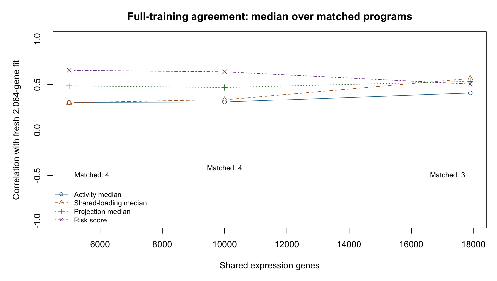

For the concise meeting handout, see
[the October16 summary](Advisor_Meeting_Summary_10_16_26.pdf).
This longer report retains detailed evidence and limitations.

# What the work has established

The approved October 14 write-up remains the project's benchmark. Its
single-block model has mean external concordance **0.627** across five
cohorts, with $\alpha_F=0$: survival informs the coefficients but not the
loading updates. The matched expression–methylation framework has ICGC
primary-PDAC concordance **0.685** versus **0.676** for the expression-only
framework; both fits are unconverged and improvement is not established. Neither result has been replaced.

Since that write-up, the experiments have produced positive evidence that
survival-informed fitting can recover a low-variance prognostic program in
simulation, a clean simulation comparator panel, and reproducible diagnoses
of real-data instability. They have **not established a final supervised
method** satisfying convergence, rank selection and external performance
requirements. Several central feature-sensitivity requests are still open.

| October 2 request | Evidence available | Status |
|---|---|---|
| Unified methods/results/biology write-up | Approved interim PDF and reproducible frozen results | Complete as an interim account |
| Survival shapes loadings $F$ | Implemented experimentally; replicated recovery evidence | Partial; adoption requirements fail |
| More features at fixed $K$ | Full-range expression curve through17,900 shared genes | Expression complete; CpG/joint curves remain open |
| Probe-wise methylation variability | Full 305,492-probe observed-value inventory and SD histograms | Complete descriptively; filter choice remains open |
| Parsimonious retained programs | Protected/full-state pruning evaluated and rejected | Rank selection unresolved |
| Multimodal value | Methylation-dominant and shared molecular structure | Predictive benefit and validated added biology unproven |

**What is concretely solved.** Dead point-mass programs no longer receive
survival protection in the opt-in pruning rule. Full posterior information
can be retained through opt-in pruning refits. Comparator rank-zero/rank-one
cases and individual errors remain in denominators. The failed historical
framework CV fold is exactly reproducible. A curvature experiment removes
constant-risk predictions in its five candidate CV folds. These are specific
software corrections and diagnoses, not proof of the complete scientific goal.

**Current decision.** No replacement is proposed. Preserve the benchmark,
report failures, and review working-step and prior/objective consistency before another large feature-count fitting panel. The October 16 progress-book chapter contains the current mathematical review.

\newpage

# Does survival now influence $F$?

**In experimental code, yes.** The canonical single-modality update combines
reconstruction and survival precision/signal contributions,
$A_F=A_{\rm gen}+w_S A_{\rm surv}$ and
$B_F=B_{\rm gen}+w_S B_{\rm surv}$, with $w_S=1$ in the evaluated
unweighted formulation. It also fixes projection scale and can use
survival-informed initialization. The benchmark's $\alpha_F=0$ update omits
those survival contributions. It remains close to factorization followed
by survival regression in this important sense, although its stopping rule
means its loadings need not equal a separately converged unsupervised fit.

## Loading-update balance measured at saved states

A read-only audit separates the reconstruction and survival terms for each
loading coordinate while holding the other moments fixed. The fractions
below are medians across features, on a 0–1 scale:
$A_{\rm surv}/(A_{\rm gen}+A_{\rm surv})$ and
$|B_{\rm surv}|/(|B_{\rm gen}|+|B_{\rm surv}|)$. They exclude priors and are
not variance explained, causal effects or a selected mixing weight.

| Saved fit / program | Block | Survival precision fraction | Survival numerator fraction |
|---|---|---:|---:|
| Frozen joint / 4 | Expression | $2.03\times10^{-7}$ | $7.27\times10^{-5}$ |
| Frozen joint / 4 | Methylation | $9.00\times10^{-10}$ | $4.40\times10^{-6}$ |
| Frozen expression-only / 7 | Expression | $1.61\times10^{-7}$ | $4.41\times10^{-5}$ |
| Profiled joint / 4 | Expression | $8.22\times10^{-8}$ | $6.62\times10^{-5}$ |
| Profiled joint / 4 | Methylation | $4.26\times10^{-10}$ | $4.81\times10^{-6}$ |
| Methylation-only 10k / 6 | Methylation | $2.83\times10^{-7}$ | $1.35\times10^{-4}$ |

All four fits use the same 144 TCGA patients and reach 500 iterations without
convergence. These are isolated-coordinate likelihood contributions at capped
terminal states, not sequential-update telemetry or proof of what caused
collapse. The survival terms are small in these states; cumulative effects
and empirical prior refits are not assessed by these fractions. Point-mass
zero coefficients gate both survival terms; a zero mean alone need not do so
when the coefficient second moment remains positive. Saved objective/removal
components are reported separately and retain their prior/KL caveat.

## Recovery evidence and its limits

The clean comparator rerun covers 40 simulated datasets and 200 method results,
with no fitting errors. Its supervised arm recovers the planted program in
17/20 low-noise and 19/20 high-noise datasets. The four comparator arms do not
recover the planted survival-active program under the specified joint
criterion; EBMF alone has no fitted survival risk by design. Two supervised
fits reach their iteration cap, and one high-noise prediction is constant.
This is controlled simulation evidence, not an external-cohort result.

The latest, separately approved profiled-curvature experiment changes only
an opt-in flag from the framework controls. Its simulations give:

| Model | Noise | Recovery /20 | False active | Reference false active | Converged /20 |
|---|---:|---:|---:|---:|---:|
| Single | .25 | 18 | 1.35 | 1.15 | 19 |
| Single | 1 | 20 | .40 | .35 | 20 |
| Multimodal | .25 | 16 | .80 | .75 | 20 |
| Multimodal | 1 | 19 | .40 | .65 | 20 |

All recovery and false-positive criteria pass; Single convergence does not.
The fixed beds are retained. These results do not establish validity for all
feature counts, rank selection or the final Bayesian objective.

## External performance has not established non-inferiority

The earlier selected supervised Single candidate, evaluated before Round 2,
was compared with the frozen D4 reference on five cohorts (616 patients).

| Model | Mean external C | Delta versus D4 (95% interval) |
|---|---:|---|
| Frozen D4, $\alpha_F=0$ | .626699 | Reference |
| Earlier supervised candidate | .620725 | $-.005974\;[-.031708,.020662]$ |
| Earlier $\alpha_F=0$, point-Laplace L/F arm | .635304 | $.008605\;[-.011261,.030378]$ |

The supervised arm fails the required lower limit $>-0.02$. The earlier
$\alpha_F=0$ arm passes that requirement but does not supervise $F$.

The latter arm changes loading priors as well as retaining $\alpha_F=0$;
it is not the frozen D4 fit. No model is selected from these external scores.
No new Round 2 external cohort has been scored. Simulation recovery alone
therefore does not close the supervision requirement.

\newpage

# Multimodal stability and the meaning of seven programs

The selected supervised multimodal fit collapsed to zero risk on TCGA.
Training-only tracing identified shared coefficient-prior absorption.
Replacing it by a fixed prior did not produce a converged, credibly
prognostic real-data fit. An unchanged historical-framework CV fold also
lost all coefficient means and second moments; the exact trace reproduces
all 13 saved-state/history checks, locating the persistent loss at outer
iteration 167, inner sweep 1.

The approved working-intercept profile removes a penalty on the arbitrary
constant-risk direction. All five candidate CV risks are nonconstant, but
all five reach 500 iterations, and credible-program counts are 0,1,0,0,0.
Its own five-fold mean C is .563678. The original reference has one undefined
score, so the prescribed five-finite-pair comparison remains ineligible.
Single candidate CV C=.624776 versus .623985 passes its paired one-SE rule.

| Source/model, full TCGA | Training C | Credible programs | Final K | Converged |
|---|---:|---:|---:|---|
| Frozen joint framework | .637768 | 1 | 7 | No |
| Frozen expression-only framework | .643559 | 1 | 7 | No |
| Frozen matching Single $\alpha_F=0$ comparison | .593717 | — | — | — |
| Round 2 profiled joint framework | .639172 | 1 | 7 | No, 500 cap |
| Round 2 profiled Single framework | .651632 | 3 | 7 | No, 300 cap |

These are training quantities, not the external benchmark values .685/.627.
The profile panel completes 92 new fits plus 10 cached references without
execution errors or warnings. Eight new fits cap. It is not adopted.

## Seven may be appropriate; the roles must justify the count

A joint fit can retain expression-dominant, methylation-dominant and
prognostic programs, with overlapping roles. Fewer programs are not
inherently better. The frozen joint fit already provides this descriptive
role evidence:

| Program | Provisional interpretation | Expression share | Methylation share | Survival-active |
|---:|---|---:|---:|---|
| 1 | Classical/gastric | 23.5% | 4.8% | No |
| 2 | Immune | 5.1% | 20.9% | No |
| 3 | Mixed, unlabelled | 31.5% | 0.3% | No |
| 4 | Basal-like versus classical | 6.2% | 4.5% | Yes |
| 5 | Normal versus activated stroma | 4.8% | 1.2% | No |
| 6 | Exocrine/acinar | 28.9% | 9.3% | No |
| 7 | Methylation-only | 0% | 58.9% | No |

All rows are from the frozen benchmark, not inferred labels for the newer
fit. Shares normalize fitted rank-one squared norms within a modality;
they are not additive variance explained or survival contributions. Labels
are provisional; CpG annotation and enrichment were not performed.

The Single write-up's four retained programs classify one K=7 fit; three
other fitted programs are inactive under its operational thresholds.
No deletion/refitting produced those four. Thus “7 versus 4” compares
classification/model settings as well as modalities. The saved-fit role audit below addresses molecular/prognostic roles;
redundancy and convergence still require resolution before interpreting this
as excess joint rank.

## Saved-fit role and agreement audit

The newer profiled joint fit preserves a recognizable mixture of molecular
roles. Activity matching pairs all seven programs to the same benchmark
indices; correlations range .832–.999. The sole credibly prognostic program
remains program 4. No biological labels are transferred to the newer fit.

| Matched program | Expression norm share, benchmark / newer | Methylation norm share, benchmark / newer | Credible, benchmark / newer |
|---:|---:|---:|---|
| 1 | 23.5% / 18.0% | 4.8% / 1.4% | No / No |
| 2 | 5.1% / 14.0% | 20.9% / 17.5% | No / No |
| 3 | 31.5% / 30.4% | 0.3% / 0% | No / No |
| 4 | 6.2% / 7.6% | 4.5% / 2.7% | Yes / Yes |
| 5 | 4.8% / 1.7% | 1.2% / 1.5% | No / No |
| 6 | 28.9% / 28.2% | 9.3% / 8.2% | No / No |
| 7 | 0% / 0% | 58.9% / 68.7% | No / No |

Both fits reached 500 iterations without convergence. Risk-score correlation
is .954; program 4 activity correlation is .947, with expression/methylation
loading correlations .916/.903. Program 7 remains methylation-only, with
activity correlation .999 and methylation loading correlation .993. These
are descriptive agreement measures, not evidence of incremental prediction
or optimal K. Molecular norm shares are not additive PVE or survival fractions.
Nonzero loading means are dense within the nonzero blocks; this audit does
not validate probe-level feature selection. No new survival score or external
outcome was used.

\newpage

# How much of the feature-count request is complete?

A limited earlier Single experiment varied the screening count per cohort,
then intersected the selected features. Requested count and fitted dimension
are different quantities:

| Requested/cohort | Shared genes | Mean training CV C | CV SE | Capped folds | Frozen D4 external C |
|---:|---:|---:|---:|---:|---:|
| 1,000 | 662 | .650200 | .017200 | 1/5 | — |
| 2,000 | 1,365 | .648933 | .022598 | 0/5 | — |
| 3,000 | 2,064 | .651199 | .023631 | 1/5 | — |
| 5,000 | 3,600 | .655413 | .027386 | 2/5 | — |
| Frozen D4 reference | 2,064 | — | — | — | .626699 |

This earlier curve uses the selected experimental Single configuration:
canonicalization, $w_S=1$, supervised initialization and a shared point-Laplace
coefficient prior. It is not the frozen $\alpha_F=0$ D4 configuration.
All four full-training fits converge. The observed differences are small
relative to their uncertainty and do not justify a new feature count.
Screening/scaling preceded folds; these are conditional CV results, not a
fully nested raw-data pipeline. The runner exited nonzero after saving its
tables because its source was edited during execution. Saved fits/counts
and summary arithmetic were independently verified; a clean-process rerun
remains optional unfinished work. This limitation is not hidden.

That limited experiment did **not** complete the advisor request: it stops well
short of the maximum feature universe, omits CpG-count expansion and does
not provide the requested factor-agreement curve.

## Full-range expression feature sensitivity: completed

The approved cold-start study fixes **K=7, deletion off and $\alpha_F=0$**,
using the same 273 TCGA+CPTAC training patients. It expands nested shared
gene sets through all 17,900 measured common genes. Cohort screening cutoffs
are 3,000/6,607/11,602/17,900; the nominal 5,000 shared-gene target crosses
at 5,001. Screening and platform standardization precede the fixed five
patient folds, so this is **conditional CV**, not a nested preprocessing
assessment. Cold starts were authorized because the frozen activity matrix
has rank4/7 and its prescribed continuation inverse is singular.

| Shared genes | Training C | Conditional CV C ± SE | CV converged | Retained / survival-active |
|---|---:|---:|---:|---:|
| 2,064 | 0.6563 | 0.6084 ± 0.0462 | 5/5 | 4 / 2 |
| 5,001 | 0.6159 | 0.5773 ± 0.0266 | 5/5 | 4 / 2 |
| 10,000 | 0.6170 | 0.6088 ± 0.0397 | 5/5 | 4 / 2 |
| 17,900 | 0.6191 | 0.6068 ± 0.0186 | 5/5 | 3 / 2 |
| Frozen D4: 2,064 | 0.6563 | Not newly scored | Historical full fit converged | 4 / 2 |

**All 24 fits converge**, with finite C and no recorded warnings or errors;
the slowest fold takes 211 iterations, below the original 300 cap. The full
fits take 20/25/31/37 iterations. Total measured fitting time is 9.2 minutes;
the maximum R allocation high-water estimate is 819 MB, not OS resident
memory. The first fit's allocation estimate is unavailable after a reporting
bug; its original record and unchanged fit are preserved. The all-gene set
contains 240 constant standardized columns, retained under existing rules.

Including the full measured universe could reduce arbitrary screening choices
even without a prediction gain, provided performance and stability are
preserved. That is a reason to evaluate it, not a requirement that C must
increase. This sensitivity study does not establish noninferiority or
reliable gene-level signal/noise selection.

More genes do not show a clear gain in this conditional-CV experiment.
The point estimates fluctuate, and all-gene mean C 0.6068 is close to the
2,064-gene mean 0.6084. All full fits have two operational survival-active
programs; classified retention changes 4→4→4→3. These are shrinkage
classifications from seven-slot fits, not deletion/refitting or credible-
interval counts. The earlier limited experiment used point-Laplace molecular
and coefficient priors; its C values are not a direct continuation of this
benchmark point-exponential/Normal curve.

{width=100%}

### Strong agreement from 5k to 10k genes; less uniform across the full range

The 5,001- and 10,000-gene fits have four matched nonconstant programs:
common-gene loading correlations are **0.960–0.994**, activity correlations
0.933–0.993 and risk-score correlation **0.972**. This is strong agreement
for that expansion. Their conditional CV means are 0.577 and 0.609, with
SEs 0.027 and 0.040; the study does not establish a predictive improvement.

| Comparison | Matched programs | Common-gene loading absolute r range | Risk r |
|---|---:|---:|---:|
| 2,064 → 5,001 genes | 4 | 0.115–0.962 | 0.655 |
| 5,001 → 10,000 genes | 4 | 0.960–0.994 | 0.972 |
| 10,000 → 17,900 genes | 3 | 0.737–0.915 | 0.667 |

The earlier median correlations of 0.297/0.333/0.566 compare each larger
fit with the **2,064-gene baseline**, not with the preceding count. Two
baseline-to-5k/10k loading matches are strong and two weak. At all genes,
three nonconstant pairs remain. Constant/unmatched factors are undefined,
not counted as zero correlation. Thus prediction is broadly similar and
some expansions preserve programs very well; stability is not uniform over
the whole range. Matching alone cannot distinguish rotation from biological
change, and biological interpretation still needs validation.

{width=100%}

Loading summaries also distinguish program shrinkage from gene selection:
each nonzero full-fit program has nonzero posterior means for every included
gene. This is not evidence that every gene is informative; no gene-level
selection threshold was introduced. The current experiment tests tolerance
of larger inputs, not a validated gene-selection procedure.

The fresh baseline molecular loadings reproduce the archived fit to about
$10^{-10}$ and its oriented risk correlates 0.99999996. The small training-C
difference (0.656259 versus 0.656307) and changed coefficient second moments
are retained; the archive predates the documented sign/variance fixes.
The frozen external mean C 0.627 remains historical evidence and was not
rescored or used to choose a feature count. **No new default is adopted.**
Survival-informed F, supervised K selection and multimodal value remain open.

Next: methylation alone, then joint curves varying one modality at a time.
The original loader's shared-probe eligibility includes 305,352 CpGs, 140
fewer than the full TCGA descriptive inventory. That exact training imputation has now been reconstructed: all frozen 10k
values, probe ranking, patient order and expression values match exactly.
The next study uses 10k/25k/50k/100k/all 305,352 probes, not a 10k endpoint.
It starts with methylation alone, fixed K=7 and the historical framework;
filter policies will be evaluated separately. Within this eligible universe,
the supplied mean rule retains 182,934 CpGs and the extreme-proportion rule
221,142. No SD threshold or new default is adopted. External outcomes cannot
select counts; large fits may require prepared HPC arrays. Warm continuation
remains deferred for review.

\Needspace{22\baselineskip}

The first methylation-only result is now available; it is the 10k reference,
not the endpoint of the study. All rows below concern the same 144 training
patients, but use different molecular inputs and are not matched CV estimates.

| Model | Genes | CpGs | Training C | Credible programs | Converged |
|---|---:|---:|---:|---:|---|
| Frozen joint benchmark | 3,000 | 10,000 | .637768 | 1 | No, 500 cap |
| Frozen expression-only benchmark | 3,000 | 0 | .643559 | 1 | No, 500 cap |
| New methylation-only reference | 0 | 10,000 | .612671 | 0 | No, 500 cap |
| New methylation-only expansion, original arithmetic | 0 | 25,000 | Undefined | Undefined | Execution error |
| Same 25k case, stable arithmetic | 0 | 25,000 | .983854 | 7 | No, 500 cap |

The methylation-only reference has nonconstant risk (SD .1173), but its one
nonzero coefficient is not credible under the original rule. Four programs
meet the existing retained classification; no program is deleted. Runtime
was 964 seconds, with R allocation high-water 1,076 MB and no warnings/errors.
Thus this is a failed convergence/credible-prognostic result, not a successful
supervised methylation model. The unchanged 25k full-training cell stopped after 28 seconds at the
F-update check for finite Cox/projection moments and nonnegative variances;
no fit or score is available. An approved identical-settings replay now
locates the failure at outer iteration 6, inner sweep 1, program 1. Projection
means/variances are valid; Cox working weights and numerators each contain
17 nonfinite values. Finite risk predictors span about 5,734 units: global
exponential shifting underflows 143/144 weights to zero and leaves 17 zero
risk-set sums, including six event rows. This is a numerical failure upstream
of the loading update, alongside rapid risk-score expansion. Stable arithmetic
alone would not establish a convergent model.

**The arithmetic failure has now been repaired at the captured point.**
An opt-in log-space evaluation of the same Breslow quantities gives no
nonfinite working values; weights sum to 74.9999999999582 against 75 deaths.
The original calculation has 17 nonfinite weights and 17 nonfinite numerators.
Default arithmetic, priors and scientific criteria remain unchanged. The
full 25k same-case rerun now finishes without warnings or execution errors,
but fails convergence at the unchanged 500-iteration cap (44.3 minutes).
Training C is .983854, with risk SD 39,086 and log partial likelihood
−40,177. The final relative risk and reconstruction changes are .00589
and .0622, both above the original .0001 tolerance. Seven coefficients
meet the numerical credibility rule, but their interpretation is unreliable
in this unconverged fit. High ranking concordance coexists with extreme,
unstable predictor magnitudes; it is not a validated gain or a
successful supervised model. This is not an inherent 10k-CpG limit or evidence
of an imputation failure. The arithmetic hangup is repaired; the unstable
fitting trajectory remains unresolved.

\Needspace{15\baselineskip}

**The requested common-CpG loading correlations are now available.**
The saved 10k and 25k fits match all seven programs by activity on the same
144 patients and 10,000 common probes:

| Matched program | Activity correlation | Common-CpG loading correlation |
|---:|---:|---:|
| 1 | .982 | .945 |
| 2 | .878 | .922 |
| 3 | .968 | .925 |
| 4 | .513 | .118 |
| 5 | .764 | .038 |
| 6 | .235 | −.087 |
| 7 | .941 | .923 |

Risk-score correlation is .245. Several molecular patterns persist, while
others change substantially. Both fits cap, and the 25k fit uses repaired
arithmetic, so these are **provisional saved-fit correlations**, not a clean
converged feature-count curve or evidence that feature count alone caused
the differences. No biological labels are transferred. Larger counts,
methylation CV, filter comparisons and joint count curves remain unrun.
No controls or criteria are tuned.

\newpage

# Full-probe methylation variability: completed

The descriptive run covers **305,492 available TCGA probes on the same 144
training patients**. It uses observed raw beta values before imputation.
All probe SDs are defined; 29,414 individual values are missing and remain
missing in these calculations. No survival outcome, model fit or new cutoff
is used. The screened reference IDs and patient order match the frozen fit.

| Descriptive set | CpGs | Overlap with frozen screened 10k |
|---|---:|---:|
| All available TCGA probes | 305,492 | 10,000 |
| Mean beta in [.1,.9] | 182,996 | 9,990 |
| Neither extreme fraction reaches 95% | 221,222 | 10,000 |
| Both filters | 182,996 | 9,990 |
| Frozen screened reference IDs | 10,000 | 10,000 |

The proportion rule retains 38,226 probes excluded by the mean rule. The mean
rule would also exclude 10 currently screened probes; **neither rule is adopted**.
Median beta SD is **.0600** over all probes, versus **.1793** in the frozen
screened set using raw observations (.1792 in the existing imputed cache).
This confirms that the top-variance screen substantially enriches variability;
it does not show which feature universe explains survival better.

{width="100%"}

The companion mean-versus-SD density plot and safe aggregate tables are in
[the CpG output directory](../../results/multimodal_real/outputs/feature_sensitivity/cpg_qc/).
Cross-reactive/SNP probe-filter provenance remains unverified; no new QC or
imputation was applied. This completes the requested descriptive inventory
and SD histogram, while the feature-count/performance experiment remains open.

\newpage

# Multimodal value and manuscript integration

## Two acceptable multimodal contributions

**Prediction:** compare joint, expression-only and methylation-only fits
on the same patients, folds and expression feature counts. Report paired
uncertainty. Matching expression-only C is not predictive improvement, and
training C alone is not external performance.

**Additional biology:** assess stable molecular structure absent from
expression-only fitting. The methylation-only and immune components already
provide descriptive candidates. Neither is survival-active in the benchmark;
58.9% methylation share is not evidence of 58.9% survival explanation.
Annotation, enrichment, reproducibility across feature sets and checks of
composition/technical explanations are needed for a stronger biological claim.

## What enters the larger write-up

| Revision dependency | Evidence available for review | Still required |
|---|---|---|
| R1–R3: updates, scale and objective | Implemented supervision, curvature diagnosis, prior/KL caveats | Stable defensible final formulation |
| R4: rank/classification | Failed pruning panels; distinction between seven fitted/four classified | Valid rank choice, redundancy and converged role stability |
| R5–R7: evaluation/results | Recovery/comparator tables, external failure, full-range expression CV | CpG/joint sensitivity and final allowed external report |
| R8: biology | Frozen/newer role agreement, provisional benchmark labels and limitations | Final-program CpG annotation and confounding checks |
| R9: implications/continuing work | Clear progress and unresolved requirements | Conclusions supported by the final reviewed evidence |

Andrew has requested incorporation of applicable verified findings into the
larger write-up. A bounded revision adds the expression feature-count results,
CpG expansion failures, the arithmetic repair and provisional CpG loading comparison, without changing
the evaluated benchmark model or claiming a supervised replacement. The
approved interim version remains preserved in its immutable tag. Further
methodological and biological revisions require their original review gates.

## Evidence and provenance

All numbers above are saved results; this report runs no model or new
external scoring. The benchmark tag is
`benchmark-interim-writeup-2026-10-14`; all 10 snapshot hashes match.
The method-panel checkpoint is `f0858ec`; the CpG design is `dc69f6d`,
the full-range expression design is `6597b4b`, and its reporting correction
is `6371e42`. The current software suite has 706 passing tests. Full per-task commits, failures and tables are indexed in
[the Round 2 handoff](../plans/Codex_to_Claude_Round2.md) and
[attempt history](../plans/Round2_attempts_log.md). The
[approved priority plan](../plans/Advisor_Priorities_and_Execution_10_15_26.md)
links these deliverables to the October 2 meeting and write-up revision markers.
Software tests validate specified behavior; their count is not proof that
all statistical goals have been met.

\newpage

# Regrouping checkpoint

The benchmark is retained. The complete gene-count study, full-probe
mean/SD inventory, saved-program role comparison and diagnosed numerical
repair are concrete progress. They do not resolve the central requirement:
a convergent survival-supervised model with defensible rank, preserved
external performance and demonstrated multimodal value. The evaluated
single-modality benchmark still uses $\alpha_F=0$.

Pause further fitting for review. The next priority should be a bounded
review of the Cox working-step stability and prior/objective consistency,
using the saved failure states before additional large-feature panels.
Stable risk-set arithmetic allows the calculation to continue, but does
not guarantee an improving likelihood or convergent variational updates.
A proposed remedy needs a prospective design and the unchanged simulation
and training-validation gates. Longer runs, clipping, new weights or new
convergence criteria should not be inferred from the present result.

## October 16 diagnostic validation update

One approved observation-only replay reproduced the entire saved Single
simulation fit and history exactly, without warnings, and retained its
300-iteration convergence failure. Post-run multi-program validation exposed
an observer-only reconstruction cross-term omission. The original objective
summary is preserved but invalid for ascent diagnosis. The observer correction
passes eight focused tests; a separately approved corrected replay has now completed with exact saved-fit identity and complete late-cycle coverage. No model remedy, benchmark or criterion
has changed. The complete current account is adapted into the October 16
chapter of the progress book.

The corrected late50-cycle observation has zero decreases in each of350
fixed-prior posterior steps for loadings, subject scores and coefficients;
loading-prior refits lose the reference objective50/350 times and working
refreshes18/50 times. Scale and precision updates have no such late losses.
This supports reviewing a fixed-posterior loading-prior maximization step
before damping or weights. Joint empirical-Bayes subject-score/coefficient
comparisons retain additional losses whose optimizer/density/reference-prior
interpretation remains unresolved. This is a local quadratic diagnostic,
not a certified common implemented ELBO, a cure for the25k trajectory or
an adopted remedy. The audit record retains the full table and limits; the October16 chapter summarizes them.

## Current method implementation checkpoint

The next consistency repair is now implemented opt-in, with software-fixture
validation and one bounded simulation check, without adoption. Holding the loading posterior
fixed, the point-Laplace prior uses $\pi=S/p$ and rate $S/T$, where
$S=\sum_j\Pr_q(F_j\ne0)$ and $T=\sum_jE_q|F_j|$. Its KL is corrected to the
returned prior at the same step. The posterior sweep and historical default
path are preserved. This addresses the demonstrated prior-step mismatch;
it does not certify the complete algorithm or resolve Cox working refreshes.
The existing truncated-Normal extreme-tail approximation remains a numerical
limitation to assess before interpreting an extreme-state evaluation.

The full-range gene curve above completes the Single benchmark training/CV
sensitivity, not the matched TCGA framework expression-only curve. That curve,
remaining methylation/filter/joint curves, large-p added-noise simulations,
rank selection and final biological validation remain open meeting items.
No benchmark, feature count, filter or supervised configuration is adopted.
The next prospective experiment and original gates are specified in
`docs/plans/Round2_fixed_q_loading_prior_proposal.md`; scientific execution
requires its fixed driver and registration commit before running.

The first fixed-settings consistency check meets the native ELBO rule in10
iterations rather than the saved reference's300 cap, while recovery and
false-active counts are unchanged. Output movement is still.01915 versus
the existing1e-4 diagnostic, so reliable optimization is not established.
The next priority is stopping/objective consistency before a larger panel.
