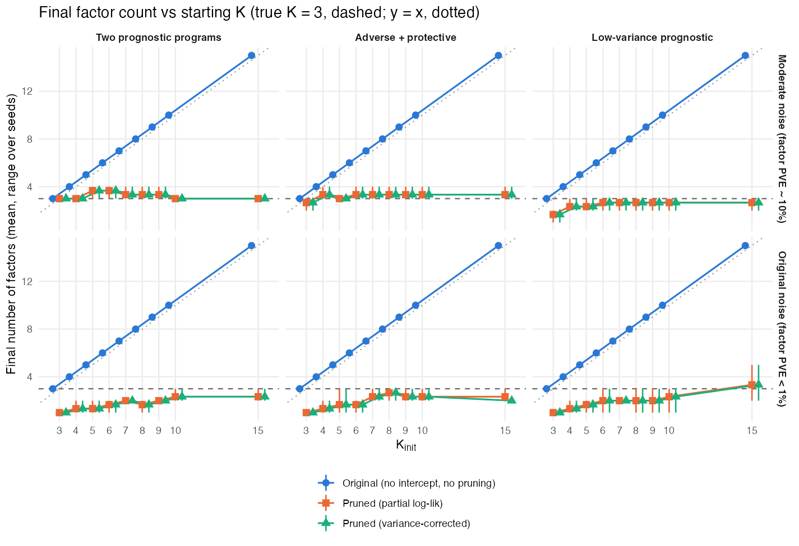
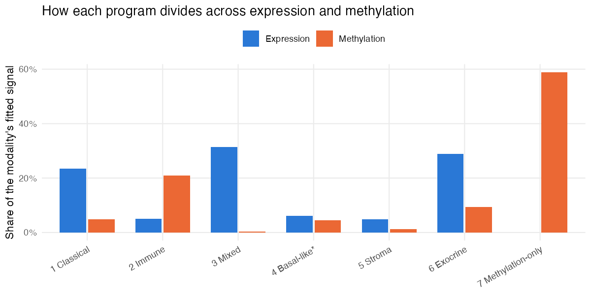

::: {.planning-summary}
**Deliverable for review:** the structure, evidence inventory, and editorial rules for a substantial technical report. This page is the first deliverable; the report and its derivation appendices have not yet been drafted.

**Agreed format:** an article-style report with a 15–20-page main text, plus derivation appendices, rendered to HTML and PDF from one Quarto source. Its purpose is to give advisors a consolidated account of the project and establish a manuscript foundation before choosing a journal.

**Review update:** Claude's [planning review](plan_review_findings.md) has been checked against the cited files. The [Review disposition](implementation_plan.md) records which recommendations were adopted or qualified. This revision explicitly specifies the biological characterization methods. The separate [drafting prompt](drafting_prompt.md) assigns the initial draft to Claude Code on `writeup/draft`, with independent complete-draft review by Codex afterward. The draft target is October 16, 2026; it is not a declaration of readiness to share.
:::

## Purpose and reading strategy {#sec-purpose}

The report should let a biostatistician understand what each model estimates, how it is fitted and used for prediction, what the simulations establish, and what the PDAC applications reveal. The central distinction is between the methodology underlying the results already obtained and the additional work needed to establish survival-guided program discovery.

Read the [outline](#sec-outline) and [evidence assessment](#sec-evidence) first. The [figure and table plan](#sec-exhibits) shows how the findings can be presented without reproducing the sequence of development reports. The [source map](#sec-sources) and downloadable [source inventory](source_inventory.csv) support a closer review.

This writeup covers verified evidence available through October 12, 2026. It excludes a literature review, bibliography development, new fitting experiments, a journal shortlist, and detailed histories of discarded model variants. The existing prelim chapter and historical derivations remain separate source documents.

## Proposed outline and page allocation {#sec-outline}

The main text will follow the scientific argument rather than meeting dates. The allocation below totals approximately 18 pages, including figures and tables; it is a layout target rather than a reason to omit an important qualification.

| Section | Purpose and contents | Main-text target |
|---|---|---|
| Summary of current findings | State the evaluated configurations, central performance results, biological findings, and methodological limitations. | 1 page |
| 1. Methods | Define common notation; single-modality YFB model and fitting algorithm; multimodal extension and fitting algorithm; prediction and multiple-cohort handling. | 6 pages |
| 2. Evaluation framework | Describe simulation designs, datasets, preprocessing, comparators, performance and recovery metrics, uncertainty, and biological characterization. | 2 pages |
| 3. Results | Present single-modality simulation and real-data performance, then multimodal simulation and real-data performance. Include rank sensitivity and convergence. | 5 pages |
| 4. Biological findings | Characterize the single-modality programs; explain shared and modality-specific multimodal programs and their correspondence. | 3 pages |
| 5. Interpretation and remaining evidence | Explain the supported conclusions and the evidence still needed to finalize the method. | 1 page |
| Appendix A | Derivations for single-modality YFB, distinguishing the joint mathematical formulation from the evaluated algorithm. | Outside page target |
| Appendix B | Derivations for the current multimodal framework, including intercepts, signed priors, projection moments, and pruning. | Outside page target |

### 1. Methods: what a reader must understand

**Common notation.** Define patients, features, modalities, cohorts, factors, observed survival time, and censoring. Distinguish the nonnegative latent activities $L$ from the observable projection scores used in the Cox predictor. Use separate symbols for survival coefficients and methylation measurements. A notation table will give matrix dimensions and interpretations.

**Single-modality formulation.** Describe Gaussian reconstruction, feature-specific residual precision, empirical-Bayes priors, the normalized YFB predictor, and the Cox working approximation. Explain the implemented factor-wise update order, initialization, stopping rule, and frozen prediction. State where the survival weight $\alpha$ and loading-update weight $\alpha_F$ enter. The configuration behind the principal results has $\alpha_F=0$: survival informs the coefficients, but does not guide the discovery of the loadings.

**Factor counts and rank selection.** Separate the starting rank, the number of retained molecular programs, and the number classified as survival-active. Explain the current recommendation of starting rank 7 and the disagreement among evidence, complexity, and prediction criteria. The report must identify the role of external-cohort performance in this recommendation rather than describing it as wholly training-selected. Classification after fitting and explicit removal/refitting are different operations.

**Multimodal formulation.** Introduce shared nonnegative activities $L$, per-feature intercepts $\mu_m$, signed loadings $F_m$, modality–factor-specific empirical-Bayes prior parameters, and feature-specific precisions. Describe the joint projection, loading-uncertainty contribution to coefficient updates, factor-scale normalization, and factor-removal/refitting procedure. Identify the actual controls used in the reported fits; package defaults and the evaluated configuration are not interchangeable.

**Multiple cohorts and prediction.** Keep the model with one feature block conceptually distinct from integration of two matched blocks. Explain per-platform standardization, optional genomic offsets, stratified baseline hazards, and cohort-specific coefficients. CPTAC contributes proteomics to the established pooled training analysis; it is not a second RNA-seq cohort. Prediction uses frozen fitted loadings and coefficients, with risk orientation determined before evaluation outcomes are used.

For the historical saved D4 fit, state the exact convention used by `make_km_figures.R`: **risk = −η**, one fixed orientation used for all held-out cohorts. This fit predates the sign-correction change. Do not generalize that negation to every current fit or confuse it with the outcome-oriented descriptive C-index returned by the biological signature helper.

Include one readable algorithm box per model. State the approximations explicitly: the Cox working surrogate and the objective used for multimodal pruning do not justify claiming exact joint coordinate ascent or a guaranteed monotone evidence bound.

### 2. Evaluation framework: designs and comparisons

Describe the single-modality simulation of shared and cohort-specific programs, including under- and over-specified starting ranks. Include the multimodal simulation's scenarios, noise settings, starting-rank grid, replication, and fitted variants. Report simulation metrics according to their definitions in the runners, including factor matching, correct-sign prognostic recall, false prognostic programs, convergence, and discrimination.

Give a cohort table distinguishing pooled TCGA/CPTAC training, the five external validation cohorts, matched TCGA training, the 50-donor ICGC primary-PDAC validation set, and the 67-donor sensitivity set. The matched 50-donor set overlaps the broader PACA-AU RNA-seq validation cohort; it is not an additional independent replication.

Describe feature screening and transformations separately for the established single-block analysis and the matched multimodal analysis. Explain paired bootstrap differences and fixed-effect pooling separately from the arithmetic mean of cohort C-indices. The independently tuned, regularized two-step pipeline is the principal single-modality comparator. The rank-matched and older unpenalized comparisons provide supporting context.

#### Biological characterization methods {#sec-characterization-methods}

Include a compact methods table in the main report or a referenced appendix table, with an explanatory paragraph in Evaluation. Explain how each analysis supports interpretation rather than only naming a program's biological function. The rows below distinguish the inputs, populations, statistics/settings, multiplicity, and conclusions. They describe existing analyses; they do not authorize rerunning them.

| Analysis | Input object | Population | Statistic and settings | Multiplicity | What the output supports |
|---|---|---|---|---|---|
| Ranked enrichment (fgsea) | Nonnegative posterior means E[F], over the 2,064 selected genes | Established single-modality fit; one program at a time | Raw loading ranking; `scoreType="pos"`; set sizes 10–500; seed 1. Hallmark, Reactome, KEGG, GO-BP, custom PDAC (Moffitt/Bailey and DeSurv lists). Explain normalized enrichment and leading-edge genes. | BH within each program × collection; reporting padj < 0.10. No stated control across programs/collections. | Association of high-loading genes with predefined sets, not mechanism or survival-driven discovery. S21/S22/S41/S42. |
| Over-representation sensitivity | Top 50, 100, or 150 genes by E[F] | Same selected feature universe | Hypergeometric over-representation via `enricher`; supplied background is the 2,064 selected genes, not the genome. Explain the cutoff sensitivity. | Report the saved adjusted p-values and the within-call family; do not imply global error control. | A threshold-based cross-check using the same gene universe, not independent replication. S21/S41/S42. |
| Subtype concordance | Training latent activities E[L], not YF projections | TCGA, n = 144 | Spearman correlation with PurIST.prob; Kruskal–Wallis comparison across PurIST calls | Saved test p-values are unadjusted; state that scope. | Within-training correspondence to an established subtype axis. S23/S41/S53. |
| DeSurv gene-list overlap | Top 270 genes by E[F]; DeSurv lists | Both lists restricted to the selected shared-gene background | Jaccard similarity and hypergeometric overlap test | Reported overlap p-values are unadjusted | Gene-list correspondence, not a predictive head-to-head comparison. The custom fgsea collection reuses the same lists. S35/S41. |
| External signature association | Mean of available leading-edge genes after within-cohort gene z-scoring | Five held-out cohorts | Univariable Cox HR per unit of that mean signature score; state gene coverage. C2 chooses the lowest-padj signature; C4 subsequently excludes PDAC_custom for genomics-only controls. | Unadjusted association tests; C4 is a post hoc correction | External descriptive associations of the selected signature, not necessarily the full program; not preregistered confirmation. S24/S40/S41/S51/S52. |
| Program directions and survival curves | Marginal projection association for direction labels; frozen Program 3/7 projection scores and overall risk for curves | Direction labels documented in decisions; five external cohorts for KM | Marginal directions differ from conditional joint β signs. Within-cohort tertiles; pooled program curves with cohort-stratified log-rank. Historical D4 risk = −η. | Descriptive grouping/tests; report actual scope | Direction and held-out separation, without clinical cutoffs. Keep these scores distinct from signature scores and E[L]. S01/S36/S49. |
| Multimodal top-gene interpretation | Signed expression loadings: up to top 8 positive and 6 negative genes | Matched TCGA fit at starting rank 7 | Manual interpretation of the output gene lists, not fgsea/ORA | No enrichment test performed | Provisional expression-supported labels; weaker characterization than the single-modality enrichment analysis. S31/S43. |
| Multimodal modality shares | Posterior-mean L and modality-specific F | Same fitted programs | ‖L_k‖²‖F_mk‖², divided by the sum of these rank-one squared norms within modality m | Descriptive | Relative fitted rank-one signal, not additive PVE or survival contribution. S31/S43. |
| Multimodal correspondence | Expression loading columns on shared genes | Joint fit versus expression-only, established D4, or unsupervised flash reference | Saved absolute Pearson correlations and best matches; identify the reference and common-gene count. Saved tables contain only \|r\|. | Descriptive matching | Pattern similarity with direction unavailable; do not imply sign agreement or a one-to-one match from independent best matches. S32/S43/S44. |
| Multimodal marginal survival association | Z_k = Σ_m Y_m F_mk, standardized within cohort | TCGA and ICGC primary PDAC | Univariable HR per one SD of the joint projection, including methylation | 7 programs × 2 cohorts = 14 unadjusted tests | Descriptive marginal association, distinct from joint posterior survival-active classification. S31/S43. |

Explain the dependence among the single-modality checks: DeSurv lists are used in both custom enrichment and overlap, and the selected gene universe is itself DeSurv-aligned. Do not count these as independent validations. Describe C4 as a post hoc response to the original borrowed-signature confounding. The updated pathway report explicitly says methods were chosen for availability and warrant methodological assessment before manuscript use. This is an interpretive qualification, not authorization for new analyses.

The biological signature helper returns `max(C, 1−C)` for its descriptive C-index. If those values are mentioned, label the outcome-based orientation; never use them as frozen-risk predictive validation or substitute them for the principal external benchmark. Its HR scale is one unit of the mean z-scored-gene signature, not automatically one SD of that signature.

### 3. Results: performance and recovery

**Single-modality simulation.** Lead with recovery and merging of programs under different starting ranks, survival performance against the two-step arm, and dependence on shared versus cohort-specific structure. Label the simulation's unpenalized comparator; it is different from the principal real-data comparator. Use survival-strength and coefficient-attribution experiments as supporting evidence where they answer a current methodological question.

**Single-modality real data.** Present per-cohort C-indices and uncertainty, the principal paired comparison, held-out survival curves, and the retained factor counts. Follow with a concise explanation of rank sensitivity and what cohort-specific coefficients reveal about the protective program. Avoid presenting performance-neutral optional extensions as successive model improvements.

**Multimodal simulation.** Present the completed full sweep, concentrating on the framework with intercepts, signed loadings, empirical-Bayes fitting, and pruning. Explain recovery and convergence by noise and scenario. Keep the variance-corrected objective comparison in supporting material unless its results alter the interpretation. Failure to recover the low-variance prognostic program must be described for the specific setting in which it occurs.

**Multimodal real data.** Lead with matched-donor comparisons at starting rank 7, then show all starting ranks, retained programs, and convergence. Expression-only fits of the same framework isolate the contribution of methylation. The established pooled model provides a useful benchmark, but its training data and preprocessing differ. Similar observed C-indices are not proof of statistical equivalence.

The pruning check is not guarded by successful convergence: the current implementation can check removal and refit after reaching the iteration cap. Report that fact alongside the real-data pruning results rather than describing all removal comparisons as converged.

### 4. Biological findings: programs and their support

**Single-modality.** Explain Program 7's adverse/basal-like association and Program 3's protective/classical association, together with the two retained stromal and immune programs. Use **immune infiltrate with a vascular component** as Program 6's primary label, following the updated August 21 report; note mixed stromal genes where relevant instead of silently alternating labels. For each label, identify which rows of the characterization-methods table support it and what those outputs show. Distinguish joint coefficient signs, marginal program associations, and overall risk orientation.

**Multimodal.** Describe the basal-like/classical axis, classical/gastric, stromal, immune, exocrine, mixed, and methylation-only programs. Connect them to expression-only and established single-modality programs using the saved loading-correspondence results. Show the distribution of fitted signal within each modality. These shares describe molecular reconstruction, not contribution to survival prediction.

The current multimodal biological evidence is strongest for expression-defined labels and an additional methylation-dominant structure. A mechanistic CpG interpretation requires annotation and characterization beyond the current program table. Cell-composition effects are an interpretation to assess, not a demonstrated causal explanation.

Table 5 will include a **label basis** column identifying manual top-signed-gene interpretation and the named correspondence reference. Report \|r\| explicitly wherever the saved source has no sign. Do not compute new signed correlations for this drafting task.

| Completed multimodal characterization | Proposed characterization (M8; not completed evidence) |
|---|---|
| Signed top-expression-gene lists and manual provisional labels | Sign-aware/two-sided enrichment of expression loadings; the existing EBMF pathway runner illustrates an alignment convention, not a completed multimodal analysis |
| Within-modality rank-one fitted-signal shares | CpG annotation and genomic-context enrichment |
| Absolute loading correlations with expression-only, D4, and unsupervised flash references | Checks of cell-composition and technical explanations; direction-aware correspondence if later computed |
| Fourteen unadjusted, within-cohort standardized joint-projection Cox associations | Characterization and validation of the final programs after method work |

### 5. Interpretation and remaining evidence

The closing section should explain the value of interpretable molecular programs and survival shrinkage while acknowledging the small predictive difference from a carefully tuned two-step pipeline. It should identify the evidence needed for survival-guided recovery of low-variance programs, dependable multimodal rank selection on real data, convergence, feature-count sensitivity, and methylation-specific biological interpretation.

Use one **Continuing work** subsection for prospective supervision, prior/weight, rank-selection, feature-count, and characterization plans. State there that α_F = 0 is not the intended final method and what later work will test. Methods states the evaluated algorithm and briefly points to this subsection; do not distribute proposed fixes throughout the report. Factual limitations may still be stated next to affected results. Omit fixed-date research timelines and personal updates.

Add one claim-centered **evidence-gap table** to this section: value over EBMF/NMF alone; value over two-step EBMF → Cox; value over DeSurv; rank selection reflecting survival and reconstruction; multimodal added value; biology. Columns: claim, existing evidence, exact source ID/path/selector, conclusion currently justified, and missing evidence. The implementation plan specifies the source map. Distinguish missing scientific evidence from missing exposition. Do not assign a survival C-index to unsupervised factorization without an explicit prediction rule, or interpret DeSurv-aligned preprocessing/overlap as predictive superiority over DeSurv.

Every method-dependent source passage, equation/algorithm block, table, figure, and caption must carry the hidden Revisit markers defined in the implementation plan. This allows revision after reviewed `feature/supervised-F` results exist without anticipating them now.

### Derivation appendices

**Appendix A** will derive the Cox working approximation, coefficient update, reconstruction-only activity update, loading updates, and residual precision update. It will explain the EBNM pseudo-observation $x=B/A$ and standard error $s=A^{-1/2}$, normalized projections, objective calculation, and the differences between the mathematical joint model and the evaluated $\alpha_F=0$ algorithm. The current coefficient update treats projected scores as fixed; do not attribute full loading-uncertainty propagation to it.

**Appendix B** will derive the shared activity update and sequential modality-specific loading updates, including feature coupling in the survival predictor. Include the intercept update, expected squared reconstruction residual, projected-score second moments, coefficient update, and factor-scale transformations with corresponding changes to moments and priors. State precisely that the selected pruning objective evaluates the Cox partial log-likelihood at the mean predictor, then checks factor removal and refits. Explain the difference between this objective and an exact expectation of the survival term.

The existing multimodal derivation is a useful algebraic starting point, but predates the intercept, signed priors, and pruning. Add those components to the new appendix; preserve the historical derivation.

## Evidence available now {#sec-evidence}

The inventory distinguishes numerical checks against aggregate outputs from documentary sources that still require equation-by-equation reconciliation during drafting. These findings are a planning snapshot, not the finished Results section.

| Topic | Available evidence | Qualification for the writeup |
|---|---|---|
| Single-modality validation | Mean external C approximately 0.627 across five cohorts; pooled paired difference against the independently tuned K = 40 LASSO baseline is 0.0259, with 95% limits 0.0002 and 0.0498. | Arithmetic mean performance and the fixed-effect pooled difference are different summaries. The earlier approximately 0.042 difference uses an unpenalized comparator. Sources S09–S13. |
| Rank and retained programs | Starting rank 7 supports two survival-active and four retained molecular programs in the established fit; rank and threshold analyses are available. | Selection criteria disagree. Explain the external-performance evidence and avoid treating the threshold classification as automatic selection of a unique optimal rank. Sources S14–S16. |
| Single-modality simulation | The current shared/cohort-specific simulation output has 540 rows spanning three scenarios, six starting ranks, two arms, and 15 seeds. | Use the runner to establish the estimand and comparator for each metric; supporting simulations have separate designs. Sources S17–S20. |
| Single-modality biology | Characterization covers all four retained programs, with enrichment, subtype concordance, DeSurv overlap, and external-cohort checks. | Evidence supports descriptive program labels; it does not demonstrate that survival changed the loadings under $\alpha_F=0$. Sources S21–S24. |
| Multimodal simulation | The full output contains 486 fits: 162 per variant. All 162 fits of the selected pruned variant report convergence. | Report recovery by scenario/noise; a global claim that every true program is recovered would be wrong. Three seeds per setting limit precision. Sources S25–S27. |
| Multimodal validation | On the same 50 primary-PDAC donors, joint C = 0.6852 and expression-only framework C = 0.6757 at starting rank 7. | Both selected fits report incomplete convergence. Equality with the established model's rounded C is descriptive; this is not an equivalence test. Sources S28–S30. |
| Multimodal biology | At starting rank 7, the basal-like program has ICGC HR 1.99 per SD, p = 0.00033. The methylation-only and immune programs carry 58.9% and 20.9% of fitted methylation signal. | HRs are unadjusted/descriptive. The two methylation-associated programs are not classified as survival-active. CpG mechanism remains open. Sources S31–S32. |

### Gaps that affect interpretation

| Gap | What the report can say now | Evidence still needed |
|---|---|---|
| Survival-guided discovery | The evaluated single-modality loading update omits survival. The multimodal loading update includes survival but low-variance recovery is setting-dependent. | Successful recovery of a planted low-variance prognostic program under a finalized algorithm, with stability and external confirmation. |
| Rank selection on real multimodal data | Explicit pruning works in simulation, but the real-data starting-rank sweep retains the starting factors. | A validated selection procedure that is dependable on real data and does not use validation outcomes to tune rank. |
| Full convergence | Most real multimodal fits reach the iteration cap. | Confirmation at the formal stopping criterion and assessment of sensitivity of reported quantities. |
| Feature-count imbalance | Current matched fits screen 3,000 genes and 10,000 variable CpGs. | The planned larger-feature studies and a defensible assessment of modality/survival balance. |
| Methylation biology | Shared immune and methylation-only structure is visible in the saved fit. | Probe annotation, genomic-context enrichment, and checks of biological and technical explanations. |
| Journal positioning | Existing findings support discussion of statistical method and applied biology contributions. | Advisor assessment of the consolidated report; journal choice follows that assessment. |

## Proposed figures and tables {#sec-exhibits}

Use a small set of figures in the main text. Detailed grids and supporting sensitivity results can accompany the relevant appendix. Redraw or relabel existing figures when titles, labels, or captions imply a stronger claim than the analysis supports.

| Exhibit | Main purpose | Existing material |
|---|---|---|
| Table 1: model and notation | Compare the two reconstruction models, predictors, priors, uncertainty treatment, and fitting choices. | Current fitters, prediction code, and derivation notes (S04–S08). |
| Table 2: evaluation design | Give simulation settings and cohort/sample definitions in compact panels. | Simulation runners, cohort audit, loader, and prelim chapter (S02–S03, S17, S25, S30). |
| Figure 1: single-modality simulation | Show recovery/merging and performance against starting rank. | [Current simulation figure](../../docs/progress_book/figs/2026-09-04_multicohort_delta_fig.png); S18–S20. |
| Table 3 / Figure 2: external prediction | Give per-cohort C and intervals, with the independently tuned regularized comparator and pooled difference. | [Regularized-comparator figure](../../docs/progress_book/figs/2026-08-21_yfb_vs_ebmf_lasso_k40_ci.png); S09–S13. |
| Figure 3: survival and single-modality biology | Use selected held-out survival curves and a readable four-program loading/enrichment panel. | [Risk curves](../../docs/progress_book/figs/2026-10-02_km_risk_external.png), [program curves](../../docs/progress_book/figs/2026-10-02_km_programs_external.png), [retained-program heatmap](../../docs/progress_book/figs/2026-08-21_k7_kept_factors_heatmap.png); S16, S21–S24. |
| Figure 4: multimodal simulation | Show retained rank and recovery across starting ranks and noise conditions. | [Rank figure](../../docs/progress_book/figs/2026-10-02_pruning_K_final.png), [recovery figure](../../docs/progress_book/figs/2026-10-02_pruning_recovery.png); S25–S27. |
| Table 4 / Figure 5: matched validation | Compare models on the same donors and show starting-rank sensitivity and convergence. | [Starting-rank figure](../../results/multimodal_real/outputs/real_cindex_by_kinit.png); S28–S30. |
| Table 5 / Figure 6: multimodal programs | Connect provisional labels, their label basis, modality contributions, explicit \|r\| correspondence, and descriptive survival associations. | [Modality shares](../../results/multimodal_real/outputs/real_program_modality_share_K07.png), [program loadings](../../results/multimodal_real/outputs/real_program_loadings_K07.png); S31–S32/S43–S44. |

<details>
<summary>Preview: the multimodal rank-selection result to explain</summary>

{fig-alt="Existing multimodal simulation figure comparing final rank against starting rank, separated by noise and prognostic scenario."}

</details>

<details>
<summary>Preview: what methylation contributes to the fitted programs</summary>

{fig-alt="Existing multimodal program plot showing the share of fitted expression and methylation signal carried by each program."}

</details>

## Source map and reconciliation rules {#sec-sources}

The [source inventory](source_inventory.csv) records 54 source entries with repository paths, selectors, configuration, verification status, and caveats. Selectors prevent superficially similar comparisons from being conflated. For example, the expression-only run of the multimodal framework is identified by `config = pruned_expression_only` and `method = joint_multimodal_yfb`, not by the separate row named `expression_only_yfb`.

| Content | Primary sources | Use and limits |
|---|---|---|
| Narrative scaffold | [Prelim chapter](../prelim/project3-ssbmf.qmd); [October progress chapter](../../docs/progress_book/chapters/2026-10-02.qmd) | Reuse explanatory structure; reconcile numbers and claims with the saved outputs and current code. |
| Current decisions | [Decisions log](../../DECISIONS.md); [advisor follow-up plan](../../docs/plans/Meeting_Notes_Followup_10_2_26.md) | The dated record governs which choices remain current. Older conclusions may have been superseded. |
| Single-modality mathematics | [Detailed YFB updates](../../docs/notes/YFB_update_derivations_detailed_05_08_26.qmd); [consistency audit](../../docs/notes/YFB_mathematical_consistency_audit_05_08_26.qmd); [current fitter](../../code/fit_cox_on_yf.R) | Derive the implementation being reported; do not import LB-specific survival terms into YFB. |
| Multimodal mathematics | [Base derivation](../../derivations/multimodal_YFB/multimodal_YFB_derivation.qmd); [current fitter](../../code/fit_multimodal_yfb.R); [updates](../../code/multimodal_yfb_updates.R) | Reconcile the older proposal with the intercept, signed priors, uncertainty, scaling, and pruning in the evaluated framework. |
| Data definitions | [Cohort audit](../../docs/PDAC_data_audit.qmd); [matched loader](../../code/load_multiomics_data.R) | Resolve platform identity, sample definitions, preprocessing, and cohort overlap. Raw patient data are not needed to render the report. |
| Single-modality numerical evidence | [External C table](../../results/benchmark_sim/outputs/desurv_comparison/external_cindex_ci.csv); [regularized comparator](../../results/benchmark_sim/outputs/ebmf_cox_external/ebmf_cox_regularized_results.csv); [principal pooled difference](../../presentation/walther_lab_meeting_08_27_2026/assets/yfb_vs_ebmf_k40_pooled_ci.csv) | The external C table's two-step rows refer to the older comparator; use the separate regularized output for the main comparison. |
| Single-modality biology | [Updated pathway report](../../docs/reports/pathway_enrichment_report_08_21_26.qmd); [retained-program enrichment](../../results/benchmark_sim/outputs/pathway_enrichment/T5_enrichment_kept.csv) | Characterization is exploratory; avoid implying causal mechanisms or survival-driven changes to F. |
| Multimodal numerical evidence | [Full simulation output](../../results/benchmark_sim/outputs/multimodal_yfb_pruning/pruning_comparison.csv); [real-data summary](../../results/multimodal_real/outputs/real_sweep_summary.csv); [program table](../../results/multimodal_real/outputs/real_program_table_K07.csv) | Use full rather than quick simulation files; filter real-data rows by configuration, method, rank, and cohort. |

**Reconciliation order.** Establish analytical intent from the dated decisions. Establish what was actually fitted from the runner, saved configuration, and implementation. Establish numerical results from the matching saved outputs. Use narrative reports to explain those results. Where these disagree, document the discrepancy and resolve it before carrying the claim into the report.

## Format and maintenance {#sec-format}

The selected format combines an article's coherent methods/results narrative with the SpatialCRT example's short findings summary and compact tables. Compared with a compact application report, it gives the models and algorithms enough space for statistical review. Compared with a submission manuscript, it allows explicit descriptions of unfinished methodology without pretending the method is finalized.

The PDF will use 11-point text, one-inch margins, modest line spacing, page numbers, and a compact contents list. HTML will provide section navigation and embedded figures/resources. Equations, figures, and tables will use cross-format Quarto markup rather than PDF-only blocks. The final report will use one main source and two included appendix sources.

| Artifact | Responsibility | Status |
|---|---|---|
| `planning.qmd` → `planning.html` | Reviewable outline, evidence assessment, sources, and exhibit plan. | Available for review |
| `source_inventory.csv` | Source paths, claim selectors, configurations, verification status, and caveats. | 54 sources; claim verification continues during drafting |
| `implementation_plan.md` | Task checklist, file responsibilities, review rules, and verification commands. | Available |
| `writeup.qmd` → HTML and PDF | Main scientific report, including both appendices in each output. | Awaiting Andrew’s Claude handoff |
| `appendices/single_modality.qmd` | Reconciled single-modality derivations. | Awaiting Andrew’s Claude handoff |
| `appendices/multimodal.qmd` | Reconciled multimodal derivations. | Awaiting Andrew’s Claude handoff |
| `drafting_prompt.md` | Claude handoff for Tasks 2, 3, and 5; draft target October 16. | Available |
| `review.md` | Codex's independent complete-draft findings; Claude records subsequent dispositions. | After the draft exists |

Rendering will read existing aggregate outputs and figures. It will not launch simulations, refit models, or depend on private patient-level files. Linked source files remain repository-relative: the HTML is readable on its own, while source links require the accompanying repository. Missing inputs needed for a future render must produce a clear failure rather than an incomplete report.

To rebuild this planning page from the repository root:

```bash
quarto render paper/writeup/planning.qmd --to html
```

On this computer, the standalone Quarto installation's Intel-only theme compiler fails on ARM. The already-installed RStudio Quarto successfully renders the page:

```bash
/Applications/RStudio.app/Contents/Resources/app/quarto/bin/quarto render paper/writeup/planning.qmd --to html
```

## Editorial checklist and review checkpoint {#sec-review}

- [x] Choose location, audience, report format, and main-text depth.
- [x] Establish section briefs and an initial source inventory.
- [x] Identify figures, tables, and interpretation gaps.
- [x] Check Claude's review claims and finalize planning revisions and dispositions (October 14).
- [ ] Draft Methods and reconcile both derivation appendices with the evaluated implementations.
- [ ] Assemble Results and Biology using the recorded source selectors.
- [ ] Render HTML/PDF and audit quantitative claims, labels, uncertainty, and layout.
- [ ] Complete an independent scientific review and resolve substantive findings.
- [ ] Update the project documentation to reflect the delivered report.

::: {.review-box}
**Author handoff.** Read the Review disposition in the [implementation plan](implementation_plan.md) before starting Claude Code with: “On branch writeup/draft, read paper/writeup/drafting_prompt.md and follow it.” This finalized planning deliverable does not start drafting automatically. Claude writes the initial report; Codex reviews it independently; Claude addresses confirmed findings before Andrew approves a merge.
:::
