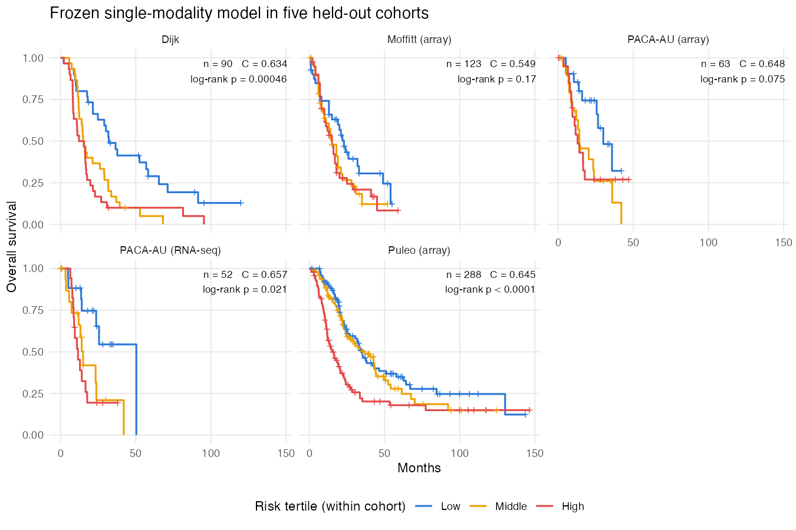

<!-- REVISIT R9 START -->

::: {.draft-status}
**Status: initial draft awaiting independent review.** This report describes methods and evidence available through October 12, 2026. It has not yet been reviewed independently, and it is not ready to share beyond the immediate project team. Every quantitative statement is traced to a saved output in `paper/writeup/source_inventory.csv`; claims that could not be traced are omitted or listed as evidence gaps. The planned manuscript authors are Walther, Liu, and Rashid. DeSurv [@Young2026] is cited throughout as the source of the gene-screening rule and the published factor gene lists.
:::

<!-- REVISIT R9 END -->

# Summary of current findings {.unnumbered}

<!-- REVISIT R9 START -->

::: {.findings}
**What the models are.** Both models factor molecular data into nonnegative patient activities $L$ and feature loadings $F$, and link survival to the observable projection of each patient's data onto the loadings, $\eta = (YF)\beta$. The single-modality model fits one feature block. The multimodal model shares $L$ across matched expression and methylation blocks, adds per-feature intercepts and signed loadings, and propagates loading uncertainty into its coefficient updates.

**What the evaluated single-modality configuration does.** In the configuration behind all single-modality results ($\alpha_F = 0$), survival informs the coefficients $\beta$ but not the loadings $F$ or the activities $L$. The programs are therefore the programs of an empirical-Bayes factorization of the training data; survival selects and weights them. This is not the intended final method (@sec-continuing).

**Single-modality performance.** Trained on TCGA-PAAD RNA-seq and CPTAC proteomics ($n = 273$), the frozen model has a mean concordance of 0.627 across five held-out cohorts ($n = 616$). Against an independently tuned two-step comparator (40 unsupervised factors, LASSO Cox), the C-index difference computed on the 616 concatenated patients is 0.026 (95% bootstrap interval 0.000 to 0.050). Against a two-step comparator given the same rank of 7 the difference is 0.011 ($-0.013$ to $0.033$).

**Single-modality biology.** Starting from rank 7, four programs are retained and two are classified as survival-active. The adverse program (7) aligns with the basal-like axis and the protective program (3) with the classical axis; the two genomics-only programs read as desmoplastic stroma (5) and immune infiltrate with a vascular component (6). These labels rest on enrichment, subtype concordance and gene-list overlap analyses that share inputs and were not prespecified.

**Multimodal model.** In simulation, the framework with intercepts, signed loadings, empirical-Bayes priors and evidence-based pruning returns close to the true rank of 3 from every starting rank at moderate noise, and converges in all 162 of its fits. It does not recover a planted low-variance prognostic program at moderate noise. On real data, nothing is pruned at any starting rank, most fits reach the 500-sweep cap, and external concordance on 50 primary-PDAC ICGC donors varies from 0.50 to 0.69 across starting ranks. At starting rank 7 the joint fit has $C = 0.685$ and the expression-only fit of the same framework $C = 0.676$; both are unconverged. Methylation adds a methylation-dominant program and loads on an immune program; it does not demonstrably improve prediction.

**Main open problems.** Survival-guided discovery of programs, a rank-selection rule that accounts for both survival and reconstruction on real data, full convergence of real multimodal fits, feature-count sensitivity, matched comparisons with DeSurv and unsupervised factorization, and a methylation-specific biological interpretation (@sec-gaps).
:::

<!-- REVISIT R9 END -->

# Methods {#sec-methods}

## Notation {#sec-notation}

Patients are indexed by $i = 1, \dots, n$, molecular features by $j$, factors (programs) by $k = 1, \dots, K$, and data blocks (modalities) by $m$. Patient $i$ has observed time $t_i$ and event indicator $\delta_i$ (1 for death, 0 for censoring). The single-modality data are an $n \times p$ matrix $Y$; the multimodal data are matched blocks $Y_m$ of dimension $n \times p_m$, here expression ($m = \mathrm{expr}$) and DNA methylation ($m = \mathrm{meth}$). Methylation measurements are written $Y_{\mathrm{meth}}$; the symbol $\beta$ is reserved for survival coefficients.

Three patient-level quantities must be kept apart: the **latent activities** $L \in \mathbb{R}_{\ge 0}^{n \times K}$, posterior scores in the reconstruction $Y \approx LF^\top$, defined only for training patients; the **projection scores**, the observable product of a patient's data with the posterior-mean loadings, which enter the Cox predictor and can be computed for new patients ($\tilde Z$ in @eq-zf, $Z$ in @eq-mm-z); and the **signature scores** used only in biological characterization, the mean of within-cohort z-scored expression over a selected gene set.

<!-- REVISIT R2 START -->
<!-- REVISIT R4 START -->
<!-- REVISIT R1 START -->
<!-- REVISIT R3 START -->

| | Single-modality model (evaluated configuration D4) | Multimodal model (evaluated framework) |
|----------------|------------------------------------|------------------------------------|
| Data | One block $Y$ ($n \times p$); training on TCGA-PAAD RNA-seq and CPTAC proteomics, per-platform standardized | Matched blocks $Y_{\mathrm{expr}}$, $Y_{\mathrm{meth}}$; TCGA-PAAD, log2 expression and methylation $\beta$-values |
| Reconstruction | $Y = L F^\top + E$ | $Y_m = \mathbf{1}\mu_m^\top + L F_m^\top + E_m$, shared $L$ |
| Activity prior $L_{ik}$ | Point-exponential, fitted per factor by empirical Bayes | Point-exponential, fitted per factor by marginal likelihood (`ebnm`) |
| Loading prior | Point-exponential ($F \ge 0$) | Point-Laplace per modality and factor (signed $F_m$) |
| Residual precision | Feature-specific $\tau_j$, maximum likelihood | Feature-specific $\tau_{mj}$, maximum likelihood |
| Cox predictor | $\eta = \tilde Z \tilde\beta$, $\tilde Z = Y \bar F D^{-1}$ | $\eta = Z\beta$, $Z = \sum_m \tilde Y_m F_m$ |
| Coefficient prior | Normal, variance estimated per factor | Normal, variance estimated per factor |
| Survival in the loading update | None ($\alpha_F = 0$) | Yes, equal weight, with feature coupling |
| Uncertainty in the coefficient update | Projection treated as fixed (plug-in) | Projection mean and variance from $q(F_m)$ |
| Scale handling | Loadings normalized to unit length inside $\tilde Z$ | Each factor rescaled so that $\mathrm{sd}(Z_k) = 1$ after every update |
| Stopping rule | Relative change $< 10^{-5}$ in a weighted monitoring objective; cap 300 | Relative change $< 10^{-4}$ in reconstruction and $\eta$; cap 500 sweeps |
| Rank handling | Start at $K = 7$; classify factors after fitting | Start at $K_{\mathrm{init}}$; remove factors by an evidence check, then refit |
| New-patient prediction | $\eta_{\mathrm{new}} = y_{\mathrm{new}}^\top \bar F D^{-1}\tilde\beta$, frozen orientation | $\eta_{\mathrm{new}} = \sum_m y_{m,\mathrm{new}}^\top \bar F_m \beta$, frozen orientation |

: Model and notation summary. Settings are those of the evaluated fits, not package defaults. $\bar F$ denotes posterior means, $D = \mathrm{diag}(\lVert \bar F_{\cdot k}\rVert_2)$, and $\tilde Y_m$ is $Y_m$ centered at the current intercept. Sources: S04, S08, S29, S37. {#tbl-models}

<!-- REVISIT R3 END -->
<!-- REVISIT R1 END -->
<!-- REVISIT R4 END -->
<!-- REVISIT R2 END -->

## Single-modality model {#sec-single-model}

<!-- REVISIT R1 START -->
<!-- REVISIT R2 START -->

**Reconstruction and priors.** The training matrix is modeled as
$$
y_{ij} = \sum_{k=1}^K L_{ik} F_{jk} + e_{ij}, \qquad e_{ij} \sim N(0, \tau_j^{-1}),
$$ {#eq-recon}
with independent point-exponential priors $L_{ik} \sim g_{L,k}$ and $F_{jk} \sim g_{F,k}$ (a point mass at zero mixed with an exponential distribution), whose parameters are estimated by empirical Bayes within each factor using the `ebnm` package. Each feature has its own residual precision $\tau_j$, estimated by maximum likelihood.

**Survival predictor.** Survival follows a Cox model whose linear predictor is the normalized projection of the patient's data onto the posterior-mean loadings:
$$
\eta_i = \sum_{k=1}^K \tilde Z_{ik}\tilde\beta_k, \qquad \tilde Z = Y \bar F D^{-1}, \quad D = \mathrm{diag}\big(\lVert \bar F_{\cdot 1}\rVert_2, \dots, \lVert \bar F_{\cdot K}\rVert_2\big).
$$ {#eq-zf}
Each column of $\bar F D^{-1}$ has unit Euclidean length, so $\tilde Z_{ik}$ is the coordinate of $y_i$ along program $k$'s loading direction. The normalization keeps $\tilde Z$ on a scale that does not grow with $p$; without it, coefficient shrinkage drove every $\tilde\beta_k$ to zero (S04). The coefficients $\tilde\beta_k$ have independent normal priors with zero mean and a variance estimated per factor, so they are interpreted per unit of normalized projection, not per standard deviation. Because $\tilde Z$ depends only on $Y$ and $\bar F$, the same formula scores training and new patients.

**Cox working approximation.** The Cox partial likelihood is replaced at each sweep by a second-order expansion around the current predictor $\hat\eta$ with a diagonal Breslow curvature,
$$
\log \mathrm{PL}(\eta) \approx \mathrm{const} - \tfrac12 \sum_i w_i (z_i - \eta_i)^2, \qquad w_i = \hat\theta_i \hat H_0(t_i), \quad z_i = \hat\eta_i + (\delta_i - w_i)/w_i,
$$ {#eq-cox-working}
where $\hat\theta_i = \exp(\hat\eta_i)$ and $\hat H_0$ is the Breslow cumulative baseline hazard. Off-diagonal curvature is dropped. [Appendix A](#sec-appendix-a) derives each coordinate update from this surrogate.

**Where survival enters.** Two weights appear in the implementation. The survival weight $\alpha \in [0,1]$ multiplies the survival term in the coefficient update; the evaluated value is $\alpha = 0.5$, which leaves the pseudo-observation $B/A$ unchanged and halves its precision. The loading weight $\alpha_F$ mixes a reconstruction contribution, with weight $1 - \alpha_F$, and a survival contribution, with weight $\alpha_F$, in the update of $F$. The evaluated configuration uses $\alpha_F = 0$. The activities $L$ do not appear in $\eta$, so their update is a reconstruction update in every configuration. Consequently, in the evaluated fits survival determines $\tilde\beta$ but not $L$ or $F$; it affects which programs are scored as prognostic, not what the programs are. The coefficient update also treats $\tilde Z$ as fixed: it does not propagate posterior uncertainty in $F$ (@tbl-math-vs-impl).

<!-- REVISIT R2 END -->
<!-- REVISIT R1 END -->

## Single-modality fitting algorithm and prediction {#sec-single-algorithm}

<!-- REVISIT R1 START -->
<!-- REVISIT R2 START -->

::: {.callout-note appearance="simple" icon=false}
## Algorithm 1. Evaluated single-modality fit (`fit_cox_on_yf()`, configuration D4)

**Input:** standardized training matrix $Y$ ($n = 273$, $p = 2{,}064$), $(t_i, \delta_i)$, starting rank $K = 7$, $\alpha = 0.5$, $\alpha_F = 0$, normal coefficient prior.

1. **Initialize** $\bar L, \bar F$ from the absolute values of the leading $K$ singular vectors of $Y$ scaled by $\sqrt{d_k}$; set $\tilde\beta = 0$ and $\tau_j = 1/\widehat{\mathrm{var}}(y_{\cdot j})$.
2. **For each outer iteration** (at most 300):
   a. Form $D$ and $\tilde Z = Y\bar F D^{-1}$; compute $\eta = \tilde Z\bar{\tilde\beta}$ and the working quantities $(w, z)$ of @eq-cox-working. These are held fixed for the rest of the iteration.
   b. **For $k = 1, \dots, K$:**
      i. update $q(\tilde\beta_k)$ from $A = \alpha\sum_i w_i \tilde Z_{ik}^2$ and $B = \alpha\sum_i w_i \tilde Z_{ik}(z_i - \eta_{i,-k})$ by empirical-Bayes normal means with pseudo-observation $x = B/A$ and standard error $A^{-1/2}$;
      ii. update $q(L_{\cdot k})$ from the reconstruction residual excluding factor $k$ (no survival term);
      iii. update $q(F_{\cdot k})$ from the reconstruction residual only ($\alpha_F = 0$).
   c. Update $\tau_j = n / \sum_i E(y_{ij} - L_i^\top F_j)^2$.
   d. Compute the monitoring objective $J = (1-\alpha)G + \alpha p S - \mathrm{KL}$ ([Appendix A.8](#sec-appendix-a-objective)). Stop after iteration 5 if $|\Delta J|/|J| < 10^{-5}$.
3. **Orientation.** Compare the training concordance of $\eta$ with 0.5 and, if needed, negate $\bar{\tilde\beta}$ once. The saved D4 fit predates the September 4 correction of this check, so its $\eta$ is a good-prognosis score; it is scored as $\mathrm{risk} = -\eta$ for every held-out cohort (@sec-orientation).
4. **Classify** factors (@sec-classification).

**Output:** $\bar L$, $\bar F$, $D$, $\bar{\tilde\beta}$, $\tau$. **Prediction:** for a new patient with standardized data $y_{\mathrm{new}}$ restricted to the training genes that are measured, $\mathrm{risk}_{\mathrm{new}} = -\,y_{\mathrm{new}}^\top \bar F D^{-1}\bar{\tilde\beta}$, with all quantities fixed from training.
:::

<!-- REVISIT R2 END -->
<!-- REVISIT R1 END -->

<!-- REVISIT R5 START -->

The saved D4 fit met the stopping rule at iteration 20 (S04, S58). The monitoring objective weights the reconstruction and survival terms by $1-\alpha$ and $\alpha p$; it is used to decide when to stop and is not the evidence lower bound of a single generative model. The coefficient posterior variances stored with this historical fit equal zero to machine precision, consistent with the pre-September sign-correction code, which overwrote $E(\tilde\beta^2)$ with $E(\tilde\beta)^2$ when it negated the coefficients (S01, 2026-09-04 entry). The report therefore gives no coefficient uncertainty for this fit.

<!-- REVISIT R5 END -->

### Risk orientation {#sec-orientation}

<!-- REVISIT R2 START -->

A concordance index requires a direction: which end of the score indicates higher risk. That direction must be fixed from training data alone; choosing it in each validation cohort from that cohort's outcomes would bias the index upward. For the saved D4 fit, $\eta = \tilde Z\tilde\beta$ is concordant with longer survival, and `make_km_figures.R` and `run_external_ci_analysis.R` use the single global convention $\mathrm{risk} = -\eta$ for all held-out cohorts (S01, S49). On the risk scale, the coefficient of Program 7 is $+0.040$ and that of Program 3 is $-0.012$. This convention is specific to the historical saved fit and is not a rule for current fits, whose orientation step was corrected on September 4.

<!-- REVISIT R2 END -->

## Programs, starting rank, and classification {#sec-classification}

<!-- REVISIT R4 START -->

Three counts must be kept apart. The **starting rank** $K_{\mathrm{init}}$ is the number of factors at initialization. A factor is **survival-active** if $|\bar{\tilde\beta}_k| > 0.001$. A factor that is not survival-active is **genomics-only** if its proportion of variance explained, $\mathrm{PVE}_k = \lVert \bar L_{\cdot k}\rVert^2 \lVert \bar F_{\cdot k}\rVert^2 / \lVert Y \rVert_F^2$, exceeds 1%, and **dead** otherwise. The **retained molecular programs** are the survival-active and genomics-only factors together. In the single-modality model this is a classification of one fitted model: no factor is removed and nothing is refitted. The two thresholds are operational. The coefficient threshold was set from the observed scale of $\tilde\beta$ in this model (S37), and neither threshold is a posterior probability.

The starting rank of 7 has two sources. It was first chosen by five-fold cross-validated training concordance with a one-standard-error rule: the best mean was at $K = 8$ (0.651, SE 0.026), and $K = 7$ was the smallest rank within one standard error (0.633; S55). It was retained after a sweep over $K_{\mathrm{init}} = 2, \dots, 20$ in which the criteria disagreed (@sec-results-rank). External concordance in the five held-out cohorts reaches a plateau at $K_{\mathrm{init}} = 7$, and that plateau was part of the evidence for keeping 7. The recommendation is therefore not purely training-selected.

<!-- REVISIT R4 END -->

## Multiple cohorts in the single-block model {#sec-multicohort}

<!-- REVISIT R5 START -->

The established model fits one feature block pooled from two training cohorts on different platforms: TCGA-PAAD RNA-seq ($n = 144$) and CPTAC mass-spectrometry proteomics ($n = 129$). CPTAC is a proteomics cohort, not a second RNA-seq cohort (S03). Genes are screened separately in each cohort by the DeSurv combined mean-and-variance rank [@Young2026], keeping the top 3,000 per cohort; the intersection has 2,064 genes. Each cohort is then standardized gene by gene to mean 0 and standard deviation 1 (per-platform standardization). Held-out cohorts receive the same per-platform standardization and are scored on the training genes they measure.

Three optional cohort terms are distinct model components: `cohort_id` adds cohort indicator columns to $L$ (a genomic offset), `strata_id` forms Cox risk sets within cohort (a cohort-specific baseline hazard), and `beta_cohort_id` gives each cohort its own partially pooled coefficients. The recommended configuration uses none of them; the decision record reports the last two as performance-neutral externally (S01).

<!-- REVISIT R5 END -->

## Multimodal model {#sec-mm-model}

<!-- REVISIT R3 START -->

**Reconstruction.** For matched blocks $m \in \{\mathrm{expr}, \mathrm{meth}\}$,
$$
Y_m = \mathbf{1}\mu_m^\top + L F_m^\top + E_m, \qquad (E_m)_{ij} \sim N(0, \tau_{mj}^{-1}),
$$ {#eq-mm-recon}
with a feature intercept $\mu_m$ re-estimated at each outer sweep, shared nonnegative activities $L$ (point-exponential prior per factor), modality-specific signed loadings $F_m$ with a point-Laplace prior $g_{mk}$ for each modality and factor, and feature-specific precisions $\tau_{mj}$. The intercept is what makes signed loadings appropriate: $F_m$ describes deviations from each feature's baseline, and $L$ remains interpretable as program activity. Prior parameters for $L$ and $F_m$ are estimated by marginal likelihood after each sweep, so a whole column can shrink to the point mass at zero.

**Survival predictor.** With $\tilde Y_m = Y_m - \mathbf{1}\mu_m^\top$, the joint projection and predictor are
$$
Z = \sum_m \tilde Y_m F_m, \qquad \eta_i = \sum_k Z_{ik}\beta_k, \qquad \beta_k \sim N(0, \sigma_k^2).
$$ {#eq-mm-z}
The projection is not normalized; instead, after every factor update, $(L_{\cdot k}, F_{mk}, \beta_k)$ is replaced by $(c_k L_{\cdot k}, F_{mk}/c_k, c_k\beta_k)$ with $c_k = \mathrm{sd}(Z_{\cdot k})$, which leaves both $L F_m^\top$ and $\eta$ unchanged and fixes $\mathrm{sd}(Z_{\cdot k}) = 1$ in training. This canonicalization removes the scale direction along which survival and reconstruction terms can otherwise drift (S01, 2026-10-02 entry). Posterior second moments and prior rates are transformed under the same change of variables. A constant shift of $\eta$ leaves the partial likelihood unchanged, so the intercept does not affect the survival term.

**Updates.** The loading update adds reconstruction and Cox working terms with equal weight and couples features through the projection, so features are updated one at a time with the projection moments refreshed after each. The coefficient update uses $E(Z_{ik}^2) = E(Z_{ik})^2 + \mathrm{Var}(Z_{ik})$, so loading uncertainty shrinks the coefficient. [Appendix B](#sec-appendix-b) gives the derivations.

**Evidence and factor removal.** The objective used for factor removal is
$$
\mathcal{E} = \sum_{m,j}\Big[\tfrac n2 \log\tfrac{\hat\tau_{mj}}{2\pi} - \tfrac{\hat\tau_{mj}}2 E\lVert \tilde y_{mj} - L f_{mj}\rVert^2\Big] + \log \mathrm{PL}\big(E(\eta)\big) - \mathrm{KL}(q\,\Vert\, g),
$$ {#eq-mm-elbo}
with $\hat\tau$ at its maximum-likelihood value. The survival term is the partial log-likelihood at the posterior mean predictor (a plug-in), not its expectation under $q$. After the coordinate loop, the change in $\mathcal{E}$ from deleting each factor is computed with the other factors fixed and the intercept and precisions re-estimated; if a deletion does not lower $\mathcal{E}$, the factor with the largest gain is removed and the model refitted, repeatedly. The check runs whether or not the loop converged (S08).

<!-- REVISIT R4 START -->

**Classification.** A factor is reconstruction-active if its share of total sum of squares, $\sum_m\lVert \bar L_{\cdot k}\bar F_{mk}^\top\rVert_F^2 / \sum_m\lVert\tilde Y_m\rVert_F^2$, is at least 1%, and survival-active if $|E\beta_k|/\mathrm{sd}(\beta_k) \ge 1.96$. These are reported separately from removal.

<!-- REVISIT R4 END -->

<!-- REVISIT R3 END -->

## Multimodal fitting algorithm {#sec-mm-algorithm}

<!-- REVISIT R3 START -->
<!-- REVISIT R2 START -->

::: {.callout-note appearance="simple" icon=false}
## Algorithm 2. Evaluated multimodal fit (`fit_multimodal_yfb()`, pruned framework)

**Input:** raw training blocks $Y_m$ (log2 expression, methylation $\beta$-values), $(t_i, \delta_i)$, starting rank $K_{\mathrm{init}}$. Controls: intercept on; point-Laplace loading priors; marginal-likelihood prior updates; feature-specific maximum-likelihood $\tau$; plug-in survival term; pruning on; at most 500 outer sweeps of 5 inner sweeps; tolerance $10^{-4}$.

1. **Initialize** $\mu_m$ at column means; $\bar L$ and $\bar F_m$ from absolute singular vectors of the concatenated centered blocks; $\tau_{mj}$ from the pooled variance of each block; $\beta$ from a Cox fit on standardized initial projections, transformed back to the raw projection scale.
2. **For each outer sweep** (at most 500):
   a. Re-estimate $\mu_m$ and re-center $\tilde Y_m$. Compute $E(Z)$, $\mathrm{Var}(Z)$, $E(\eta)$, and the Cox working quantities $w_i$ and $h_i = u_i + w_i E(\eta_i)$; hold $(w, h)$ fixed for this outer sweep.
   b. **Repeat 5 inner sweeps; for $k = 1, \dots, K$:**
      i. update $q(L_{\cdot k})$ from both blocks' reconstruction residuals; refit its point-exponential prior;
      ii. for each modality, update $q(f_{mjk})$ feature by feature with reconstruction and survival terms, refreshing $E(Z_{\cdot k})$ and $\mathrm{Var}(Z_{\cdot k})$ after each feature; refit the point-Laplace prior $g_{mk}$;
      iii. update $q(\beta_k)$ with $A = \sum_i w_i E(Z_{ik}^2)$, $B = \sum_i E(Z_{ik}) h_{i,-k}$, and prior variance $\sigma_k^2 = \max(0, B^2/A^2 - 1/A)$;
      iv. canonicalize factor $k$ so that $\mathrm{sd}(Z_{\cdot k}) = 1$.
   c. Update $\tau_{mj} = n / E\lVert\tilde y_{mj} - L f_{mj}\rVert^2$.
   d. Stop if the maximum relative change in each fitted reconstruction $\bar L\bar F_m^\top$ and in $E(\eta)$ is below $10^{-4}$.
3. **Removal check.** Compute the change in @eq-mm-elbo from deleting each factor; if the largest change is $\ge 0$, delete that factor, refit from the remaining factors (returning to step 2 with a warm start), and repeat.

**Output:** posterior moments, priors, $\mu_m$, $\tau$, classification. **Prediction:** $\mathrm{risk}_{\mathrm{new}} = \sum_m y_{m,\mathrm{new}}^\top\bar F_m\bar\beta$, with orientation fixed from training (`flip = FALSE`). Centering new data at the training intercept would change every score by the same constant and leave the C-index unchanged.
:::

<!-- REVISIT R2 END -->
<!-- REVISIT R3 END -->

## Approximations and what the objectives do not guarantee {#sec-approximations}

<!-- REVISIT R1 START -->
<!-- REVISIT R3 START -->

Each coordinate update is exact for the quadratic Cox surrogate at fixed working quantities, but the surrogate changes between sweeps, its curvature is diagonal, the single-modality monitor reweights its components, and the multimodal removal objective evaluates survival at $E(\eta)$. Neither algorithm is therefore exact coordinate ascent on one evidence lower bound, and neither is guaranteed to increase monotonically. Appendices A and B list each approximation beside the update it affects.

<!-- REVISIT R3 END -->
<!-- REVISIT R1 END -->

The evaluated single-modality configuration with $\alpha_F = 0$ is a stage in the development of the method, not its intended final form. Planned work on survival supervision of the loadings, coefficient priors, and rank selection is described in one place, @sec-continuing.

# Evaluation framework {#sec-evaluation}

## Simulation designs {#sec-sim-designs}

<!-- REVISIT R5 START -->
<!-- REVISIT R6 START -->

**Single-modality, multiple cohorts (S17, S18, S59).** Each dataset has two cohorts of 150 patients and 1,000 genes. True loading columns are the absolute values of unsupervised factorization programs estimated from the real training data, scaled to amplitude 12; feature noise precisions are drawn from Gamma(2, 2). Survival times follow a Weibull proportional-hazards model with predictor $\sum_k L_{ik}\beta_k$ over the shared programs (coefficients recycled from $1.5, -1.2, 0.8, -0.5$), and censoring is calibrated to 30%. Study-specific programs have zero loadings outside their cohort and no survival effect. Three scenarios vary the structure: all shared (six shared programs), hybrid (two shared and two specific per cohort), and nothing shared (three specific per cohort, so no program is prognostic). Each dataset is split 75/25 into training and test patients, stratified by event status. Two arms are fitted at starting ranks 2, 3, 4, 6, 12, and 20 with 15 seeds, giving 540 fits: the single-modality model with the evaluated settings, and a two-step arm consisting of a nonnegative empirical-Bayes factorization (`flashier`, at most $K_{\mathrm{init}}$ factors, backfitted) followed by an unpenalized Cox model on least-squares projection scores. Note that the data-generating predictor uses the latent activities $L$, whereas the model predicts from projections $YF$.

**Multimodal (S25, S26, S59).** Each dataset has 120 training and 120 validation patients, 50 expression and 50 methylation features, and three true programs. Survival follows a Weibull model with predictor $\sum_m Y_m F_m \beta$, matching the model's predictor form. Three scenarios set $\beta$: two prognostic programs ($0.70, 0.35, 0$), adverse and protective ($0.70, -0.70, 0$), and a low-variance prognostic program whose activities are scaled by 0.15 ($\beta = 0, 0, 1.10$). Noise is set by a multiplier on every feature's noise standard deviation: 1 reproduces the September design and 0.25 is lower noise ("moderate"). Each feature is shifted by four noise standard deviations so the data are nonnegative and the original model can be fitted. Starting ranks are 3–10 and 15, with three seeds per setting. Three variants are fitted to every dataset: the original September model (no intercept, nonnegative loadings, moment prior updates, no pruning), the evaluated pruned framework (Algorithm 2), and the same framework with the variance-corrected survival term. The full sweep contains 486 fits, 162 per variant.

<!-- REVISIT R6 END -->
<!-- REVISIT R5 END -->

## Data {#sec-data}

<!-- REVISIT R5 START -->

| Analysis | Cohort | Platform | Patients | Events | Role and preprocessing |
|----------|----------|----------|---:|---:|------------------------------------|
| Single-modality | TCGA-PAAD | RNA-seq | 144 | 139 (pooled) | Training; log2(count+1); screened and standardized within cohort |
| | CPTAC | Mass-spectrometry proteomics | 129 | | Training; provided normalized scale; screened and standardized within cohort |
| | Dijk | RNA-seq | 90 | 81 | External validation |
| | Moffitt | Microarray | 123 | 83 | External validation |
| | PACA-AU array | Microarray | 63 | 38 | External validation |
| | PACA-AU RNA-seq | RNA-seq | 52 | 31 | External validation |
| | Puleo | Microarray | 288 | 181 | External validation |
| | Five external cohorts | | 616 | 414 | Each standardized within cohort; scored on 1,989–2,050 of the 2,064 training genes |
| Multimodal | TCGA-PAAD | RNA-seq + 450K methylation | 144 | 75 | Training; 3,000 genes (DeSurv rank) and 10,000 highest-variance CpGs, screened on TCGA only |
| | ICGC PACA-AU, primary PDAC | RNA-seq + methylation | 50 | 30 | Main validation: all samples primary tumors with PDAC histology |
| | ICGC PACA-AU, all donors | RNA-seq + methylation | 67 | 40 | Sensitivity: adds IPMN with invasion, adenosquamous, acinar and signet-ring tumors |

: Cohorts and preprocessing. Events in the two single-modality training cohorts are reported pooled (139 deaths among 273 patients). The 50 matched ICGC donors overlap the PACA-AU RNA-seq external cohort and are not an additional independent replication; whether the PACA-AU array and RNA-seq cohorts share donors was not checked in the reviewed sources. Sources: S03, S09, S11, S30, S01 (2026-10-01 entry), and the orientation check recorded under S56. {#tbl-cohorts}

<!-- REVISIT R5 END -->

<!-- REVISIT R5 START -->

The matched multimodal cohorts are built from the TCGA and ICGC files with expression and methylation for the same patients (S30). Methylation is restricted to the 305,352 CpGs present in both cohorts' sex-chromosome-filtered probe sets; missing values (0.07% in TCGA) are imputed within cohort by $k$-nearest neighbors. The evaluated multimodal fits use raw inputs: log2 expression and methylation $\beta$-values. Screening uses training data only.

<!-- REVISIT R5 END -->

## Comparators and prediction rules {#sec-comparators}

<!-- REVISIT R7 START -->

**Principal single-modality comparator.** An unsupervised empirical-Bayes factorization (`flashier`, signed point-normal priors, gene-specific variances, greedy fitting with backfitting, at most 40 factors) of the same $273 \times 2{,}064$ training matrix, followed by a LASSO Cox model on projection scores $Y\bar F D^{-1}$ with the penalty chosen by cross-validation (`lambda.min`). The factor count was not informed by the supervised model; 15 of the 40 factors received nonzero coefficients (S10). Held-out patients are scored with the frozen loadings and coefficients.

**Supporting single-modality comparators.** A rank-matched two-step model (7 factors, unpenalized Cox; S12) and the earlier comparator (20 factors, unpenalized Cox; S13). Matching the rank gives the two-step model the supervised model's answer about complexity, and the unpenalized 20-factor model is not regularized; neither is the principal comparison. The output directory `desurv_comparison` contains our own models fitted with DeSurv-aligned and alternative preprocessing (configurations D1–D5); it is not a fitted DeSurv benchmark (S48).

**Multimodal comparators.** On the matched cohorts, the same framework fitted to expression alone (configuration `pruned_expression_only`) isolates the contribution of methylation. Two further arms are reported for completeness: an older isolated single-modality fitter on raw log2 expression (`expression_only_yfb`, which is not the expression-only fit of the evaluated framework) and two-step factorization followed by Cox on stacked or expression-only data (S28). The established single-modality model was trained on different data and preprocessing and is discussed separately (@sec-results-mm-real).

<!-- REVISIT R7 END -->

## Performance metrics and uncertainty {#sec-metrics}

<!-- REVISIT R7 START -->

External performance is Harrell's concordance index with a risk orientation fixed from training. All per-cohort single-modality values in @tbl-external were re-computed during drafting from the saved risk scores with frozen orientation and agree with the saved values to four decimals (S56); some of the saved runners had computed the outcome-oriented $\max(C, 1 - C)$, which coincides with the frozen value in every cohort here. Confidence intervals are percentile bootstrap intervals over patients ($B = 2{,}000$ for single-modality, $1{,}000$ for multimodal; seed 1).

Three summaries of the single-modality comparison are not interchangeable: the **mean external C** averages five cohort C-indices; the **concatenated difference** (principal and rank-matched comparisons) computes one C-index per model over all 616 patients, so comparable pairs cross cohorts, with an unstratified bootstrap; and the **inverse-variance pooled difference** (older comparator) combines per-cohort paired differences. None is an equivalence or non-inferiority test.

Simulation summaries are means over seeds. In the single-modality simulation, test-set concordance is the outcome-oriented $\max(C, 1-C)$ (S17), which is biased upward when there is no signal: in the nothing-shared scenario both arms score about 0.54. In the multimodal simulation, validation concordance uses the frozen orientation. Program recovery is the absolute correlation between a true loading column and its best-matching estimated column; a program counts as recovered at $|r| \ge 0.7$.

<!-- REVISIT R7 END -->

## Biological characterization methods {#sec-characterization-methods}

<!-- REVISIT R8 START -->

The biological labels in @sec-biology come from existing analyses of the established single-modality fit and of the starting-rank-7 multimodal fit. @tbl-char-methods in [Appendix C](#sec-appendix-c) lists, for each analysis, the object analysed, the population, the statistic and settings, the multiplicity scope, and what the output can support. No analysis in this table was rerun for this report.

<!-- REVISIT R8 END -->

<!-- REVISIT R8 START -->

Several of these analyses share inputs and are not independent validations. The custom fgsea collection and the gene-list overlap both use DeSurv's lists, and the selected gene universe was itself screened with DeSurv's rule. The subtype concordance uses training activities $E(L)$ in TCGA, which also trained the model. The original external signature check (C2) scored each program's lowest-padj set; for Program 6 that set was the DeSurv classical-tumor list, the same list used as Program 3's signature, so C2 measured the classical axis rather than Program 6. The corrected control (C4) excludes the entire PDAC_custom collection, including the Moffitt and Bailey lists, and was designed after C2's result; it is a post hoc correction. Multiple-testing control is within program and collection only. The pathway report itself states that these methods were chosen for availability rather than from a review of what the question requires and that the choice warrants assessment before manuscript use (S21). Two further cautions apply to the signature helper: its hazard ratio is per unit of the mean z-scored signature, not per standard deviation, and its concordance output is $\max(C, 1-C)$, which is outcome-oriented and cannot substitute for frozen-risk validation. Those concordance values are not used in this report.

<!-- REVISIT R8 END -->

# Results {#sec-results}

## Single-modality simulation {#sec-results-single-sim}

<!-- REVISIT R6 START -->

@tbl-single-sim and @fig-single-sim in [Appendix C](#sec-appendix-c) summarize the 540 fits. At or above the true rank (6), the model recovers every shared program at $|r| \ge 0.7$ and nearly every study-specific program, and over-specifying the rank to 12 or 20 changes little. The two-step arm recovers fewer programs and stops changing beyond rank 6 because its greedy factorization stops adding factors. The model's test concordance exceeds the two-step arm's by about 0.10 in the hybrid scenario from rank 3 upward and by about 0.02 in the all-shared scenario from rank 6; with nothing prognostic both are near the outcome-oriented null of 0.54. With $\alpha_F = 0$ the model's $L$ and $F$ updates ignore survival, so these differences come from the fitting procedure (singular-vector initialization and coordinate updates versus greedy `flashier`), not from survival supervision. Possible merges, an estimate correlated above 0.5 with two true programs, occurred in a single-seed diagnostic only at starting ranks 2–4 (S19). Among programs without a survival effect, 22%–35% were classified survival-active in the hybrid scenario and 6%–10% with nothing shared.

<!-- REVISIT R6 END -->

<!-- REVISIT R6 START -->

A separate ten-seed simulation tested cohort-specific coefficients for a program that is prognostic in only one cohort (S20). The coefficient in the owning cohort exceeded the other cohort's in 15 of 20 cohort-by-seed cases at starting rank 6 and 17 of 20 at rank 12 (medians 0.060 versus 0.008, and 0.054 versus 0.008); one seed diverged, so medians are the reported summary.

<!-- REVISIT R6 END -->

## Single-modality external validation {#sec-results-external}

<!-- REVISIT R7 START -->

@tbl-external gives per-cohort concordance. The frozen model's mean external C is 0.627 (0.549 in Moffitt to 0.657 in PACA-AU RNA-seq) and the principal comparator's 0.601. Over the 616 concatenated patients the C-indices are 0.629 and 0.603, a difference of 0.026 with 95% interval 0.000 to 0.050; the lower limit is 0.0002, so the advantage is marginal (S11, S56, S60). The rank-matched comparator, which is better in both PACA-AU cohorts, gives a difference of 0.011 ($-0.013$ to $0.033$; S12). The older unpenalized comparator gives 0.042 (0.013 to 0.071), with a per-cohort interval excluding zero only in Puleo (S13).

<!-- REVISIT R7 END -->

<!-- REVISIT R7 START -->

| Cohort | $n$ | Events | Model C (95% CI) | Two-step, 40 factors, LASSO | Two-step, 7 factors | Two-step, 20 factors |
|------------|---:|---:|:----------:|:------:|:------:|:------:|
| Dijk | 90 | 81 | 0.634 (0.555, 0.708) | 0.600 | 0.577 | 0.592 |
| Moffitt | 123 | 83 | 0.549 (0.467, 0.625) | 0.560 | 0.541 | 0.541 |
| PACA-AU array | 63 | 38 | 0.648 (0.553, 0.747) | 0.623 | 0.665 | 0.597 |
| PACA-AU RNA-seq | 52 | 31 | 0.657 (0.544, 0.772) | 0.603 | 0.690 | 0.573 |
| Puleo | 288 | 181 | 0.645 (0.599, 0.688) | 0.618 | 0.643 | 0.602 |
| Mean of five | 616 | 414 | 0.627 | 0.601 | 0.623 | 0.581 |
| Difference, model minus comparator | | | | 0.026 (0.000, 0.050)$^a$ | 0.011 ($-0.013$, 0.033)$^a$ | 0.042 (0.013, 0.071)$^b$ |

: External concordance of the frozen single-modality model (risk $= -\eta$) and two-step comparators. All C-indices use training-fixed orientation (S56). $^a$Difference of C-indices computed on the 616 concatenated patients, bootstrap over patients. $^b$Inverse-variance pooled per-cohort paired differences. The 40-factor LASSO model is the principal comparator; the rank-matched and 20-factor unpenalized models are supporting. Sources: S09, S10, S11, S12, S13, S56, S57, S60. {#tbl-external}

<!-- REVISIT R7 END -->

<!-- REVISIT R7 START -->

Within each cohort, patients were split into tertiles of the frozen risk score (@fig-km-risk). The low-risk tertile has the longest survival in every cohort; the log-rank test has $p < 0.05$ in Dijk ($p = 0.00046$), PACA-AU RNA-seq ($0.021$), and Puleo ($< 0.0001$), and not in PACA-AU array ($0.075$) or Moffitt ($0.17$) (S36). Tertiles are within-cohort descriptive groups, not fixed clinical cutoffs.

{#fig-km-risk fig-alt="Kaplan-Meier curves by risk tertile in five external PDAC cohorts." width="66%"}

<!-- REVISIT R7 END -->

## Starting rank and factor classification {#sec-results-rank}

<!-- REVISIT R4 START -->

At starting rank 7 the established fit has three dead factors, two genomics-only programs (5 and 6), and two survival-active programs (3 and 7); the retained programs explain 1.9%–3.0% of the training variance each (S16, S58). @tbl-rank-sweep shows the starting-rank sweep. The evidence lower bound and BIC both prefer $K_{\mathrm{init}} = 3$; the joint log-likelihood keeps rising to $K_{\mathrm{init}} = 15$; cross-validated survival log partial likelihood is highest at 19; and external concordance is below 0.60 up to rank 6, then lies between 0.626 and 0.628 at every starting rank from 7 to 20 except 11 (0.600) and 13 (0.539). The number of survival-active programs is 1 at starting ranks 2–4 and 2 or 3 from rank 5 upward. Starting rank 7 is the smallest rank on the external-concordance plateau and the rank selected by training cross-validation (@sec-classification). The dated record attributes the dips at ranks 11 and 13 to single-start fitting failures, and an earlier explanation of the gap between ELBO and external performance in terms of reconstruction remains a hypothesis that was not verified (S01).

<!-- REVISIT R4 END -->

<!-- REVISIT R4 START -->

| Starting rank | Survival-active | Genomics-only | ELBO | BIC | CV log PL per event | Mean external C |
|---:|:---:|:---:|---:|---:|---:|---:|
| 3 | 1 | 2 | $-806{,}783$ | 1,575,641 | $-3.222$ | 0.594 |
| 5 | 3 | 1 | $-808{,}550$ | 1,581,604 | $-3.205$ | 0.596 |
| 7 | 2 | 2 | $-810{,}687$ | 1,614,080 | $-3.230$ | 0.627 |
| 9 | 2 | 3 | $-810{,}568$ | 1,623,226 | $-3.212$ | 0.627 |
| 10 | 2 | 3 | $-814{,}091$ | 1,636,335 | $-3.194$ | 0.628 |
| 12 | 2 | 3 | $-820{,}757$ | 1,662,571 | $-3.176$ | 0.627 |
| 15 | 2 | 3 | $-826{,}829$ | 1,697,684 | $-3.195$ | 0.627 |
| 20 | 2 | 3 | $-847{,}947$ | 1,767,490 | $-3.183$ | 0.627 |

: Single-modality starting-rank sweep (selected rows of $K_{\mathrm{init}} = 2, \dots, 20$; all fits converged). ELBO is the monitoring objective at convergence; BIC uses $K_{\mathrm{init}}(n + p + 1)$ parameters; CV log PL is five-fold cross-validated Cox partial log-likelihood per event; external C uses the five held-out cohorts and was part of the evidence for the recommendation. Source: S14. {#tbl-rank-sweep}

<!-- REVISIT R4 END -->

<!-- REVISIT R4 START -->

At starting rank 7 the classification is unchanged (two survival-active, two genomics-only) for coefficient thresholds from $10^{-4}$ to $10^{-2}$ combined with PVE thresholds from 0.1% to 2%. A PVE threshold of 5% removes both genomics-only programs; a coefficient threshold of 0 counts four programs as survival-active because two coefficients are of order $10^{-10}$; and a threshold of 0.05 counts none (S15).

<!-- REVISIT R4 END -->

## Multimodal simulation {#sec-results-mm-sim}

<!-- REVISIT R6 START -->
<!-- REVISIT R4 START -->

With pruning, the final number of programs depends much less on the starting rank (@fig-mm-rank). The original model has no removal step, so its final rank equals the starting rank in all 162 fits. At moderate noise the evaluated framework returns a mean of 3.2–3.3 programs in the two scenarios with high-variance prognostic programs and 2.5 in the low-variance scenario, averaged over starting ranks 3–15, and the means are close to constant from starting rank 4 upward. At the September noise level it returns fewer than three programs on average (1.7–2.0), and the final rank rises with the starting rank, from 1 at starting rank 3 to 2.3–3.3 at ranks 10 and 15; it is therefore not independent of the starting rank in that setting. All 162 fits of the evaluated framework met the convergence criterion, against 27 of 162 for the original model (S26).

<!-- REVISIT R4 END -->

@tbl-mm-sim reports recovery by scenario and noise. At moderate noise, the framework recovers all three programs in the two-prognostic scenario and 2.96 of 3 in the adverse-and-protective scenario, finds 87% of prognostic programs with the correct sign, and has validation C of 0.79–0.80. In the low-variance scenario at moderate noise it recovers about two programs, finds the low-variance prognostic program in none of the 27 fits (recall 0), and classifies 1.26 other programs per fit as survival-active, so survival is attributed to high-variance programs; validation C is 0.63. At the September noise level, recovery is lower (0.93–1.33 programs), but the low-variance prognostic program is found in 52% of fits (48% with the correct sign). That result comes from a setting in which every true program is weak, so it does not show that the method recovers a low-variance program alongside strong ones. The variance-corrected survival term gave nearly identical results (largest difference in any summary in -mm-sim, 0.04). Each cell averages 27 fits from only three simulated datasets per setting, which limits precision.

<!-- REVISIT R6 END -->

<!-- REVISIT R6 START -->

| Noise | Scenario | Final rank | Programs recovered (of 3) | Prognostic found, correct sign | False survival-active | Validation C | Converged |
|----------|--------------------|:---:|:---:|:---:|:---:|:---:|:---:|
| Moderate | Two prognostic | 3.26 | 3.00 (2.74) | 0.87 | 0.67 | 0.80 | 1.00 (0.07) |
| Moderate | Adverse + protective | 3.22 | 2.96 (2.78) | 0.87 | 0.59 | 0.79 | 1.00 (0.37) |
| Moderate | Low-variance prognostic | 2.48 | 1.96 (2.00) | 0.00 | 1.26 | 0.63 | 1.00 (0.19) |
| September | Two prognostic | 1.74 | 1.19 (0.11) | 0.57 | 0.44 | 0.79 | 1.00 (0.07) |
| September | Adverse + protective | 1.96 | 1.33 (0.59) | 0.67 | 0.52 | 0.80 | 1.00 (0.22) |
| September | Low-variance prognostic | 1.96 | 0.93 (0.15) | 0.48 | 1.15 | 0.81 | 1.00 (0.07) |

: Multimodal simulation, evaluated pruned framework; values in parentheses are the original September model on the same datasets. Each cell averages 27 fits (starting ranks 3–10 and 15, three seeds). "Prognostic found, correct sign" is the fraction of true prognostic programs matched at $|r| \ge 0.7$ by a survival-active estimate with the correct coefficient sign. "False survival-active" counts survival-active estimates not matched to a true prognostic program. Validation C uses frozen orientation on 120 validation patients. Source: S26, S27. {#tbl-mm-sim}

<!-- REVISIT R6 END -->

<!-- REVISIT R6 START -->
<!-- REVISIT R4 START -->

![Final number of programs after pruning, against starting rank, in the multimodal simulation (true rank 3, dashed line). Lines show the evaluated pruned framework in each scenario: points are means over three seeds and vertical bars span the seeds; points are offset horizontally for legibility. The original September model is not drawn: it has no removal step, so its final rank equals the starting rank in every fit. The variance-corrected variant is omitted because no summary in @tbl-mm-sim differs from the plotted framework by more than 0.04. Noise is a multiplier on every feature's noise standard deviation. Sources: S26, S62; drawn for this report by `figures/make_pruning_rank_figure.R` from the saved sweep, replacing the progress-chapter figure.](figures/multimodal_pruning_final_rank.png){#fig-mm-rank fig-alt="Two-panel line chart of final rank against starting rank. At moderate noise the three scenario lines stay near three programs; at September noise they start at one and rise to about two to three." width="80%"}

<!-- REVISIT R4 END -->
<!-- REVISIT R6 END -->

## Multimodal real-data validation {#sec-results-mm-real}

<!-- REVISIT R7 START -->

@tbl-mm-real compares models on the same 50 primary-PDAC ICGC donors and the 67-donor sensitivity set at starting rank 7. The joint expression-and-methylation fit has $C = 0.685$ (0.579, 0.779) and the expression-only fit of the same framework $C = 0.676$ (0.569, 0.770). Both fits stopped at the 500-sweep cap without meeting the convergence criterion. The difference of 0.010 is small relative to either interval and was not tested; similar observed concordance is not evidence of equivalence. On all 67 donors the order reverses (0.639 and 0.653). The two-step comparators have concordance below 0.53, and the September version of the joint model 0.453.

The October progress chapter (S39) reports that the established single-modality model has $C = 0.685$ on the same 50 donors. That value is hard-coded in the plotting script, and no saved score file or computation was found for it during drafting, so it is not used here as a verified result; it appears in the evidence-gap table (@tbl-gaps). The established model was in any case trained on different data (TCGA and CPTAC, per-platform standardized, 2,064 genes), and the 50 donors overlap the PACA-AU RNA-seq cohort on which it was already evaluated.

<!-- REVISIT R7 END -->

<!-- REVISIT R7 START -->

| Model (training: TCGA, $n = 144$) | Data | ICGC primary PDAC ($n = 50$, 30 events) | ICGC all donors ($n = 67$, 40 events) | TCGA training | Converged |
|----------------------------------|----------|:------:|:------:|:------:|:---:|
| Evaluated framework, joint | Expression + methylation | 0.685 (0.579, 0.779) | 0.639 (0.547, 0.734) | 0.638 | No (500 sweeps) |
| Evaluated framework, expression only | Expression | 0.676 (0.569, 0.770) | 0.653 (0.568, 0.744) | 0.644 | No |
| September joint model | Expression + methylation | 0.453 (0.319, 0.599) | 0.442 (0.335, 0.562) | 0.597 | No |
| Older isolated single-modality fitter | Expression | 0.491 (0.364, 0.633) | 0.480 (0.369, 0.581) | 0.594 | – |
| Two-step factorization, then Cox | Expression | 0.525 (0.399, 0.651) | 0.527 (0.425, 0.641) | 0.670 | – |
| Two-step factorization, then Cox | Expression + methylation | 0.424 (0.286, 0.567) | 0.418 (0.310, 0.531) | 0.579 | – |

: Matched-donor comparisons at starting rank 7, frozen orientation, bootstrap 95% intervals. Selectors: `K_init == 7`; the joint and expression-only rows are `method == joint_multimodal_yfb` with `config == pruned` and `config == pruned_expression_only`; the older fitter is `method == expression_only_yfb`; the September model is `config == original`. Source: S28. {#tbl-mm-real}

<!-- REVISIT R7 END -->

<!-- REVISIT R4 START -->
<!-- REVISIT R7 START -->

@tbl-mm-kinit shows every starting rank. No factor was removed at any starting rank: the final rank equals the starting rank in all nine fits (S28). Only the fits at ranks 3 and 4 met the convergence criterion; the other seven stopped at the cap, and the removal check ran on those unconverged fits (@sec-mm-model). Concordance on the 50 primary donors ranges from 0.500 at rank 5, where no program is survival-active and every patient receives the same score, to 0.685 at rank 7; the median over the nine ranks is 0.572. The number of survival-active programs ranges from 0 to 11 and rises with the starting rank, while concordance does not. Rank 7 was chosen in advance as the single-modality default, but it is also the rank with the highest validation concordance in this sweep, so the headline rank-7 results are favourable relative to the other ranks.

| Starting rank | 3 | 4 | 5 | 6 | 7 | 8 | 9 | 10 | 15 |
|---|---|---|---|---|---|---|---|---|---|
| Final rank | 3 | 4 | 5 | 6 | 7 | 8 | 9 | 10 | 15 |
| Survival-active programs | 0 | 1 | 0 | 0 | 1 | 2 | 1 | 3 | 11 |
| Converged | Yes | Yes | No | No | No | No | No | No | No |
| ICGC primary C | 0.557 | 0.574 | 0.500 | 0.546 | 0.685 | 0.589 | 0.572 | 0.650 | 0.547 |
| ICGC all-donor C | 0.499 | 0.502 | 0.500 | 0.522 | 0.639 | 0.545 | 0.547 | 0.610 | 0.532 |

: Joint multimodal fits across starting ranks (`config == pruned`, `method == joint_multimodal_yfb`). Source: S28. {#tbl-mm-kinit}

<!-- REVISIT R7 END -->
<!-- REVISIT R4 END -->

<!-- REVISIT R4 START -->

The October progress chapter (S39) attributes the absence of pruning to each program's molecular reconstruction gain being far larger than its complexity cost, with survival changing the evidence by at most a few units. That per-program decomposition was not traced to a saved output during drafting and is not quantified here. The plug-in survival term contributes on the scale of a 75-event partial likelihood, while the reconstruction term sums over $144 \times 13{,}000$ molecular values, so in the evaluated objective survival can have little influence on which programs are retained.

<!-- REVISIT R4 END -->

# Biological findings {#sec-biology}

## Single-modality programs {#sec-bio-single}

<!-- REVISIT R8 START -->

The established fit retains four programs (@tbl-bio-single). Each label below is tied to the analyses of @tbl-char-methods that support it. Two general points apply. First, the loadings of these programs were estimated without survival ($\alpha_F = 0$), so the biology describes the dominant expression structure of the training data, which survival then weights; it is not evidence of survival-guided discovery. Second, the normalized enrichment scores are modest (1.05–1.29 for the sets cited), the fgsea test is one-sided toward high loadings, and multiplicity is controlled only within each program and collection.

**Program 7: adverse, basal-like.** Its highest loadings combine glycolytic genes (GAPDH, ENO1, TPI1, PGK1, LDHA) with integrin and receptor-tyrosine-kinase genes (ITGA3, ITGB4, MET, CDCP1). Its enriched sets include DeSurv's basal-like list (padj 0.0006), KEGG growth-factor RTK–PI3K and RAS–ERK pathways (padj 0.001) and Bailey squamous (padj 0.03) (S22). Training activities correlate with PurIST basal-like probability ($\rho = 0.58$; S23); its top genes overlap only DeSurv's basal-like list (Jaccard 0.18; S35); the basal-like signature has HR above 1 in all five external cohorts (1.30–2.40 per unit of mean score, $p < 0.05$ in two; S24); and projection tertiles separate external survival (@fig-km-programs). It corresponds to an unsupervised factor of the same data ($r = 0.69$, next best 0.33; S45).

**Program 3: protective, classical.** The top genes are epithelial and secretory (CAPN5, LPCAT4, MLPH, SLC45A3, TJP3, GALNT6). The classical label rests mainly on subtype concordance ($\rho = -0.58$) and the classical signature's HR below 1 in all five cohorts (0.42–0.88, $p < 0.05$ in three). The enrichment is less specific: DeSurv's classical and basal-like lists are both enriched (padj 0.017 each), with Moffitt classical and three integrin–FAK sets, and the top genes overlap both lists (Jaccard 0.13 and 0.10). Its unsupervised correspondence is less distinct ($r = -0.72$, next best 0.60).

**Program 5: genomics-only, desmoplastic stroma.** Collagen and fibroblast genes dominate (COL1A2, COL3A1, COL5A2, THBS2, CDH11, SPARC); its twelve sets are led by Hallmark EMT (padj 0.0005), DeSurv's stromal-immune list and extracellular-matrix organization; its top genes overlap only the stromal-immune list (Jaccard 0.18); it leans weakly basal ($\rho = 0.30$); and its EMT signature is not consistently prognostic externally (HR 0.73–1.50, $p < 0.05$ in one cohort; S40).

**Program 6: genomics-only, immune infiltrate with a vascular component.** Lymphoid genes (IKZF1, AKNA, IL10RA, RCSD1, PREX1) are mixed with vascular and basement-membrane genes (APOLD1, COL14A1, TNXB, FBLN5, SLIT3, SPARCL1), so the label keeps both components, following the August 21 report (S21). Most of its 40 sets (S61) are immune GO terms, though the two lowest padj values are DeSurv's classical and stromal-immune lists. It is uncorrelated with the PurIST axis ($\rho = -0.03$) but differs across PurIST calls (Kruskal–Wallis $p = 0.007$), a non-monotonic relation. Scored on its own immune set after the post hoc C4 correction, it has no consistent external association (HR 0.53–1.39, none with $p < 0.05$; S40).

Together, the four programs map onto DeSurv's three published factors, with DeSurv's combined stromal-immune factor divided between a stromal and an immune program. This is gene-list correspondence within a DeSurv-aligned gene universe, not an independent replication of DeSurv and not a predictive comparison with it. The August 21 report also noted that the three dead programs have no enriched sets; their posterior-mean loadings are exactly zero in the saved fit, so that observation follows from the fit and does not corroborate the classification independently.

<!-- REVISIT R8 END -->

<!-- REVISIT R8 START -->

| Program | Class | Label | Risk-scale coefficient | Supporting analyses (rows of @tbl-char-methods) |
|:---:|----------|------------|:---:|------------------------------------|
| 7 | Survival-active | Adverse; basal-like | $+0.040$ | fgsea (DeSurv basal-like, RTK–PI3K/ERK); $\rho = 0.58$ with PurIST; overlap with DeSurv basal-like only; external signature HR $> 1$ in 5/5 cohorts; tertile curves |
| 3 | Survival-active | Protective; classical | $-0.012$ | $\rho = -0.58$ with PurIST; external signature HR $< 1$ in 5/5 cohorts; tertile curves; fgsea and overlap include both classical and basal-like lists |
| 5 | Genomics-only | Desmoplastic stroma | $\approx 0$ | fgsea (EMT, ECM); overlap with DeSurv stromal-immune only; weak basal lean; external signature not consistently prognostic |
| 6 | Genomics-only | Immune infiltrate with a vascular component | $\approx 0$ | fgsea (immune GO terms; DeSurv lists); overlap with stromal-immune and classical lists; non-monotonic subtype relation; corrected external control null |

: Retained single-modality programs at starting rank 7. Risk-scale coefficients are $-\bar{\tilde\beta}_k$ of the saved fit, per unit of normalized projection; they agree in sign with the marginal direction labels. Sources: S16, S21–S24, S35, S40, S45, S58. {#tbl-bio-single}

<!-- REVISIT R8 END -->

<!-- REVISIT R8 START -->

**Direction labels.** Adverse and protective labels follow the marginal association of each program's projection with survival (S01). The pathway report read the stored coefficients ($\tilde\beta_7 = -0.040$, $\tilde\beta_3 = +0.012$) as risk-scale values and described a sign disagreement with the marginal directions. Because the saved fit's $\eta$ is a good-prognosis score (@sec-orientation), the risk-scale coefficients are $+0.040$ for Program 7 and $-0.012$ for Program 3, which agree in sign with the marginal labels. These coefficients are conditional on the other programs and are not interchangeable with the marginal associations.

{#fig-km-programs fig-alt="Kaplan-Meier curves by tertile of Program 3 and Program 7 projection scores in pooled external cohorts." width="66%"}

<!-- REVISIT R8 END -->

## Multimodal programs {#sec-bio-mm}

<!-- REVISIT R8 START -->

The starting-rank-7 joint fit has seven programs (@tbl-bio-mm). Labels are provisional: they come from a manual reading of each program's eight highest positive and six most negative expression loadings, together with the saved loading correlations to three references. No enrichment test and no CpG annotation was performed for these programs. Because the saved correlations are absolute values, the tables cannot show whether a matched pair points in the same direction, and best matches chosen independently for each program need not form a one-to-one alignment; for example, both the immune and stromal programs have their best established-model match in Program 6.

| Program | Provisional label | Label basis: top signed expression genes; correspondence $|r|$ | Share of expr / meth signal | Class | HR per SD, TCGA ($p$) | HR per SD, ICGC ($p$) |
|:---:|----------|------------------------------|:---:|:---:|:---:|:---:|
| 1 | Classical / gastric | + REG4, TFF1, CLDN18, CEACAM5; $-$ CXCL12, ADAM12, CILP. D4 P3 0.79; flash k5 0.79; expr-only 0.87 | 23.5% / 4.8% | Reconstruction | 1.07 (0.58) | 0.79 (0.30) |
| 2 | Immune | + CCL19, CORO1A, PTPRC, CCL21, LTB; $-$ FOXA2, H1F0. D4 P6 0.52; flash k9 0.63; expr-only 0.67 | 5.1% / 20.9% | Reconstruction | 0.85 (0.17) | 0.87 (0.54) |
| 3 | Mixed (no label) | + MIF, TNFRSF6B, CCDC85B, SYT8; $-$ IL6ST, HIPK3, EDIL3. D4 best 0.36; flash k3 0.78; expr-only 0.79 | 31.5% / 0.3% | Reconstruction | 1.00 (0.98) | 1.48 (0.051) |
| 4 | Basal-like vs classical | + S100A2, MUC16, KRT5, KRT6A, KRT17; $-$ CLDN18, LYZ, REG4. D4 P7 0.68; flash k8 0.70; expr-only 0.88 | 6.2% / 4.5% | Both | 1.34 (0.0055) | 1.99 (0.00033) |
| 5 | Normal vs activated stroma | + ADH1B, C7, CHRDL1, PRUNE2; $-$ COL11A1, MMP11, MSLN, COL17A1. D4 P6 0.48; flash k2 0.60; expr-only 0.52 | 4.8% / 1.2% | Reconstruction | 0.75 (0.043) | 0.83 (0.46) |
| 6 | Exocrine / acinar | + CTRB2, CPB1, CPA1, PNLIP, PRSS1; $-$ LRRC15, COL11A1, GREM1. D4 best 0.38; flash k6 0.87; expr-only 0.91 | 28.9% / 9.3% | Reconstruction | 0.92 (0.53) | 1.17 (0.37) |
| 7 | Methylation-only | No expression loading; no expression correspondence | 0% / 58.9% | Reconstruction | 1.11 (0.36) | 0.87 (0.44) |

: Multimodal programs at starting rank 7. Label basis: manual reading of top signed expression genes, plus best absolute loading correlation with the established single-modality programs (D4; 1,781 shared genes), an unsupervised `flash` fit of TCGA expression (14 factors; 3,000 genes), and the expression-only fit of the same framework. Shares are within-modality rank-one shares of fitted signal. Class: reconstruction-active only, or both reconstruction- and survival-active. HRs are univariable, per one within-cohort SD of the joint projection, and unadjusted; 14 tests. ICGC is the 50-donor primary-PDAC set. Sources: S31, S32, S43, S44. {#tbl-bio-mm}

<!-- REVISIT R8 END -->

<!-- REVISIT R8 START -->

The one survival-active program (4) is the basal-like versus classical axis. Its marginal hazard ratio per SD of the joint projection is 1.99 in ICGC ($p = 0.00033$) and 1.34 in TCGA ($p = 0.0055$). It corresponds to established Program 7 ($|r| = 0.68$), and the classical/gastric program (1) corresponds to established Program 3 ($|r| = 0.79$), although Program 1 is not survival-active here. Of the 14 marginal tests, three have $p < 0.05$ (Program 4 in both cohorts and Program 5 in TCGA); no correction for multiplicity was applied.

Methylation contributes in two ways (@fig-mm-share). A methylation-only program carries 58.9% of the fitted methylation signal and has no expression loading. The immune program carries 20.9% of the methylation signal while being defined on the expression side by immune genes. Neither is survival-active, and neither has a marginal association with $p < 0.05$. The basal-like program carries 4.5% of the methylation signal. These shares describe the fitted rank-one reconstruction within each modality. They are not additive proportions of variance, because cross-terms between programs are excluded, and they say nothing about each program's contribution to survival prediction.

The current evidence therefore supports expression-defined program labels and the existence of methylation-dominant structure in the screened CpGs. It does not establish what that structure is. The 10,000 CpGs were chosen by variance, and high-variance CpGs often track cell composition, so the immune and methylation-only programs may reflect composition or technical variation; this is an explanation to test, not a finding.

{#fig-mm-share fig-alt="Grouped bar chart of expression and methylation signal shares for seven multimodal programs." width="62%"}

<!-- REVISIT R8 END -->

<!-- REVISIT R8 START -->

| Completed multimodal characterization | Proposed characterization (not completed evidence) |
|------------------------------|------------------------------|
| Signed top-expression-gene lists and manual provisional labels | Sign-aware, two-sided enrichment of expression loadings; the existing signed enrichment of unsupervised reference factors (S47) shows an alignment convention, not a completed multimodal analysis |
| Within-modality rank-one fitted-signal shares | CpG annotation and genomic-context enrichment |
| Absolute loading correlations with expression-only, established D4, and unsupervised `flash` references | Checks of cell-composition and technical explanations; direction-aware correspondence if later computed |
| Fourteen unadjusted, within-cohort standardized joint-projection Cox associations | Characterization and validation of the final programs after the method work |

: Multimodal characterization completed to date and characterization that remains to be done. Sources: S31, S32, S43, S44, S47, S38. {#tbl-mm-completed}

<!-- REVISIT R8 END -->

# Interpretation and remaining evidence {#sec-interpretation}

## What the current evidence supports {#sec-supports}

<!-- REVISIT R9 START -->

The single-modality model yields a few interpretable programs and a risk score that transfers across platforms, but its advantage over a tuned two-step pipeline is small and marginal, and with $\alpha_F = 0$ that advantage comes from how programs are fitted and coefficients shrunk, not from survival-guided discovery. Its programs match the known basal-like/classical and stromal/immune axes of PDAC. The multimodal framework fixes the September model's failure to remove factors and works as designed in simulation when the true programs explain enough variance; on real data it has not shown that methylation improves prediction, nothing is pruned, and most fits are unconverged. Neither model recovers a planted low-variance prognostic program alongside strong ones, which is the case a supervised factorization exists for.

<!-- REVISIT R9 END -->

## Evidence gaps by claim {#sec-gaps}

<!-- REVISIT R9 START -->

@tbl-gaps lists the six claims a manuscript would need to make, the evidence that exists, the conclusion it justifies now, and what is missing. It records the present state of the evidence; it does not imply that the missing analyses were run for this report.

| Claim | Existing evidence | Source ID, path and selector | Currently justified conclusion | Missing evidence |
|----------|--------------------|--------------------|--------------------|--------------------|
| Value over EBMF or NMF alone | Simulated recovery of shared and specific programs; established Programs 3 and 7 correspond to unsupervised EBMF factors; their pathway results partly agree; multimodal programs correspond to an unsupervised `flash` fit | S18 (`multicohort_sim_results.csv`, scenario × K_init × arm); S19 (`top2_match_diagnostic.csv`); S45 (`T5_ebmf_factor_correspondence.csv`, program 3, 7); S46 (`T6_ebmf_pathway_concordance.csv`: 5 of 13 sets concordant); S32 (`real_factor_comparison.csv`, `reference == flash`) | The programs largely coincide with unsupervised structure; recovery differences in simulation reflect the fitting procedure, not supervision, under $\alpha_F = 0$ | A survival comparison with unsupervised factorization needs an explicit scoring rule (for example, factor scores entered into a Cox model). No NMF comparison was found in the reviewed comparator sources |
| Value over two-step EBMF $\to$ Cox | Principal concatenated difference 0.026 (0.0002, 0.0498) against 40 factors with LASSO; rank-matched difference 0.011 ($-0.013$, 0.033); older unpenalized difference 0.042; simulation two-step arm with unpenalized Cox | S10 (`ebmf_cox_regularized_results.csv`, `k_tag == "k40"`); S11 (`yfb_vs_ebmf_k40_pooled_ci.csv`); S12 (`yfb_vs_ebmf_k7_matched_ci.csv`, `cohort == "POOLED"`); S13 (`external_paired_diff_ci.csv`, pooled row); S18 | A small, marginal advantage over the principal comparator in this benchmark; no advantage shown over the rank-matched comparator | Comparison of the final method with the same comparators in simulation and real data, with replicated starts |
| Value over DeSurv | Gene-list overlap of the four programs with DeSurv's three factors; our models fitted with DeSurv-aligned preprocessing | S35 (`T4_sbmf_desurv_overlap.csv`, program × desurv_factor); S48 (`run_desurv_comparison.R`, configurations D1–D5) | Correspondence of gene lists within a DeSurv-aligned gene universe. No predictive comparison with DeSurv exists in the reviewed sources | A matched head-to-head with DeSurv on the same training and validation data. The directory name `desurv_comparison` does not indicate a DeSurv fit |
| Rank selection accounting for survival and reconstruction | Single-modality sweep with disagreeing criteria and an external-concordance plateau from 7; threshold sensitivity; multimodal simulation final ranks; real multimodal fits never pruned; removal criterion with plug-in survival | S14 (`k_init_sweep_results.csv`); S55 (`kcv_yfb_desurv_corrected.csv`); S15 (`threshold_grid_K7.csv`); S26, S27 (`pruning_comparison*.csv`, `variant == "pruned"`); S28 (`real_sweep_summary.csv`, `K_final`); S01; S08 | Starting rank 7 is supported by training cross-validation and by external performance, which was used in the recommendation; criteria disagree; the multimodal removal step works in simulation but not on real data | A selection rule that combines survival and reconstruction, validated with replicated simulations and without validation outcomes. The dated explanation of the ELBO-versus-performance gap is unverified, and the October per-program evidence decomposition was not traced to a saved output |
| Multimodal added value | Joint and expression-only fits of the same framework on the same 50 donors at starting rank 7; seven programs with modality shares and correspondence | S28 (`K_init == 7`, `cohort == "icgc_primary"`, `method == "joint_multimodal_yfb"`, `config == "pruned"` or `"pruned_expression_only"`); S31 (`real_program_table_K07.csv`); S32 | Similar observed concordance (0.685 and 0.676), both unconverged; methylation adds methylation-dominant structure | A test of improved prediction; converged fits; robustness to starting rank, CpG selection and feature counts. The established single-modality model's C on the same donors (0.685 in the October chapter) is hard-coded in `plot_real_cindex_by_kinit.R` and has no saved score source |
| Biological understanding | Single-modality enrichment, subtype concordance, overlap and external signature checks; multimodal top genes, shares, absolute correspondence and 14 unadjusted HRs | S21–S24, S35, S36, S40–S44, S49, S51–S54 | Descriptive program labels consistent with known PDAC axes; checks share inputs, include a post hoc correction and within-training concordance, and use unadjusted tests and unsigned matching | Mechanism; characterization of the final programs; signed enrichment of multimodal loadings; CpG annotation; assessment of the characterization methods themselves |

: Claim-centered evidence gaps. File names are abbreviated; the full repository path for each source ID is recorded in `source_inventory.csv`. {#tbl-gaps}

<!-- REVISIT R9 END -->

## Limitations {#sec-limitations}

<!-- REVISIT R9 START -->

The external cohorts differ in platform, size and event rate, and two of them come from the same ICGC project; the matched multimodal validation set overlaps one of them. The multimodal real-data results rest on one training cohort of 144 patients with 75 deaths and a 50-donor validation set, so concordance intervals are wide (about $\pm 0.10$). Rank 7 is favourable among the multimodal starting ranks evaluated. The multimodal simulation uses three datasets per setting. Feature screening keeps 3,000 genes and the 10,000 highest-variance CpGs, about 3% of those available, and the effect of that choice is unknown. The single-modality simulation reports outcome-oriented concordance. The saved historical single-modality fit predates the September orientation correction and has no stored coefficient uncertainty. The biological characterization methods were chosen for availability and have not been assessed.

<!-- REVISIT R9 END -->

## Continuing work {#sec-continuing}

<!-- REVISIT R9 START -->
<!-- REVISIT R1 START -->

The configuration with $\alpha_F = 0$ is not the intended final method: a supervised factorization should be able to find a prognostic program that explains little molecular variance, and the evaluated configuration cannot, because survival never enters the loading update. The planned work, recorded in the October 2 follow-up plan and its October 13 sequencing (S38), has five parts. These are plans; no result from them is reported here.

1. **Survival supervision of the loadings.** Diagnose why survival has little effect even when it enters the loading update: its contribution is multiplied by the current coefficient, so a direction no program already points at receives no survival information; its precision is small relative to the reconstruction term; and in the single-modality model the loading scale is not fixed. The work adds the multimodal scale canonicalization to the single-modality model, removes $\alpha_F$ as a separate setting, tests a supervised initialization, and compares a coefficient prior with an explicit survival weight. Success is defined in advance as recovery of a planted low-variance prognostic program in a large majority of simulation seeds, without instability and without loss of external concordance.
2. **Notation and prediction.** Settle the definition of the normalized projection and the coefficient units once the scale canonicalization is in place, and carry the chosen supervision method into the multimodal model.
3. **Rank selection.** Compare an evidence criterion with weighted survival against selection by cross-validated concordance plus reconstruction, with replicated simulation panels and a one-standard-error rule, for both models.
4. **Robustness and comparators.** Repeat fits from jittered starts, compare loading prior families, vary the number of genes and CpGs, and run a comparator matrix in simulation and on real data that includes unsupervised factorization, the two-step pipeline, and DeSurv.
5. **Biology of the final programs.** Recompute risk scores, survival curves and enrichment for the final programs, and add signed enrichment and CpG annotation for the multimodal programs.

<!-- REVISIT R1 END -->
<!-- REVISIT R9 END -->

# References {.unnumbered}

::: {#refs}
:::











# Appendix C. Supporting exhibits {#sec-appendix-c .unnumbered}

These exhibits are referenced from the main text and placed here to keep the main text within its page target.

<!-- REVISIT R8 START -->

| Analysis | Input object | Population | Statistic and settings | Multiplicity | What the output supports |
|------------|------------|------------|----------------------|------------|----------------------|
| Ranked enrichment (fgsea) | Nonnegative posterior means $E(F)$ over the 2,064 selected genes | Established single-modality fit; one program at a time | Genes ranked by raw loading; `scoreType = "pos"` (one-sided, high loadings); set sizes 10–500; seed 1. Collections: Hallmark, Reactome, KEGG, GO-BP, and a custom PDAC collection (Moffitt and Bailey subtype lists and DeSurv's three factor lists). Normalized enrichment score (NES) compares a set's running-sum statistic with permutations; leading-edge genes are the set members ranked before the running-sum maximum. | Benjamini–Hochberg within each program $\times$ collection; reported at padj $< 0.10$. No control across programs or collections. | Association of high-loading genes with predefined sets; not mechanism or survival-driven discovery. S21, S22, S41, S42 |
| Over-representation sensitivity | Top 50, 100, or 150 genes by $E(F)$ | Same selected gene universe | Hypergeometric test (`enricher`); background is the 2,064 selected genes, not the genome. Checks dependence on the cutoff. | Adjusted p-values within each call; no global error control. | Threshold-based cross-check on the same universe; not independent replication. S21, S41, S42 |
| Subtype concordance | Training latent activities $E(L)$, not projection scores | TCGA, $n = 144$ | Spearman correlation with PurIST basal-like probability; Kruskal–Wallis test across PurIST calls | Unadjusted | Within-training correspondence to an established subtype axis. S23, S41, S53 |
| DeSurv gene-list overlap | Top 270 genes by $E(F)$; DeSurv factor lists | Both lists restricted to the selected shared-gene background | Jaccard similarity; hypergeometric overlap test | Unadjusted | Gene-list correspondence; not a predictive comparison. The custom fgsea collection reuses the same lists. S35, S41 |
| External signature association | Mean of within-cohort z-scored expression over the available leading-edge genes of one selected set | Five held-out cohorts | Univariable Cox HR per unit of the mean signature score. C2 scores each program's lowest-padj set; C4 excludes the whole PDAC_custom collection for the two genomics-only programs. Gene coverage reported. | Unadjusted; C4 is a post hoc correction | Descriptive external association of the selected signature, not necessarily of the whole program; not preregistered confirmation. S24, S40, S41, S51, S52 |
| Program directions and survival curves | Marginal association of each program's projection for direction labels; frozen Program 3 and 7 projections and overall risk for curves | Direction labels from the dated decision record; five external cohorts for curves | Within-cohort tertiles; pooled program curves with cohort-stratified log-rank tests. Historical D4 risk $= -\eta$. | Descriptive | Direction and held-out separation, without clinical cutoffs. Distinct from signature scores and from $E(L)$. S01, S36, S49 |
| Multimodal top-gene interpretation | Signed expression loadings: top 8 positive and top 6 negative genes | Matched TCGA fit, starting rank 7 | Manual reading of the gene lists; no fgsea or over-representation analysis | No test | Provisional expression-supported labels; weaker than the single-modality characterization. S31, S43 |
| Multimodal modality shares | Posterior-mean $L$ and modality-specific $F_m$ | Same fitted programs | $\lVert \bar L_{\cdot k}\rVert^2\lVert \bar F_{mk}\rVert^2$ divided by the sum of these rank-one squared norms within modality $m$ | Descriptive | Relative fitted rank-one signal; not additive variance explained and not a survival contribution. S31, S43 |
| Multimodal correspondence | Expression loading columns on shared genes | Joint fit versus expression-only fit, established D4 programs (1,781 shared genes), or an unsupervised `flash` fit of TCGA expression (14 factors, 3,000 genes) | Saved absolute Pearson correlations and best matches. Saved tables contain only $|r|$. | Descriptive | Pattern similarity with direction unavailable; independent best matches need not form a one-to-one alignment. S32, S43, S44 |
| Multimodal marginal survival association | $Z_{\cdot k} = \sum_m \tilde Y_m \bar F_{mk}$, standardized within cohort | TCGA training and ICGC primary PDAC | Univariable Cox HR per one SD of the joint projection, which includes methylation | 7 programs $\times$ 2 cohorts $=$ 14 unadjusted tests | Descriptive marginal association, distinct from the joint survival-active classification. S31, S43 |

: Biological characterization methods. "Unadjusted" means the saved p-values carry no correction for the number of tests. {#tbl-char-methods}

<!-- REVISIT R8 END -->

<!-- REVISIT R6 START -->

![Difference in test concordance between the single-modality model and the two-step arm, by scenario and starting rank (true rank 6). Bars are means over 15 seeds with $\pm 1$ standard error; both arms are scored on the same simulated data. Concordance is the outcome-oriented $\max(C, 1-C)$, and the two-step arm uses nonnegative `flashier` and unpenalized Cox. With $\alpha_F = 0$ the difference reflects the fitting procedure, not survival-guided programs. Source: S18; figure reused from the September 4 progress chapter.](../../docs/progress_book/figs/2026-09-04_multicohort_delta_fig.png){#fig-single-sim fig-alt="Bar chart of mean C-index difference between the single-modality model and the two-step arm across starting ranks for three simulation scenarios." width="88%"}

<!-- REVISIT R6 END -->

<!-- REVISIT R6 START -->

| Scenario | Starting rank | Shared recovered (model / two-step) | Specific recovered (model / two-step) | Prognostic programs active (model) | Non-prognostic active (model) | Test C (model / two-step) |
|------------|---:|:------:|:------:|:------:|:------:|:------:|
| All shared | 4 | 0.59 / 0.54 | – | 0.60 | – | 0.744 / 0.770 |
| All shared | 6 | 1.00 / 0.89 | – | 1.00 | – | 0.873 / 0.853 |
| All shared | 20 | 1.00 / 0.89 | – | 0.93 | – | 0.872 / 0.852 |
| Hybrid | 4 | 0.80 / 0.27 | 0.57 / 0.65 | 0.80 | 0.23 | 0.772 / 0.615 |
| Hybrid | 6 | 1.00 / 0.73 | 0.93 / 0.83 | 1.00 | 0.35 | 0.825 / 0.730 |
| Hybrid | 20 | 0.97 / 0.73 | 0.98 / 0.83 | 1.00 | 0.27 | 0.826 / 0.729 |
| Nothing shared | 4 | – | 0.53 / 0.43 | – | 0.09 | 0.542 / 0.555 |
| Nothing shared | 6 | – | 0.96 / 0.70 | – | 0.10 | 0.541 / 0.545 |
| Nothing shared | 20 | – | 1.00 / 0.70 | – | 0.10 | 0.542 / 0.544 |

: Single-modality simulation, means over 15 seeds at three of the six starting ranks (true rank 6). "Recovered" is the fraction of true programs matched at $|r| \ge 0.7$. "Active" is the fraction of true prognostic (or non-prognostic) programs whose matched estimate has $|\tilde\beta| > 0.001$. Test C is the outcome-oriented $\max(C, 1-C)$ on 75 test patients per seed. The two-step arm is nonnegative `flashier` followed by unpenalized Cox, not the principal real-data comparator. Source: S18. {#tbl-single-sim}

<!-- REVISIT R6 END -->
