## {.title-slide-custom data-menu-title="Title" data-footer-part=""}

<!-- Prelim Part III deck (SSBMF). Draft 1, 2026-11-03.
     Content cutoff 2026-11-03; slide content freezes 2026-11-30 for practice.
     Main results come from the frozen 2026-10-14 fit, in which survival sets the
     coefficients but does not shape the loadings. Results on fits where survival
     shapes the loadings are backup only until verified.
     Sources and decisions: OUTLINE.md (preamble). Figures: tools/make_figures.R and
     tools/make_diagrams.py. Speaker notes: verbatim script with
     [time | running total]; backup slides carry short "use when asked" notes. -->

::: {.center}

<h1 class="talk-title" style="font-size: 1.7em; line-height: 1.15; margin-top: 1.8em; margin-bottom: 0.3em; color: var(--unc-navy); border-bottom: none;">
Survival-supervised Bayesian matrix factorization identifies prognostic molecular programs
</h1>

<strong style="color: var(--unc-carolina-blue);">Andrew J Walther</strong>

Department of Biostatistics, University of North Carolina at Chapel Hill 
Prelim Part III &middot; December 7, 2026

:::

::: {.notes}
[0.5 min | running 0.5]

- My third project is a model that finds gene expression programs in pancreatic tumors and relates them to patient survival in one fit.
- The method is still being finished, so I'll show what is built and validated, and then what remains.
:::

## Outline {data-menu-title="Outline" data-footer-part=""}

•IntroductionPancreatic cancer, two-step analyses of expression and survival, and the gap this project addresses

•MethodsThe joint model, its priors and fitting, the finalized model, and the extension to several data types

•ResultsSimulation, and validation in five external pancreatic cancer cohorts with biological interpretation

•DiscussionSummary, limitations, and remaining work

::: {.notes}
[0.5 min | running 1]

- I'll start with the clinical problem and how it is usually analyzed, then the model, then results in simulation and in pancreatic cancer data.
- I'll end with the limitations and the work left before the final exam.
:::

## Pancreatic cancer is lethal, and tumors differ in ways that predict survival {data-menu-title="PDAC" data-footer-part="Introduction"}

::: {.p3-cards .two}
::: {.p3-card .navy}
<h3>A lethal cancer</h3>

13.7%

Five-year relative survival for pancreatic cancer (SEER, diagnoses 2016–2022)
:::
::: {.p3-card}
<h3>Tumors differ</h3>

- Expression separates **basal-like** and **classical** tumors, and basal-like tumors have shorter survival
- A bulk sample also carries signal from the **stroma** and **immune cells** around the tumor
:::
:::

Goal: find expression programs that predict survival and can score a new patient from their expression alone

SEER Cancer Stat Facts (2026); Collisson et al. (2011); Moffitt et al. (2015); Bailey et al. (2016)

::: {.notes}
[0.75 min | running 1.75]

- Pancreatic ductal adenocarcinoma, PDAC, has a five-year survival of about fourteen percent.
- Earlier work found that tumor expression splits into a basal-like and a classical subtype, and patients with basal-like tumors die sooner.
- A bulk tumor sample also contains stroma and immune cells, so its expression mixes several sources.
- The goal of this project is to find the expression programs that matter for survival and to score a new patient with them using nothing but that patient's expression.
:::

## The usual analysis finds programs first and tests survival afterward {data-menu-title="Two-step analysis" data-footer-part="Introduction"}

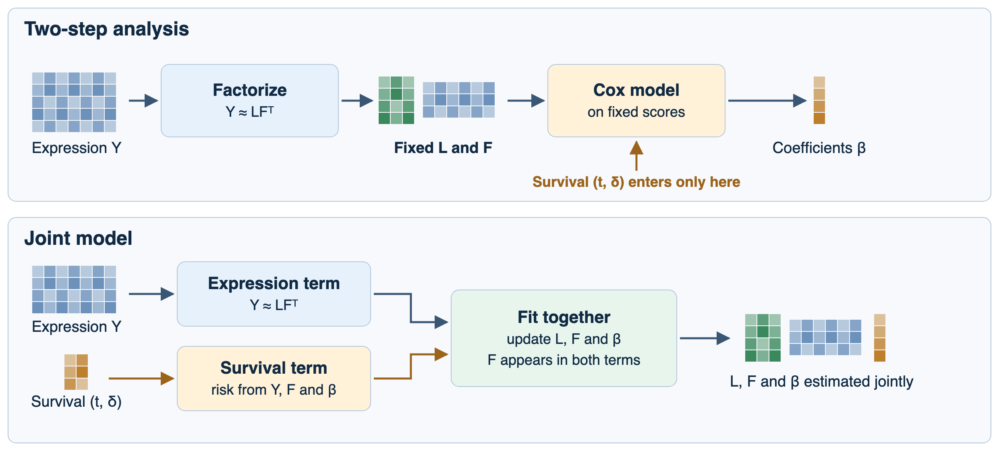

- A program that explains little expression variance but predicts survival can be missed, because cell-composition variation dominates an expression-only fit
- The Cox step treats estimated scores as known, so its standard errors leave out the uncertainty in the scores

::: {.notes}
[0.75 min | running 2.5]

- The usual pipeline has two steps.
- First a matrix factorization finds programs in the expression matrix, and then a Cox model tests the program scores against survival.
- Survival never touches the first step, and that has two consequences.
- A program that explains only a little expression variance can be lost, even if it predicts survival well, because large sources of variation such as cell composition dominate the factorization.
- And the Cox step treats the estimated scores as if they were measured exactly, so its standard errors are too small.
- A joint fit estimates both pieces together.
:::

## Existing methods each cover part of the problem {data-menu-title="Existing methods" data-footer-part="Introduction"}

::: {.p3-cards .three}
::: {.p3-card}
<h3>Survival-supervised NMF</h3>

DeSurv (Young et al.): survival guides which programs are found. Penalized point estimates, with the rank and the strength of supervision tuned by cross-validation
:::
::: {.p3-card}
<h3>Methylation and survival, gene by gene</h3>

iBAG (Wang et al. 2013): splits each gene's expression into a part explained by its promoter methylation and the rest, and relates both to survival in an accelerated failure time model
:::
::: {.p3-card}
<h3>Integration without survival</h3>

MOFA (Argelaguet et al. 2018) and iCluster (Shen et al. 2009): factors shared across data types, fitted without the outcome
:::
:::

Gap: no method learns programs across data types with survival guiding them, posterior uncertainty, and a number of programs estimated from the data

::: {.notes}
[0.75 min | running 3.25]

- Several methods cover pieces of this.
- Survival-supervised nonnegative matrix factorization from our group lets survival guide which programs are found, but it reports point estimates and tunes its rank and the strength of supervision by cross-validation.
- iBAG links methylation and expression to survival, but one gene at a time rather than through programs.
- MOFA and iCluster find factors shared across data types, but they ignore survival.
- None of them learns programs across data types with survival guiding them, carries uncertainty through, and estimates how many programs there are.
:::

## Project aims {data-menu-title="Aims" data-footer-part="Introduction"}

::: {.p3-cards .three}
::: {.p3-card .navy}
<h3>Aim 1. Joint model</h3>

A Bayesian model of expression and survival that can find low-variance prognostic programs, reports uncertainty, and shrinks programs it does not need
:::
::: {.p3-card}
<h3>Aim 2. PDAC validation</h3>

Validate the model in external pancreatic cancer cohorts and characterize its programs biologically
:::
::: {.p3-card .amber}
<h3>Aim 3. Several data types</h3>

Extend the model to expression and methylation together, so that methylation changes can be linked to expression programs
:::
:::

::: {.notes}
[0.75 min | running 4]

- The project has three aims.
- The first is the joint model itself: it should find programs that predict survival even when they explain little expression variance, report uncertainty, and decide how many programs to keep.
- The second is to validate it in external pancreatic cancer cohorts and interpret its programs.
- The third is to extend it to several data types, so that a program can include both genes and methylation sites.
:::

## Each patient contributes an expression profile and a survival outcome {data-menu-title="Notation" data-footer-part="Methods"}

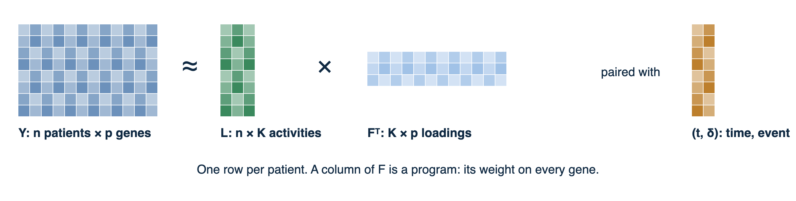

::: {.p3-gloss}
Yn × p expression, patients by genes
(tᵢ, δᵢ)observed time and event indicator
Ln × K program activity of each patient
Fp × K gene loadings, one column per program
Zᵢₖpatient i's expression projected onto program k's normalized loading
βₖlog hazard ratio of program k
:::

$$\eta_i = \sum_{k=1}^K Z_{ik}\,\beta_k \qquad\text{(risk score)}$$

::: {.notes}
[1 min | running 5]

- Here is the notation.
- Y has a row for each patient and a column for each gene, and each patient also has a survival time and an event indicator.
- We approximate Y as L times F transpose with K programs.
- A column of F is a program, its weight on each gene, and a column of L gives how active that program is in each patient.
- The risk score projects a patient's expression onto each program's loading column, scaled to unit length, and multiplies by a coefficient beta, which is a log hazard ratio.
- Because the score uses expression and loadings only, a new patient can be scored without fitting anything.
:::

## The joint model adds a Cox partial likelihood to a matrix factorization {data-menu-title="Joint model" data-footer-part="Methods"}

::: {.p3-eq}
$$y_{ij}=\sum_{k=1}^K L_{ik}F_{jk}+e_{ij},\quad e_{ij}\sim N(0,\tau_j^{-1}) \qquad\quad h_i(t)=h_0(t)\exp(\eta_i),\quad \eta = Y_c F D\,\beta$$
:::

::: {.p3-eq}
$$\begin{aligned}\mathcal J(q)={}&\lambda_G\,E_q\big[\log p(Y\mid L,F,\tau)\big]+\gamma\,E_q\big[\ell_{\mathrm{Cox}}(\eta)\big]\\&-\mathrm{KL}(q_L\Vert g_L)-\mathrm{KL}(q_F\Vert g_F)-\mathrm{KL}(q_\beta\Vert g_\beta)\end{aligned}$$
:::

- $q = q_L\,q_F\,q_\beta$ is a mean-field variational approximation, $Y_c$ is centered expression, $D=\operatorname{diag}(1/\lVert F_{\cdot k}\rVert)$, and $\ell_{\mathrm{Cox}}$ is the Breslow log partial likelihood
- $\lambda_G$ and $\gamma$ weight the expression and survival terms (both equal to 1 in the derivation)
- **F appears in both terms, so survival can reach the loadings**

::: {.notes}
[0.75 min | running 5.75]

- The model has two parts.
- The expression part is a Gaussian factorization with a separate noise precision for each gene.
- The survival part is a Cox model whose linear predictor is the projection score times beta.
- We fit a variational approximation q by maximizing this objective: the expected expression log-likelihood, plus the expected Cox log partial likelihood, minus a Kullback-Leibler penalty for each block of parameters.
- The weights lambda G and gamma set how much the expression data and the survival data count.
- The loadings F appear in both terms, and that shared F is how survival can shape the programs.
:::

## Empirical Bayes priors let the data decide how much to shrink {data-menu-title="Priors" data-footer-part="Methods"}

::: {.p3-eq}
$$L_{ik}\sim(1-\pi_{Lk})\,\delta_0+\pi_{Lk}\,\mathrm{Exp}(\lambda_{Lk}) \qquad F_{jk}\sim(1-\pi_{Fk})\,\delta_0+\pi_{Fk}\,\mathrm{Exp}(\lambda_{Fk})$$
$$\beta_k\sim(1-\pi_\beta)\,\delta_0+\pi_\beta\,N(0,\sigma^2_\beta)$$
:::

::: {.p3-cards .three}
::: {.p3-card}
<h3>Nonnegative, sparse programs</h3>

Point-exponential priors on activities and loadings: a point mass at zero mixed with an exponential
:::
::: {.p3-card}
<h3>Survival effects can be zero</h3>

Point-normal prior on β in the proposed model. The model fitted so far used a plain normal prior, βₖ ~ N(0, σ²ₖ)
:::
::: {.p3-card .navy}
<h3>Estimated from the data</h3>

Each prior's parameters are fitted by empirical Bayes, program by program (ebnm R package). The point masses also decide how many programs are kept
:::
:::

::: {.notes}
[0.75 min | running 6.5]

- The activities and loadings get point-exponential priors: a point mass at zero mixed with an exponential, so they are nonnegative and sparse.
- The survival coefficients get a point-normal prior, which lets a program have no survival effect at all.
- The model fitted so far used a plain normal prior on beta instead.
- In each case the prior's parameters are estimated from the data, program by program, which is what makes this empirical Bayes.
- The point masses are also how the model decides how many programs it needs.
:::

## The model is fitted by coordinate ascent, starting with too many programs {data-menu-title="Fitting" data-footer-part="Methods"}

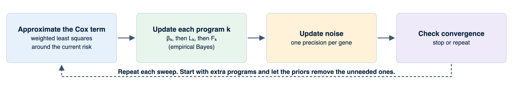

- Each update is an empirical Bayes normal-means problem: the data give an estimate and its precision, and the prior shrinks it
- The direction of the risk score is fixed once, from the training data

::: {.notes}
[0.75 min | running 7.25]

- We fit the model by coordinate ascent variational inference.
- The Cox term is not quadratic, so at the start of each sweep it is replaced by a weighted least squares approximation around the current risk score.
- Then each program is updated in turn, its coefficient, its activities and its loadings, and the noise precisions are updated at the end of the sweep.
- We start with more programs than we expect and let the priors remove the ones that are not needed.
- The sign of the risk score is fixed once from the training data.
:::

## A new patient's risk score needs only their expression {data-menu-title="Prediction" data-footer-part="Methods"}

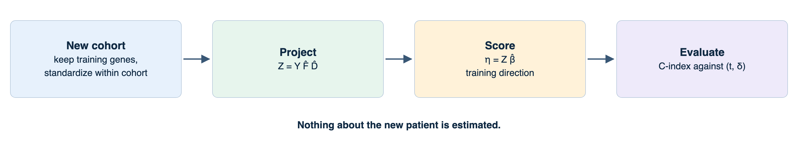

- No patient-level parameters are refitted, so training and validation patients are scored with the same formula
- The direction of the score is set in training, before any validation outcome is seen

::: {.notes}
[0.5 min | running 7.75]

- To score a patient in a new cohort, we restrict to the training genes, standardize within that cohort, project onto the fitted loadings and multiply by the fitted coefficients.
- Nothing about the new patient is estimated.
- That keeps validation clean, because the same formula is used for training and test patients.
:::

## So far survival sets the coefficients but not the loadings {data-menu-title="Fitted vs finalized" data-footer-part="Methods"}

::: {.p3-cards .two}
::: {.p3-card .grey}
<h3>Model fitted so far</h3>

- Survival sets β, but F is updated from expression only
- Genes standardized to mean 0 and SD 1 within cohort, although the loadings are nonnegative
- Normal prior on β, with the projection scores held fixed in the β update
:::
::: {.p3-card .navy}
<h3>Finalized model</h3>

- The survival term enters the loading update
- **Obstacle:** with about 2,000 genes, the expression term outweighs the survival term in each loading update
- **Plan:** rebalance $\lambda_G$ and $\gamma$, fit on a nonnegative scale, and pass a simulation test before use on PDAC
- **Fallback:** a risk score built on activities L, with new patients' activities estimated against the fixed loadings
:::
:::

::: {.notes}
[1 min | running 8.75]

- The model fitted so far is a step short of the full proposal.
- Survival sets the coefficients, but the loadings are updated from expression only, so its programs are expression programs that survival then weights.
- It also standardized each gene, which gives negative values, while the loadings are nonnegative, and that mismatch will be removed.
- The finalized model lets the survival term into the loading update.
- The obstacle is scale: with about two thousand genes, the expression part of each loading update outweighs the survival part, so survival barely moves the loadings.
- The plan is to rebalance the two weights and to accept the result only if it passes the simulation test I'll show in the results.
- If that fails, the fallback builds the risk score on patient activities instead.
:::

## The extension to several data types shares patient activities across them {data-menu-title="Several data types" data-footer-part="Methods"}

::: {.columns}
::: {.column width="52%"}
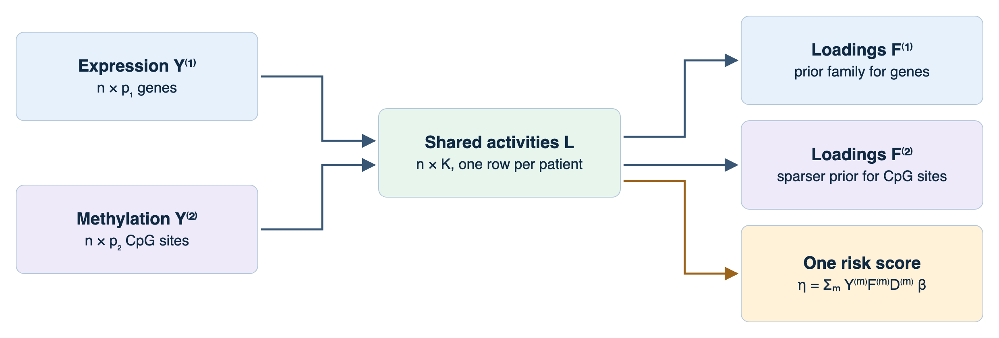
:::
::: {.column width="46%" .smallcol}
::: {.p3-eq}
$$Y^{(m)}\approx \mathbf 1\mu^{(m)\top}+L\,F^{(m)\top},\quad m=1,\dots,M$$
$$\eta=\Big(\textstyle\sum_m Y^{(m)}F^{(m)}D^{(m)}\Big)\beta$$
:::

- Each data type has its own loading prior family and noise precisions, for example a sparser prior for many methylation sites
- $M=1$ gives the single data type model
- One program can load on genes and methylation sites together
:::
:::

::: {.notes}
[0.75 min | running 9.5]

- The extension keeps one matrix of patient activities and gives each data type its own loadings.
- Each data type also gets its own prior family and noise levels, which matters because there are many more methylation sites than genes and most of them should have zero weight.
- The risk score sums the projections over data types, and with one data type it is exactly the model I just described.
- The point of the extension is that one program can include genes and methylation sites at once.
- A derivation exists, and implementing it is part of the remaining work.
:::

## Simulation: two cohorts with shared and cohort-specific programs {data-menu-title="Simulation design" data-footer-part="Results"}

::: {.p3-cards .three}
::: {.p3-card}
<h3>Data</h3>

- Two cohorts of 150 patients, 1,000 genes, true rank 6
- True loadings taken from a factorization of the real training data
:::
::: {.p3-card}
<h3>Survival</h3>

- Weibull proportional hazards from the shared programs, β = 1.5, −1.2, 0.8, −0.5
- 30% censoring, 75 test patients per dataset
:::
::: {.p3-card}
<h3>Settings</h3>

- All shared, shared plus cohort-specific, nothing shared
- Starting ranks 2, 3, 4, 6, 12, 20, with 15 datasets each
:::
:::

Comparison: a two-step fit, the factorization followed by an unpenalized Cox model

::: {.notes}
[0.75 min | running 10.25]

- The first simulation has two cohorts of 150 patients and a thousand genes.
- The true loadings come from a factorization of the real data, so the programs look like real expression programs.
- Survival depends on the shared programs.
- Three scenarios change how many programs the cohorts share, and each is fitted at six starting ranks with fifteen datasets per setting.
- The comparison is a two-step fit, the factorization followed by an ordinary Cox model.
:::

## The joint fit predicts better than the two-step fit when cohorts have their own programs {data-menu-title="Simulation concordance" data-footer-part="Results"}

::: {.columns}
::: {.column width="62%"}
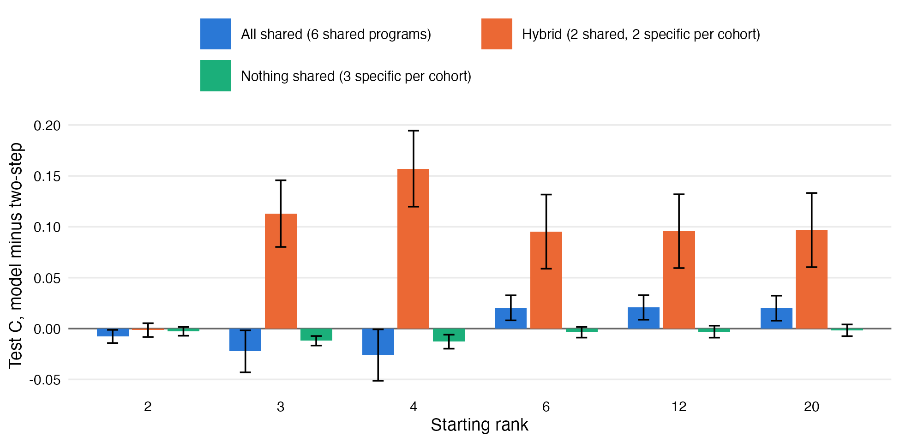
:::
::: {.column width="36%"}
- **Shared plus cohort-specific:** C higher by 0.10–0.16 from a starting rank of 3
- **All shared:** about 0.02 higher from a starting rank of 6, slightly lower at 3–4
- **Nothing shared:** within about 0.01
- Survival did not shape the loadings in either arm, so the gain comes from the priors and the shrunken survival step
:::
:::

::: {.notes}
[0.75 min | running 11]

- Each bar is the joint fit's held-out concordance minus the two-step fit's.
- When each cohort has programs of its own, the joint fit is ahead by 0.10 to 0.16 from a starting rank of three.
- When every program is shared it is ahead by about 0.02 once the starting rank reaches six.
- With no survival signal the two are the same, as they should be.
- In these fits survival did not shape the loadings either, so the gain comes from the priors and the shrinkage of the survival coefficients.
:::

## Starting with too few programs merges true programs, and starting with too many does not {data-menu-title="Starting rank" data-footer-part="Results"}

::: {.p3-cards .two}
::: {.p3-card .amber}
<h3>Starting ranks 2–4</h3>

7 of 27

estimated programs were merges of two true programs
:::
::: {.p3-card}
<h3>Starting ranks 6, 12, 20</h3>

0 of 114

estimated programs were merges
:::
:::

- With cohort-specific coefficients, the cohort carrying a survival effect was identified in 15 of 20 cases at a starting rank of 6 and 17 of 20 at 12
- Working rule: start high and let the priors shrink the extra programs

::: {.notes}
[0.5 min | running 11.5]

- Starting below the true rank forces true programs together: seven of 27 estimated programs matched two true programs at once.
- At or above the true rank there were no merges in 114 programs.
- The model also attributed a survival effect to the right cohort in most cases.
- So the working rule is to start with too many programs and let the priors shrink the extras.
:::

## The finalized model will be judged on a planted low-variance program {data-menu-title="Planned simulation test" data-footer-part="Results"}

::: {.p3-cards .two}
::: {.p3-card}
<h3>Design</h3>

- One planted program explains under 1% of expression variance but has a strong survival effect
- 400 training patients, several noise levels, 50 and 2,000 genes
- The same data fitted without survival feedback for comparison
:::
::: {.p3-card .navy}
<h3>The model passes only if it</h3>

- finds the planted program: loading correlation ≥ 0.7, correct direction, survival effect distinguishable from zero
- flags no spurious survival programs
- converges
:::
:::

Runs are in progress. Current results are in the backup slides.

::: {.notes}
[0.75 min | running 12.25]

- The first simulation could not test supervision, because survival never shaped the loadings, and this test is built for that.
- One planted program explains less than one percent of expression variance but strongly predicts survival, exactly the kind of program a two-step analysis misses.
- The finalized model passes only if it finds that program in the right direction, does not call other programs prognostic, and converges, at both fifty and two thousand genes.
- The same data are fitted without survival feedback for comparison.
- Runs are in progress, and the current numbers are in the backup slides.
:::

## PDAC application: train on two cohorts, validate on five {data-menu-title="Application pipeline" data-footer-part="Results"}

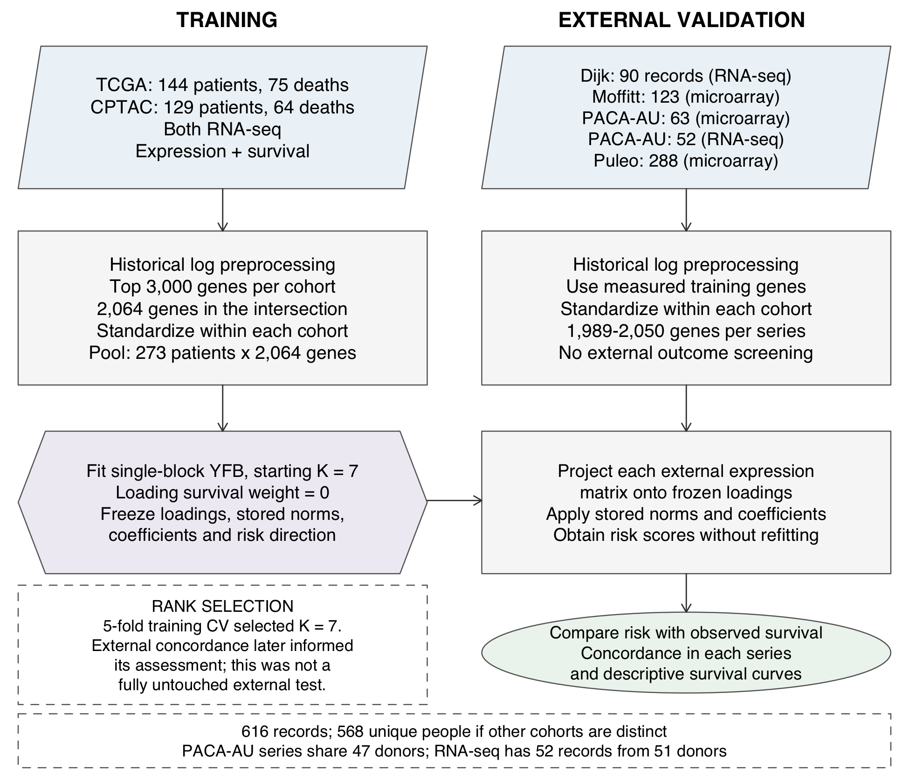

- Training: TCGA (n = 144) and CPTAC (n = 129), RNA-seq, 2,064 genes after screening each cohort for mean and variance, starting rank 7
- Validation: Dijk, Moffitt, PACA-AU microarray, PACA-AU RNA-seq and Puleo (616 records), with every choice fixed from training

::: {.notes}
[0.5 min | running 12.75]

- For the application we trained on two RNA-seq cohorts, TCGA and CPTAC, 273 patients in total, using 2,064 genes that passed a mean and variance screen in both.
- We then scored five external cohorts across microarray and RNA-seq platforms.
- Everything, including the direction of the risk score, was fixed from training before any validation outcome was used.
:::

## External concordance matches a rank-matched two-step model {data-menu-title="External concordance" data-footer-part="Results"}

::: {.columns}
::: {.column width="55%"}
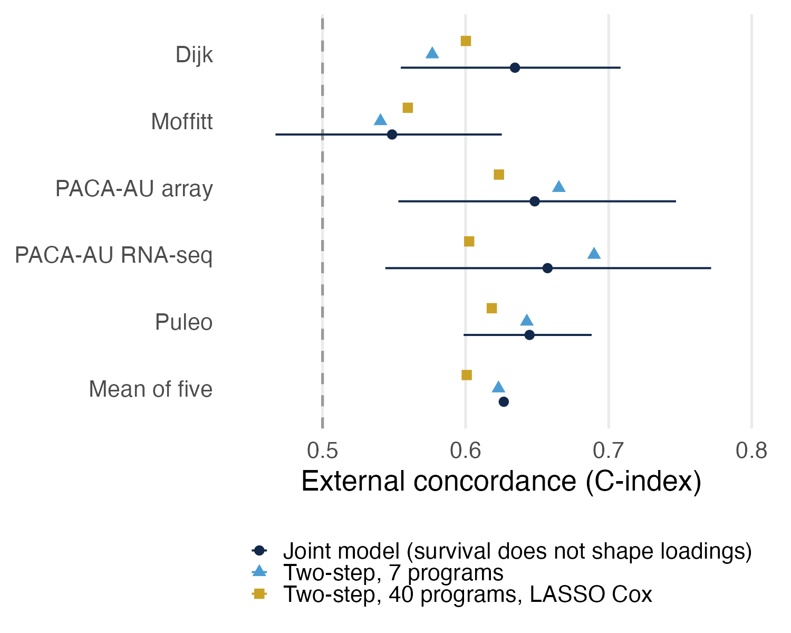
:::
::: {.column width="43%"}
| Model | Mean external C |
|---|---|
| Joint model | **0.627** |
| Two-step, 7 programs | 0.623 |
| Two-step, 40 programs, LASSO Cox | 0.601 |

- Difference from the 7-program model: 0.011 (95% CI −0.013 to 0.033)
- Difference from the 40-program model: 0.026 (0.0002 to 0.050)
- Lines are 95% bootstrap intervals for the joint model
:::
:::

::: {.notes}
[0.75 min | running 13.5]

- Across the five external cohorts the mean concordance was 0.627.
- A two-step model with the same seven programs reached 0.623, and the difference is well inside its confidence interval.
- Against an independently tuned two-step model with forty programs and a lasso Cox step, the joint model was ahead by 0.026, with an interval that just excludes zero.
- In short, prediction is comparable to a well-chosen two-step analysis.
- That is expected here, because survival did not shape these loadings.
:::

## Predicted risk separates survival in every external cohort {data-menu-title="Risk groups" data-footer-part="Results"}

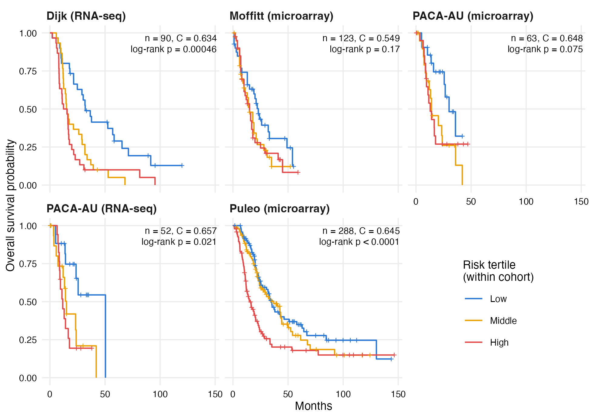

- The lowest third of predicted risk had the best survival in all five cohorts
- Log-rank p < 0.0001 (Puleo), 0.0005 (Dijk), 0.021 (PACA-AU RNA-seq), 0.075 (PACA-AU microarray), 0.17 (Moffitt)

::: {.notes}
[0.5 min | running 14]

- Splitting each external cohort into thirds of predicted risk, the low-risk third had the best survival every time.
- The separation is significant in three of the five cohorts.
- Moffitt, the weakest, also had the lowest concordance.
:::

## Two programs match the basal-like and classical subtypes {data-menu-title="Subtype programs" data-footer-part="Results"}

::: {.columns}
::: {.column width="62%"}
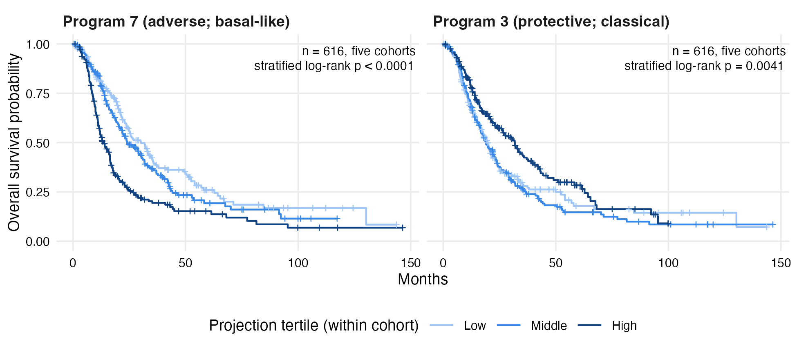
:::
::: {.column width="36%"}
::: {.p3-card .amber}
<h3>Program 7: shorter survival</h3>

- Glycolysis (GAPDH, ENO1, LDHA), integrin and growth-factor receptor genes (ITGA3, MET)
- Basal-like gene list enriched (adjusted p = 0.0006), correlation 0.58 with PurIST basal-like probability
:::

::: {.p3-card}
<h3>Program 3: longer survival</h3>

- Epithelial and secretory genes
- Correlation −0.58 with PurIST, classical signature hazard ratio below 1 in all five cohorts
:::

External tertiles: p < 0.0001 (Program 7), p = 0.004 (Program 3)

:::
:::

::: {.notes}
[1 min | running 15]

- Two of the retained programs carry the survival signal.
- Program 7 is associated with shorter survival.
- Its top genes are glycolysis genes and integrin and growth-factor receptor genes, it is enriched for the published basal-like gene list, and it correlates with the PurIST basal-like classifier.
- Program 3 is associated with longer survival and lines up with the classical subtype.
- In the external cohorts, patients in the top third of Program 7 had the shortest survival and those in the top third of Program 3 the longest.
- These programs were found from expression, so they reproduce the known subtype axis rather than discover a new one.
:::

## The other programs describe stroma and immune cells {data-menu-title="Tissue programs" data-footer-part="Results"}

::: {.columns}
::: {.column width="40%"}
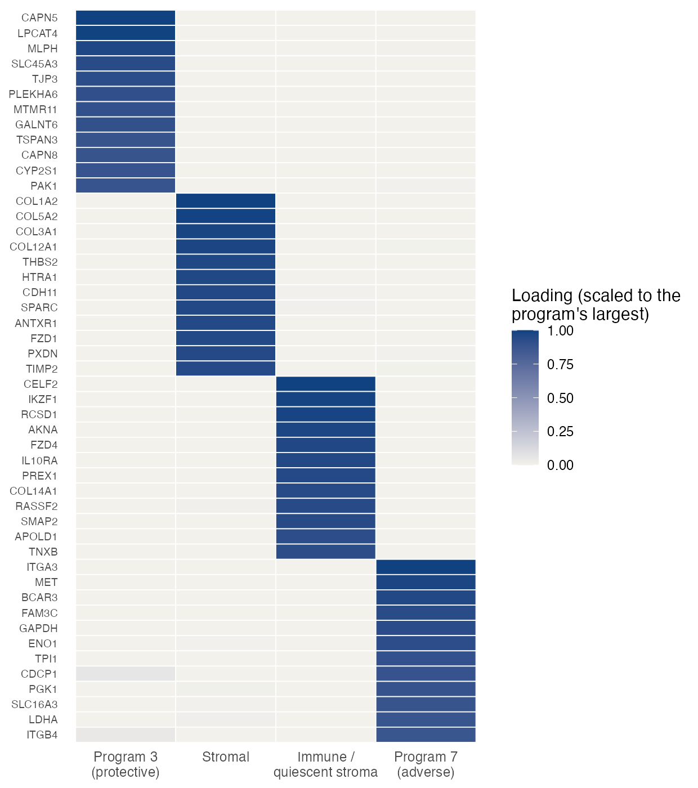
:::
::: {.column width="58%"}
- **Program 5:** fibroblast and collagen genes (COL1A2, COL3A1, SPARC), led by epithelial-to-mesenchymal transition (adjusted p = 0.0005)
- **Program 6:** lymphoid genes (IKZF1, IL10RA) with vascular and basement-membrane genes (COL14A1, TNXB)
- Neither predicts survival in the external cohorts
- Together the four programs correspond to the published tumor, stromal and immune factors, with stroma and immune cells split apart
- Program 3's survival association comes mainly from CPTAC
:::
:::

::: {.notes}
[0.75 min | running 15.75]

- The other two programs explain expression without a survival association.
- Program 5 is the stroma, dominated by collagen and fibroblast genes.
- Program 6 combines lymphoid immune genes with vascular genes.
- Neither is prognostic in the external cohorts.
- Together the four programs match the tumor, stromal and immune factors reported for pancreatic cancer, with the stroma and immune cells separated.
- One caution: with cohort-specific coefficients, Program 3's protective effect comes almost entirely from CPTAC.
:::

## What the finalized and multi-data-type models are designed to show {data-menu-title="Planned results" data-footer-part="Results"}

Survival-guided programs

Programs that predict survival even when they explain little expression variance

<b>Test</b>Planted-program simulation, then training cross-validation in PDAC against the two-step model

Uncertainty carried through

Uncertainty in the programs reflected in the survival coefficients

<b>Test</b>Interval coverage of β in simulation

Methylation linked to expression

Programs that load on genes and CpG sites together, for example hypomethylated promoters of basal-like genes with higher expression

<b>Test</b>CpG sites mapped to genes and promoters, validation in matched ICGC data

Number of programs from the data

A rank chosen without using the validation cohorts

<b>Test</b>The same final rank across starting ranks in training

::: {.notes}
[0.75 min | running 16.5]

- This slide is about results we expect rather than results we have.
- First, programs shaped by survival, tested by the planted-program simulation and then by cross-validation in the training cohorts.
- Second, uncertainty in the programs carried into the survival coefficients, checked by interval coverage in simulation.
- Third, programs that include both genes and methylation sites.
- Mapping those sites to genes and promoters would show which program genes are regulated through methylation, which is useful even if concordance barely changes.
- Fourth, a number of programs chosen without looking at the validation cohorts.
:::

## Summary {data-menu-title="Summary" data-footer-part="Discussion"}

- A joint Bayesian model of expression and survival scores new patients from expression alone
- The fitted version, with expression-only loadings, reached a mean external C of 0.627 in five cohorts, similar to a rank-matched two-step model
- It recovers the basal-like and classical axis and separate stromal and immune programs
- In simulation, starting with too many programs avoids merging true programs

::: {.notes}
[0.5 min | running 17]

- To summarize, the model fits expression and survival together and scores new patients from expression alone.
- The version fitted so far validates in five external cohorts at about the level of a well-matched two-step analysis.
- It recovers the main subtype axis and separates stroma from immune cells.
- The simulations support starting with many programs and letting the priors shrink them.
:::

## Limitations {data-menu-title="Limitations" data-footer-part="Discussion"}

- In the fitted model, survival does not shape the programs
- Prediction is comparable to a two-step model, not better
- Genes were standardized to mean 0 while the loadings are nonnegative
- The starting rank of 7 was chosen partly from validation performance
- The two PACA-AU series share 47 donors, so the 616 external records represent 568 people
- Not yet compared with DeSurv, PurIST, elastic-net Cox or clinical covariates

::: {.notes}
[0.5 min | running 17.5]

- The main limitation is the one I've repeated: in the fitted model survival does not shape the programs, so the benefit of supervision is not shown yet on real data.
- Prediction is comparable to two-step analysis, not better.
- The data scaling is inconsistent with nonnegative loadings.
- The starting rank used validation performance.
- Two external series share donors, so pooled intervals are optimistic.
- And several comparators are still missing.
:::

## Remaining work {data-menu-title="Remaining work" data-footer-part="Discussion"}

::: {.p3-list}
- **Survival-guided loadings:** rebalance the expression and survival terms, pass the planted-program test, and check training cross-validation in PDAC
- **Model details:** refit on a nonnegative data scale, and choose the number of programs without validation data
- **Several data types:** implement the model and fit matched expression and methylation (TCGA training, ICGC validation)
- **Biology:** complete the characterization, with enrichment, subtype agreement and CpG-to-gene annotation
- **Comparisons:** DeSurv, PurIST, elastic-net Cox and clinical covariates, with donor-aware intervals
- **Software:** an R package with one fitting function, tests and a vignette
- **Manuscript:** results regenerated from the package
:::

::: {.notes}
[0.75 min | running 18.25]

- Here is what remains before the final exam.
- First and most important, get survival to shape the loadings and confirm it with the simulation test and with cross-validation in the training data.
- Then refit on a nonnegative scale and choose the number of programs without the validation cohorts.
- Next, implement the extension to expression and methylation and fit it to matched TCGA and ICGC data.
- Alongside that, finish the biological characterization and the wider comparison with other methods.
- The model then goes into an R package, and the manuscript will regenerate its results from that package.
:::

## Backup &middot; With survival shaping the loadings, the model finds a planted low-variance program that two-step methods miss {.backup-slide data-menu-title="B: Planted program, 50 genes" data-footer-part="Backup"}

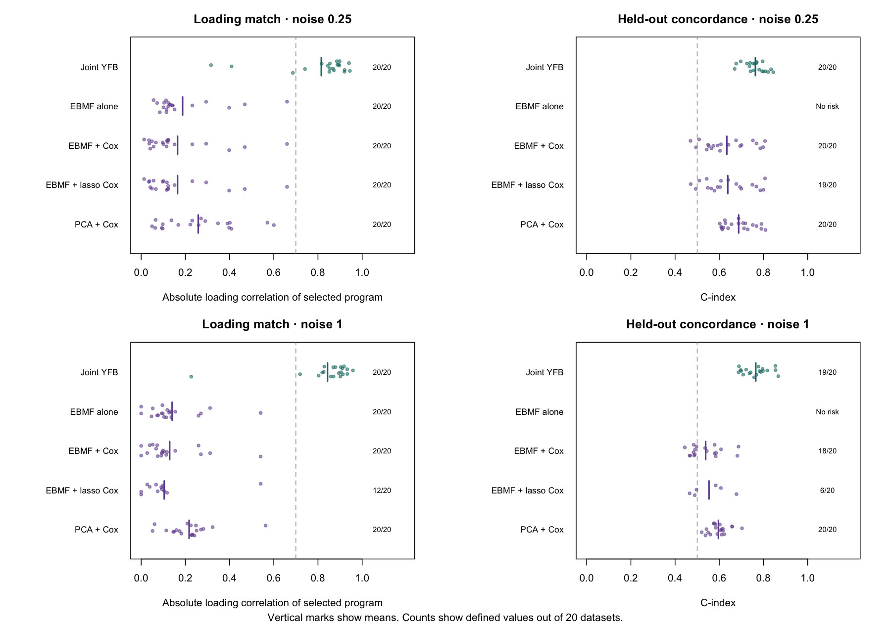

- 400 training patients, 50 genes, planted log hazard ratio 3.3, 20 datasets per noise level
- Found in 17 of 20 and 19 of 20 datasets. With survival feedback off, 1 of 20 each. Four comparator methods: 0 of 20
- Strong effect and few genes, so this shows the mechanism, not performance at real-data size

::: {.notes}
- Use when asked whether supervision can work at all.
- The supervised fit found the planted program in 17 and 19 of 20 datasets, against one for the unsupervised fit and none for four comparators.
:::

## Backup &middot; Recovery and held-out concordance in the planted-program simulation {.backup-slide data-menu-title="B: Planted program, concordance" data-footer-part="Backup"}

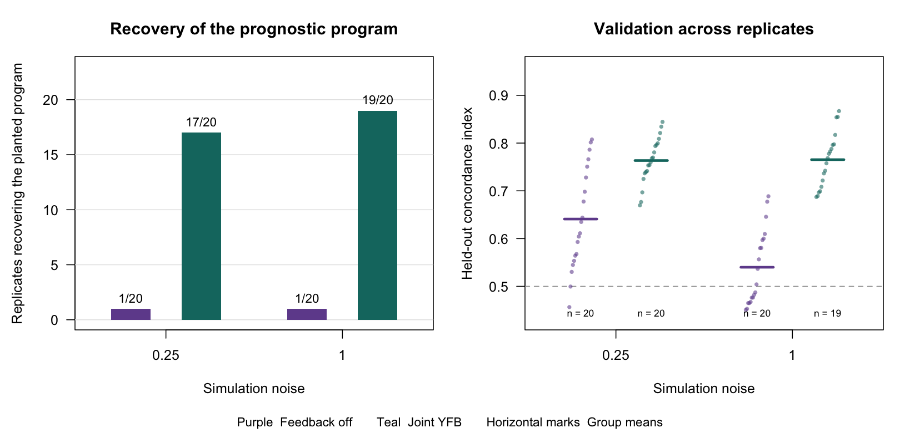

- Held-out C 0.763 and 0.765 with survival feedback, 0.641 and 0.540 without
- 19 of 20 supervised fits converged at each noise level
- The planted program explains at most 0.49% and 0.04% of expression variance

::: {.notes}
- Use when asked about prediction in the planted simulation.
:::

## Backup &middot; At 2,000 genes the supervised model finds the planted program, with slightly too many spurious survival programs {.backup-slide data-menu-title="B: Planted program, 2,000 genes" data-footer-part="Backup"}

| Planted variance share | Found, survival feedback | Found, no feedback | Spurious survival programs, feedback (no feedback) | Converged |
|---|---|---|---|---|
| 0.25% | 10 of 10 | 0 of 10 | 1.0 (1.6) | 10 of 10 |
| 1% | 10 of 10 | 0 of 10 | 1.5 (1.3) | 10 of 10 |
| 5% | 10 of 10 | 1 of 10 | 1.1 (1.1) | 10 of 10 |

- The pass limit is at most 1 spurious survival program on average, so this narrowly fails in two of three settings
- Not yet checked on PDAC at this setting

::: {.notes}
- Use when asked about the larger setting.
- At two thousand genes the supervised fit found the planted program every time, while the unsupervised fit never did.
:::

## Backup &middot; With survival feedback on, PDAC concordance matches the two-step model {.backup-slide data-menu-title="B: Supervised fit on PDAC" data-footer-part="Backup"}

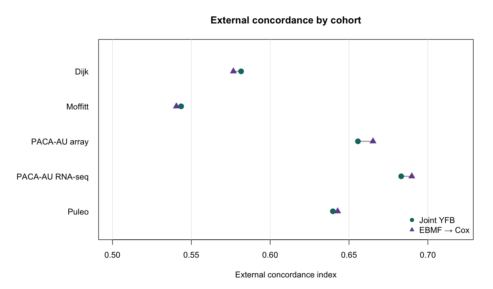

- Mean external C 0.621 (survival feedback on) and 0.623 (two-step, 7 programs)
- Paired difference −0.002 (95% bootstrap interval −0.012 to 0.006)

::: {.notes}
- Use when asked what happens on real data with survival feedback switched on.
:::

## Backup &middot; With survival feedback on, PDAC programs are almost identical to unsupervised programs {.backup-slide data-menu-title="B: Supervised programs on PDAC" data-footer-part="Backup"}

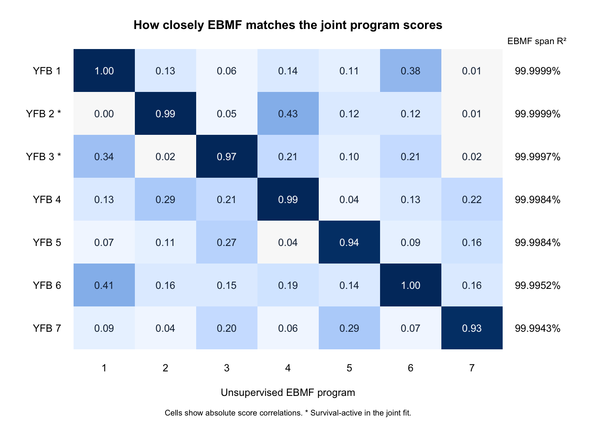

- The two survival-associated programs correlate 0.993 and 0.975 with unsupervised programs, and their gene loadings 0.991 and 0.976
- No additional low-variance prognostic program was found

::: {.notes}
- Use with the previous slide.
- On real data the supervised fit found the same programs as the unsupervised fit, as expected when survival has almost no weight in the loading update.
:::

## Backup &middot; Survival carries almost no weight in the loading update at 2,000 genes {.backup-slide data-menu-title="B: Why survival barely moves F" data-footer-part="Backup"}

::: {.p3-eq}
$$A_{F_{jk}}=\underbrace{\tau_j\sum_i E[L_{ik}^2]}_{\text{expression}}+\underbrace{E[\beta_k^2]\sum_i w_i\,y_{ij}^2}_{\text{survival}}\qquad\text{(precision of the update for } F_{jk})$$
:::

- Share of this precision from the survival term: about 1 at 50 genes, about 1 in a million at 2,064 genes
- Raising the survival weight 10,000-fold brings the share to one half, but no cross-validation fold converges and C falls from 0.656 to 0.555
- No single survival weight works at this dimension, so the plan rebalances the expression term instead

::: {.notes}
- Use when asked why survival does not shape the loadings on PDAC.
- The survival term is about a millionth of the information in each loading update, and simply turning up its weight makes the fit unstable.
:::

## Backup &middot; An earlier real-data check could not tell the supervised and fitted models apart {.backup-slide data-menu-title="B: Earlier real-data check" data-footer-part="Backup"}

- Supervised fit (October 15) minus the fitted model: ΔC = −0.003 (95% CI −0.029 to 0.024)
- The check, set in advance, required the lower limit to be above −0.02
- The interval was too wide to show the supervised fit was no worse

::: {.notes}
- Use when asked about the October supervised fit on real data.
- Its concordance was essentially the same as the fitted model's, but the interval was too wide to meet the margin set in advance.
:::

## Backup &middot; Fixing the noise level stops divergence but does not make supervision work {.backup-slide data-menu-title="B: Fixed noise" data-footer-part="Backup"}

- With free noise precisions, large survival weights made the reconstruction error explode (to 4.5 × 10¹⁴)
- Fixed noise kept it at 0.079
- Of 12 fits, 1 converged, 8 hit the iteration limit and 3 stalled
- Null programs were still flagged as prognostic

::: {.notes}
- Use when asked about stability.
- Holding the noise level fixed prevents the blow-up, but the fits still do not converge reliably and still flag null programs.
:::

## Backup &middot; Pass criteria for the planted-program simulation {.backup-slide data-menu-title="B: Pass criteria" data-footer-part="Backup"}

- **Recovery:** loading correlation ≥ 0.7 with the planted program, correct direction, survival effect at least 1.96 posterior SDs from zero
- **Gain:** at least 3 of 10 more datasets recovered than the unsupervised fit, in at least two settings
- **Specificity:** at most 1 spurious survival program on average
- **Convergence:** at least 90% of fits

::: {.notes}
- Use when asked how the simulation test is scored.
- These criteria were set before the runs.
:::

## Backup &middot; Training and validation cohorts {.backup-slide data-menu-title="B: Cohorts" data-footer-part="Backup"}

| Cohort | Platform | Patients or records | Deaths | Role |
|---|---|---|---|---|
| TCGA-PAAD | RNA-seq | 144 | 75 | Training |
| CPTAC | RNA-seq | 129 | 64 | Training |
| Dijk | RNA-seq | 90 | 81 | Validation |
| Moffitt | Microarray | 123 | 83 | Validation |
| PACA-AU | Microarray | 63 | 38 | Validation |
| PACA-AU | RNA-seq | 52 | 31 | Validation |
| Puleo | Microarray | 288 | 181 | Validation |

- 616 validation records and 414 deaths. The PACA-AU series share 47 donors, and the RNA-seq series repeats one, so the records represent 568 people

::: {.notes}
- Use when asked about the cohorts or the event counts.
:::

## Backup &middot; Preprocessing {.backup-slide data-menu-title="B: Preprocessing" data-footer-part="Backup"}

- Top 3,000 genes per training cohort by combined mean and variance rank, intersection 2,064
- Each gene standardized to mean 0 and SD 1 within cohort
- External cohorts standardized the same way and scored on the training genes they measure
- Standardized data contain negative values, which nonnegative loadings cannot reconstruct. The finalized model will work on a nonnegative scale

::: {.notes}
- Use when asked about scaling.
- The standardization helped stability in earlier fits but conflicts with nonnegative loadings.
:::

## Backup &middot; The Cox working approximation {.backup-slide data-menu-title="B: Cox approximation" data-footer-part="Backup"}

::: {.p3-eq}
$$P_{ri}=\frac{\mathbf 1\{i\in R_r\}\,e^{\eta_i^0}}{\sum_{a\in R_r}e^{\eta_a^0}},\qquad u_i=\delta_i-\sum_r d_rP_{ri},\qquad w_i=\sum_r d_rP_{ri}$$
$$\ell_{\mathrm{Cox}}(\eta)\approx \ell_{\mathrm{Cox}}(\eta^0)+u^\top(\eta-\eta^0)-\tfrac12(\eta-\eta^0)^\top W(\eta-\eta^0),\qquad W=\operatorname{diag}(w)$$
:::

- Breslow handling of ties, with the score kept exact
- The exact negative Hessian couples patients through shared risk sets. The diagonal weight wᵢ, each patient's expected number of events, keeps the updates one coordinate at a time
- This is a working approximation, not a second-order Taylor expansion

::: {.notes}
- Use when asked how the Cox term fits into coordinate ascent.
:::

## Backup &middot; Each coordinate update is an empirical Bayes normal-means problem {.backup-slide data-menu-title="B: Update equations" data-footer-part="Backup"}

::: {.p3-eq}
$$\log q^*(\theta)=-\tfrac{A_\theta}{2}\theta^2+B_\theta\,\theta+\log g(\theta)+C\quad\Rightarrow\quad x_\theta=B_\theta/A_\theta,\quad s_\theta^2=A_\theta^{-1}$$
$$A_{\beta_k}=\sum_i w_i\big(\bar Z_{ik}^2+v_{Z_{ik}}\big),\qquad B_{\beta_k}=\sum_i \bar Z_{ik}\,h_i^{-k},\qquad h_i=u_i+w_i\eta_i^0$$
:::

- The prior is fitted to the observations x with standard errors s (ebnm), and the posterior moments come back
- The β precision uses the second moment of the projection, so loading uncertainty enters the survival coefficients in the proposed model
- The model fitted so far used the plug-in projection, without the variance term

::: {.notes}
- Use when asked for the update equations.
:::

## Backup &middot; How the fitted model was run {.backup-slide data-menu-title="B: Fitted configuration" data-footer-part="Backup"}

- Starting rank 7, initialized from absolute singular vectors of Y
- Survival weight 0.5 on the coefficient update, and no survival term in the loading update
- Stopped when a monitoring statistic changed by less than 10⁻⁵ (met at sweep 20). The statistic is not the evidence lower bound
- Coefficient posterior variances were not stored, so no coefficient intervals are reported for this fit

::: {.notes}
- Use when asked about convergence or settings of the fitted model.
:::

## Backup &middot; Why the risk score projects expression onto the loadings {.backup-slide data-menu-title="B: Projection score" data-footer-part="Backup"}

- Lₖ Fₖᵀ is unchanged when Lₖ is multiplied and Fₖ divided by the same constant, so the score uses each loading column scaled to unit length
- β is then a log hazard ratio per unit of normalized projection
- A new patient needs no fitted activity, so training and validation use the same formula
- The alternative, η = Lβ, lets survival act on the activities directly but needs each new patient's activities estimated (mean external C 0.611 against 0.627)

::: {.notes}
- Use when asked why the model does not use L in the Cox model.
:::

## Backup &middot; Retained, survival-associated and inactive programs {.backup-slide data-menu-title="B: Program classes" data-footer-part="Backup"}

- **Survival-active:** absolute posterior mean coefficient above 0.001
- **Expression-only:** not survival-active, and explains more than 1% of the variance of Y
- **Inactive:** neither
- From a starting rank of 7: two survival-active (7, 3), two expression-only (5, 6), three inactive
- Both thresholds are operational and are not posterior probabilities

::: {.notes}
- Use when asked how programs were labeled.
:::

## Backup &middot; Choosing the starting rank {.backup-slide data-menu-title="B: Starting rank choice" data-footer-part="Backup"}

- Five-fold cross-validated training C was best at K = 8 (0.651, SE 0.026), and K = 7 was the smallest within one SE (0.633)
- Over starting ranks 2–20, external C reached a plateau at 7
- The final choice therefore also used validation performance

::: {.notes}
- Use when asked how seven was chosen.
- Cross-validation pointed to seven or eight, and the external plateau was also at seven, so the choice was not made from training data alone.
:::

## Backup &middot; The two-step comparators {.backup-slide data-menu-title="B: Comparators" data-footer-part="Backup"}

- **Factorization:** unsupervised empirical Bayes matrix factorization (flashier), point-normal priors, gene-specific variances, greedy fitting with backfitting
- **40 programs, LASSO Cox:** penalty chosen by cross-validation, 15 of 40 programs kept
- **7 programs, Cox:** rank matched to the joint model
- **20 programs, Cox:** mean external C 0.581
- Held-out patients scored with the fixed loadings and coefficients, and the risk direction set in training

::: {.notes}
- Use when asked how the comparators were built.
:::

## Backup &middot; External concordance by cohort {.backup-slide data-menu-title="B: Concordance table" data-footer-part="Backup"}

| Cohort | Records | Joint model (95% CI) | Two-step, 40, LASSO | Two-step, 7 | Two-step, 20 |
|---|---|---|---|---|---|
| Dijk | 90 | 0.634 (0.555, 0.708) | 0.600 | 0.577 | 0.592 |
| Moffitt | 123 | 0.549 (0.467, 0.625) | 0.560 | 0.541 | 0.541 |
| PACA-AU microarray | 63 | 0.648 (0.553, 0.747) | 0.623 | 0.665 | 0.597 |
| PACA-AU RNA-seq | 52 | 0.657 (0.544, 0.772) | 0.603 | 0.690 | 0.573 |
| Puleo | 288 | 0.645 (0.599, 0.688) | 0.618 | 0.643 | 0.602 |
| **Mean** | 616 | **0.627** | 0.601 | 0.623 | 0.581 |

- Intervals resample records, not donors

::: {.notes}
- Use when asked for cohort-level numbers.
- The rank-matched two-step model was ahead in both PACA-AU series.
:::

## Backup &middot; Cohort-specific survival coefficients {.backup-slide data-menu-title="B: Per-cohort coefficients" data-footer-part="Backup"}

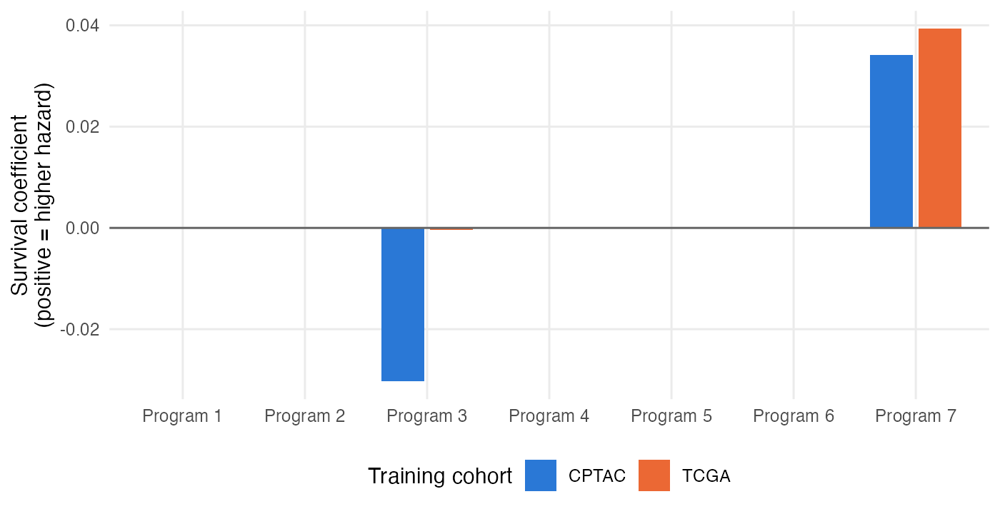

- Program 7's association appears in both training cohorts
- Program 3's comes mainly from CPTAC (0.030 against 0.0004 in TCGA)
- Cohort-specific coefficients did not change external concordance

::: {.notes}
- Use when asked whether the programs are prognostic in both training cohorts.
:::

## Backup &middot; Enrichment of the four retained programs {.backup-slide data-menu-title="B: Enrichment" data-footer-part="Backup"}

| Program | Leading enriched sets (adjusted p) |
|---|---|
| 7 (shorter survival) | Basal-like list (0.0006), growth-factor receptor, PI3K and RAS–ERK pathways (0.001), Bailey squamous list (0.03) |
| 3 (longer survival) | Classical and basal-like lists (0.017 each), Moffitt classical list |
| 5 (stroma) | Epithelial-to-mesenchymal transition (0.0005), stromal-immune list, extracellular matrix |
| 6 (immune, vascular) | Mostly immune GO biological-process terms |

- Ranked enrichment (fgsea). Normalized enrichment scores are modest (1.05–1.29), and multiplicity is controlled within each program and collection

::: {.notes}
- Use when asked for the enrichment detail.
- Program 3's enrichment is less specific than its subtype correlation.
:::

## Backup &middot; How this model differs from survival-supervised NMF {.backup-slide data-menu-title="B: Comparison with DeSurv" data-footer-part="Backup"}

| | Survival-supervised NMF (DeSurv) | This model |
|---|---|---|
| Factorization | NMF, penalized point estimates | Empirical Bayes factorization with posterior distributions |
| Number of programs | Chosen by cross-validation | Shrinkage from an over-specified start |
| Survival strength | A tuned weight | Likelihood weights, with survival-shaped loadings still to be shown |
| Uncertainty | Not reported for programs | Posterior variances for L, F and β |
| Data types | One | Extension to several planned |
| Prediction | Projection onto loadings | Projection onto loadings |

::: {.notes}
- Use when asked how the method differs from DeSurv.
- Projection-based prediction is common to both, so it is not claimed as new here.
:::

## Backup &middot; The model for several data types in more detail {.backup-slide data-menu-title="B: Several data types, details" data-footer-part="Backup"}

- A feature intercept μ⁽ᵐ⁾ for each data type, re-estimated every iteration, so spare programs do not absorb feature means
- The loading prior family is chosen per data type (point-exponential, point-Laplace or normal) and fitted for each data type and program
- Reconstruction and survival terms enter each loading update as a plain sum, with no tempering weight
- Each program is rescaled after its update so its projection has unit SD
- A program is removed when the objective is no lower without it, then the model is refitted

::: {.notes}
- Use when asked how the extension is specified.
- The derivation exists, and the implementation is part of the remaining work.
:::
